{
  "title": "Applying the Interim Brotli CVE Workaround on SDDC Manager 9.1.1",
  "date": "2026-10-30T07:30:00-04:00",
  "lastmod": "2026-10-30T07:30:00-04:00",
  "slug": "sddc-manager-brotli-cve-2026-111497-workaround",
  "url": "/posts/sddc-manager-brotli-cve-2026-111497-workaround/",
  "draft": false,
  "description": "Walking through Broadcom's manual interim workaround for CVE-2026-111497, the Brotli vulnerability in SDDC Manager 9.1.1, with the nginx and UI server changes, the verification tests, and the rollback.",
  "featured_image": "brotli-workaround.png",
  "categories": [
    "Home Lab",
    "How-To's",
    "VMware Cloud Foundation"
  ],
  "tags": [
    "VCF",
    "VMware",
    "SDDC Manager",
    "Security",
    "CVE",
    "homelab"
  ],
  "years": [
    "2026"
  ],
  "aliases": [],
  "comments": []
}

Broadcom has a manual interim workaround for a critical Brotli vulnerability in SDDC Manager 9.1.1.  It's all done at a shell, with edits to two files.  This post walks through it on my SDDC Manager 9.1.1 lab, from the backups to the verification tests and the rollback.

<aside class="tested-on"><strong>Tested on</strong><dl><div><dt>Environment</dt><dd>Nested VCF 9.1.1 lab</dd></div><div><dt>SDDC Manager</dt><dd>9.1.1.0200, a 9.1.1 EP (build 25801071)</dd></div><div><dt>Covers</dt><dd>CVE-2026-111497 interim workaround, KB 460732</dd></div></dl></aside>

## What the workaround does

[CVE-2026-111497](https://support.broadcom.com/web/ecx/support-content-notification/-/external/content/SecurityAdvisories/0/39445) is rated Critical, and it's documented in [VMSA-2026-0008](https://support.broadcom.com/web/ecx/support-content-notification/-/external/content/SecurityAdvisories/0/39445).  Read the advisory before you continue.  [KB 460732](https://knowledge.broadcom.com/external/article?articleNumber=460732) covers SDDC Manager 9.1.1 and 9.1.1 EP, and Broadcom is clear that the workaround is temporary and only mitigates this one CVE.

The fix is to refuse any request body that declares `Content-Encoding: br`, since Brotli is the only encoding the CVE affects.  It's done in two places.  An nginx rule covers requests arriving on port 443, and a check in the SDDC Manager UI server covers requests sent straight to `127.0.0.1:7500`, which nginx never sees.  Both return an HTTP 415, and gzip and deflate are left alone.

If your SDDC Manager is on 5.2.x, 9.0.2, or 9.1.0, this isn't your KB.  Broadcom covers those versions in [KB 460734](https://knowledge.broadcom.com/external/article?articleNumber=460734).

## Before you start

My lab's SDDC Manager reports VMware Cloud Foundation 9.1.1.0200.25801071 in its About dialog, so that's the build this post covers.

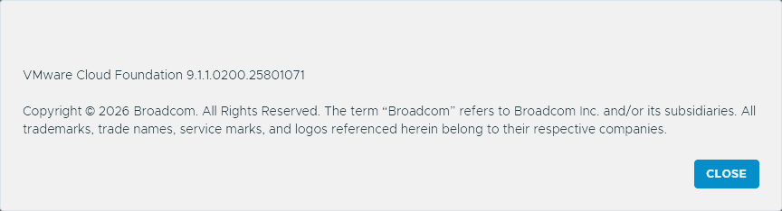

Before I touched anything, I checked the SDDC Manager backup settings in VCF Operations, under **Administration → SDDC Manager → D3M0 → Backup Settings**.  Automatic backup is enabled on a weekly schedule, and the last backup shows as Successful.  The KB's first prerequisite is to back up the SDDC Manager appliance.  I didn't take a new one, since I already had a backup from October 24th.

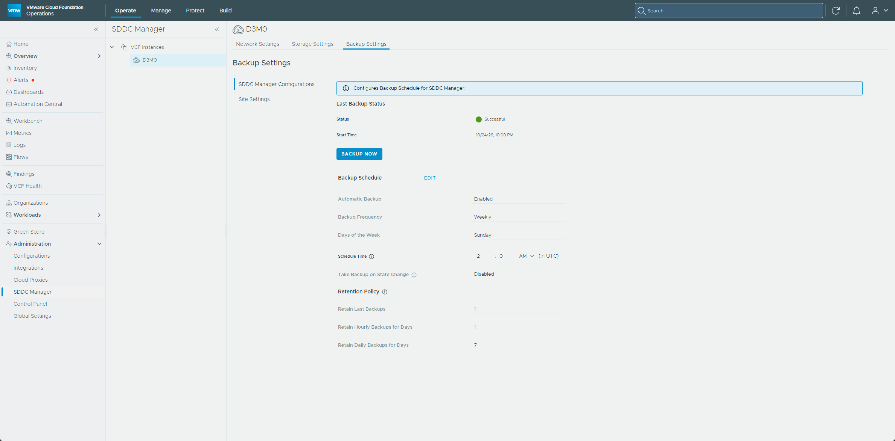

Then I SSH'd to SDDC Manager as the `vcf` user and switched to `root` with `su -`.  Everything below needs root, since it edits files under `/etc/nginx` and the UI app and restarts services.

Next, I backed up the two files the workaround modifies.  The copies are what the rollback restores from.  I ran these in the root shell and kept it open, because the later commands reuse the `$APP` variable.

```bash
APP=/opt/vmware/vcf/sddc-manager-ui-app/server/src/servers/sddcManagerServer/app.js
cp -p $APP $APP.orig-cve111497
cp -p /etc/nginx/nginx.conf /root/nginx.conf.before-cve111497
```

Both copies completed without an error.

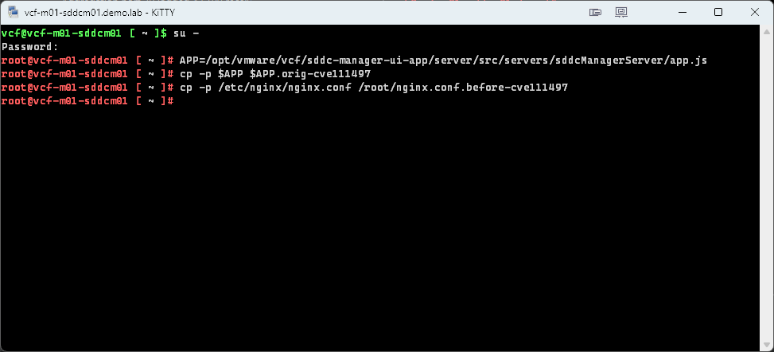

## Step 1: The nginx rule

I opened `/etc/nginx/nginx.conf` with `vi` to make two additions.  The first goes in the `http { }` block, right after the `map_hash_bucket_size 128` line, which is line 15 on mine.

vi opened the file read-only, with `[readonly]` in the status line at the bottom.

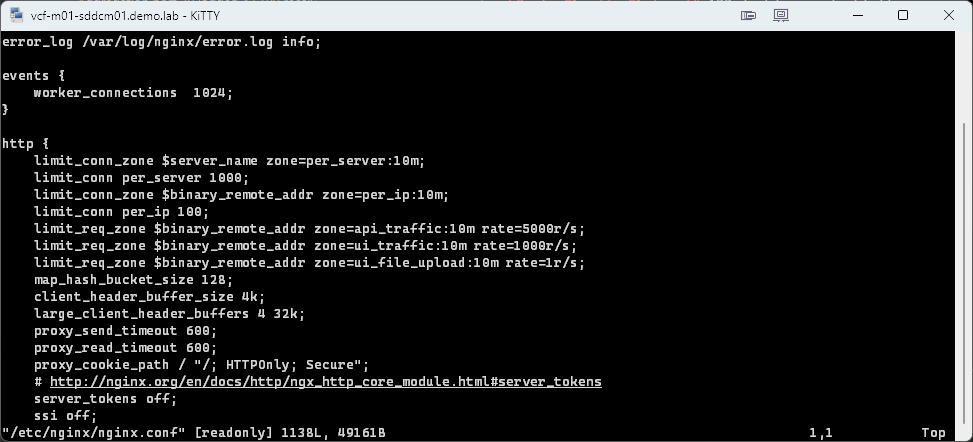

I checked why.  The file is mode `0400` and owned by root, so nothing has the write bit.  It isn't immutable, and `vi` is the real `/bin/vi`, not an alias to `view`.

```text
root@vcf-m01-sddcm01 [ ~ ]# ls -l /etc/nginx/nginx.conf
-r--------. 1 root root 49161 Oct 16 18:36 /etc/nginx/nginx.conf
root@vcf-m01-sddcm01 [ ~ ]# lsattr /etc/nginx/nginx.conf
--------------e------- /etc/nginx/nginx.conf
root@vcf-m01-sddcm01 [ ~ ]# type vi
vi is hashed (/bin/vi)
```

Root can still write to it, so I forced the save with `:wq!`.  Afterward I ran the same three checks again.  The file still shows `-r--------`, with no immutable flag, and `vi` is still `/bin/vi`, so the appliance's permissions are unchanged.

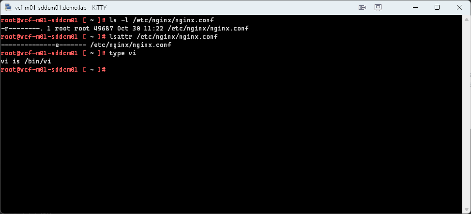

This is the map I added.

```nginx
# CVE-2026-111497 interim workaround: refuse request bodies that declare
# Content-Encoding: br. Brotli is the only encoding affected by this CVE.
# Remove once the Node.js runtime is upgraded to a fixed release.
map $http_content_encoding $reject_br {
    default 0;
    "~*\bbr\b" 1;
}
```

The map is in place right after `map_hash_bucket_size 128`.

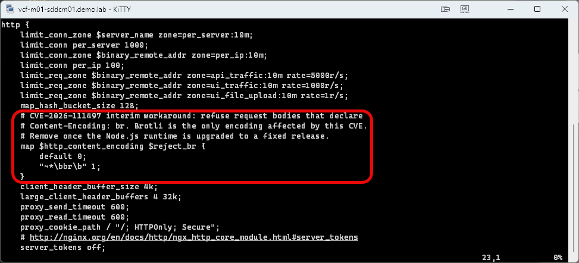

The second goes in the `server { listen 443 ssl; ... }` block, just before the `# certs sent to the client in SERVER HELLO` comment and after the `limit_req` line.

```nginx
# CVE-2026-111497 interim workaround: reject Brotli request bodies
# before they reach the UI server (localhost:7500). See map above.
if ($reject_br) {
    return 415;
}
```

Here's the `if` block in place, after the `limit_req` line and before the `# certs sent to the client` comment.

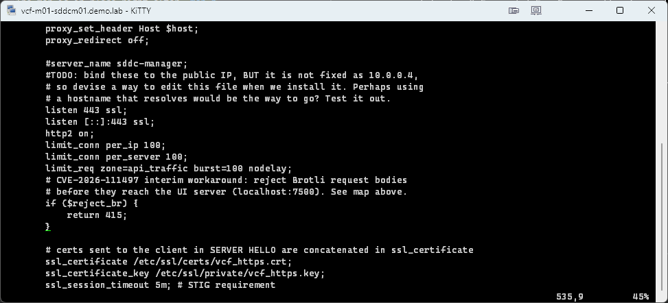

Test the configuration and reload nginx.

```bash
nginx -t && systemctl reload nginx
```

`nginx -t` reported the syntax is ok and the test is successful, and the reload returned without an error.

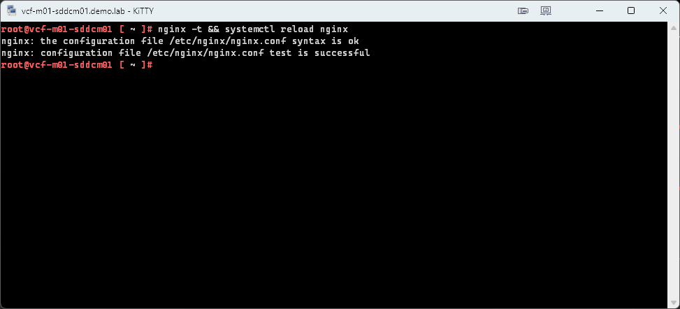

If `nginx -t` fails, restore the original and contact Broadcom support.

```bash
cp -p /root/nginx.conf.before-cve111497 /etc/nginx/nginx.conf
nginx -t
```

## Step 2: The UI server check

nginx can't see requests sent straight to `127.0.0.1:7500`, so the UI server gets the same rule.  I opened the `app.js` file that `$APP` points to and found this line, which is line 137 on my build.

```javascript
winston.debug('Mounting app middleware');
```

I added the following block directly below it, before the `app.use(bodyParser.json({...` call.

```javascript
// CVE-2026-111497: reject Brotli request bodies before any parser runs.
// Other encodings (gzip, deflate) are left as they are.
app.use((req, res, next) => {
   if (/\bbr\b/i.test(req.headers['content-encoding'] || '')) {
      return res.status(415).json({ message: 'Brotli request bodies are not accepted', status: 415 });
   }
   next();
});
```

Here's the middleware in place between the `winston.debug` line and the `bodyParser.json` call.

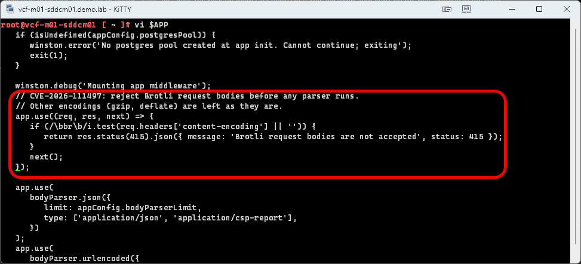

Then I restarted the UI service, which returned without an error.

```bash
systemctl restart sddc-manager-ui-app
```

After that I ran Broadcom's wait loop.  It polls the UI until it answers with something other than a 503 or no response at all.

```bash
for i in $(seq 1 40); do
  c=$(curl -s -o /dev/null -w '%{http_code}' -X POST http://127.0.0.1:7500/ui/api/ping \
      -H 'Content-Type: application/json' --data-binary '{"a":1}')
  [ "$c" != 503 ] && [ "$c" != 000 ] && break
  sleep 6
done
echo "ui_code=$c"
```

The loop ended with `ui_code=403`.  That's the UI answering, not the 503 or 000 the loop waits out, so the UI was back up.

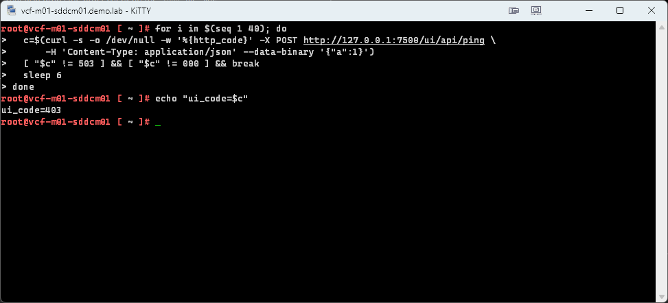

## Verify

Broadcom gives four tests to run on SDDC Manager.  The first two should return 415, and the last two should not.

| Test | What to expect |
| --- | --- |
| Brotli body, straight to the UI on port 7500 | `415` |
| Brotli body, through nginx | `415` |
| Plain JSON, through nginx | Not `415`.  A normal response such as `401` or `403` if you aren't logged in |
| gzip body | Not `415` |

Here are the Brotli tests.  The first goes direct to the UI server, and the second goes through nginx.

```bash
curl -s -o /dev/null -w '%{http_code}' -X POST http://127.0.0.1:7500/ui/api/ping \
  -H 'Content-Type: application/json' -H 'Content-Encoding: br' --data-binary '{"a":1}'

curl -k -s -o /dev/null -w '%{http_code}' -X POST https://127.0.0.1/ui/api/ping \
  -H 'Content-Type: application/json' -H 'Content-Encoding: br' --data-binary '{"a":1}'
```

Both returned `415`, the first direct to the UI on port 7500 and the second through nginx.

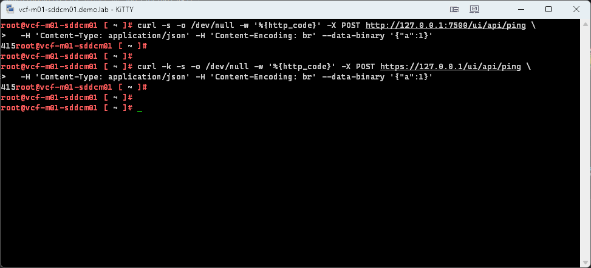

The plain JSON test is the second command again without the `Content-Encoding` header.

```bash
curl -k -s -o /dev/null -w '%{http_code}' -X POST https://127.0.0.1/ui/api/ping \
  -H 'Content-Type: application/json' --data-binary '{"a":1}'
```

Broadcom's gzip test builds a gzip file and sends it straight to the UI on port 7500.  I sent a real gzip body through nginx instead.

```bash
printf '{"a":1}' | gzip | curl -k -s -o /dev/null -w '%{http_code}' -X POST https://127.0.0.1/ui/api/ping \
  -H 'Content-Type: application/json' -H 'Content-Encoding: gzip' --data-binary @-
```

Both returned `403` instead of `415`.  The UI is rejecting the unauthenticated request, which is the normal answer, so plain JSON and gzip bodies still get through the new rule.

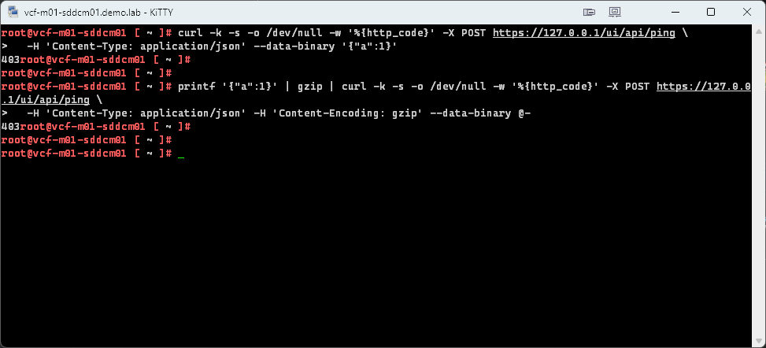

Finally, confirm the configuration is in place.

```bash
nginx -T 2>/dev/null | grep -c reject_br
grep -c 'CVE-2026-111497' $APP
```

The first should return 2, one for the map and one for the `if`, and the second should return 1.

Mine came back `2` and `1`.

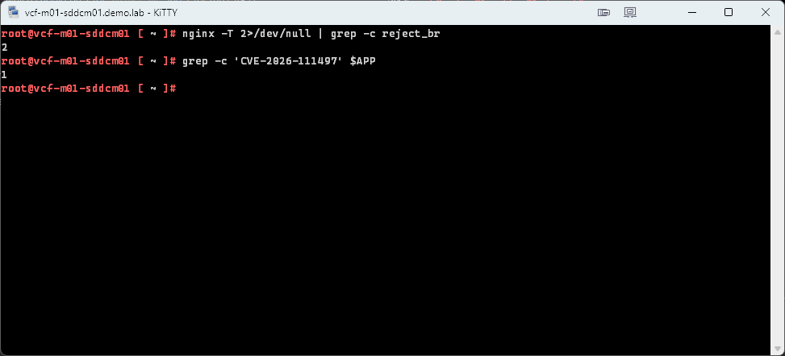

If any test returns something else, don't continue.  Roll back and contact Broadcom support.

## Rolling back

Restore both files from the backups, then reload nginx and restart the UI service.  The first line sets `$APP` again, in case you're in a new shell.

```bash
APP=/opt/vmware/vcf/sddc-manager-ui-app/server/src/servers/sddcManagerServer/app.js
cp -p $APP.orig-cve111497 $APP
cp -p /root/nginx.conf.before-cve111497 /etc/nginx/nginx.conf
nginx -t && systemctl reload nginx
systemctl restart sddc-manager-ui-app
```

## Wrapping up

The workaround did what the KB says it should.  Brotli request bodies get a 415 both straight to the UI server and through nginx, and plain JSON and gzip bodies still get past the new rule to the normal 403 for an unauthenticated request.  The only snag was that nginx.conf is mode 0400 on SDDC Manager, so vi opened it read-only and I had to save with `:wq!`.  The mode was unchanged afterward.

Keep in mind that this is a stopgap and not a fix.  The comment in the nginx rule says to remove it once the Node.js runtime is upgraded to a fixed release, and nothing here replaces patching when Broadcom ships one.  Keep an eye on [KB 460732](https://knowledge.broadcom.com/external/article?articleNumber=460732) for updates.  Until then, the two backups from the start are what take it back out.

-virtualex-
