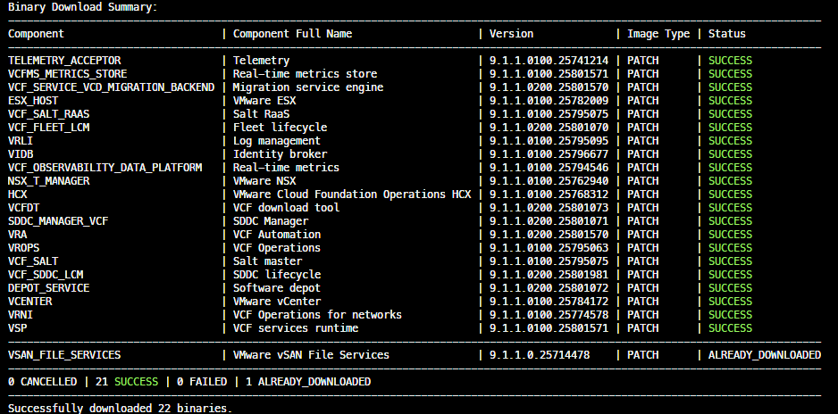

{
  "title": "Patching VMware Cloud Foundation 9.1.1: Series Overview",
  "date": "2026-10-19T23:07:00-04:00",
  "lastmod": "2026-10-19T23:07:00-04:00",
  "slug": "vcf-9-1-1-patch-series-overview",
  "url": "/posts/vcf-9-1-1-patch-series-overview/",
  "draft": false,
  "description": "The overview for my series on applying the October 2026 patch releases to a VMware Cloud Foundation 9.1.1 lab: what's in the patch set, the caveats to know about, and how the series is laid out.",
  "featured_image": "series-overview.png",
  "categories": [
    "Home Lab",
    "How-To's",
    "VMware Cloud Foundation"
  ],
  "tags": [
    "VCF",
    "VMware",
    "Patching",
    "Lifecycle Management",
    "homelab"
  ],
  "years": [
    "2026"
  ],
  "aliases": [],
  "comments": []
}

On October 12th, Broadcom published a new round of patches for VCF 9.1.1 components.  This series applies them to the lab I [upgraded from 9.0.2 to 9.1.1](/posts/vcf-9-1-upgrade-series-overview/), in the order the documentation gives, using the upgrade planner where it applies.  This post covers what's in the patch set, the caveats to know first, and how the series is laid out.

## What's in the patch set

<a href="https://techdocs.broadcom.com/us/en/vmware-cis/vcf/vcf-9-0-and-later/9-1/release-notes/patch-releases-9-1-1-x.html">Patch releases</a> carry time-sensitive security and catastrophic fixes, aren't synchronized across components, and you choose which to apply.  The VCF Download Tool pulled 22 binaries into my offline depot, all patch image types.

| Version | Components |
| --- | --- |
| **9.1.1.0200** | SDDC Manager, Fleet Lifecycle, SDDC Lifecycle, Software Depot, VCF Automation, Migration Service Engine, VCF Download Tool |
| **9.1.1.0100** | VCF Operations, NSX, vCenter, ESX, Log Management, Identity Broker, VCF Services Runtime, and the remaining management components |

My lab already runs 9.1.1.0100 for Fleet Lifecycle, SDDC Lifecycle, and VCF Automation, so for those three this round is the 0200 patch on top.

## Caveats to know first

| Component | What to know |
| --- | --- |
| **Fleet Lifecycle** | Patch it first, before any other VCF component.  The 0200 patch also fixes fleet lifecycle installs or patches failing in multi-VCF deployments because of an invalid SDDC Manager certificate, and VCF Automation deployments or upgrades failing when the VCF services runtime binaries haven't been downloaded. |
| **VCF Operations 0100** | Patching it also patches the Cloud Proxy and the License Server, and no other lifecycle operation can run while it patches.  It has to be patched before any ESX host.  It fixes vCenter license assignment failing from VCF Operations. |
| **VCF Services Runtime 0100** | Fixes ports 30005 and 30006 being exposed over an insecure TLS port, and a Log Management install that stalls during setup. |
| **VCF Automation** | Patch it before the Migration Service Engine.  Doing the engine first creates a deadlock that blocks both. |
| **Software Depot** | While a software depot instance is being patched, patching other components is blocked, because the patch binaries aren't available until it finishes. |
| **ESX 0100** | Live-patchable, no host reboot.  It includes NSX kernel module updates. |
| **vCenter 0100** | If the vSphere Lifecycle Manager database was reset before an upgrade, a vSphere Supervisor can lose data. |
| **The rest** | Log Management, Real-Time Metrics, Salt Master and RaaS, and Telemetry are security enhancements only.  The Identity Broker patch includes no changes other than the alignment of build details. |

## Before I start

| Item | What I'm doing |
| --- | --- |
| **Depot** | The same offline depot as the first series. |
| **Backups** | I'm not taking extra backups or snapshots first. |

## The series

| Part | Covers |
| --- | --- |
| **[Part&nbsp;1](/posts/vcf-9-1-1-patch-part-1-management-components/)** | The management plane: Fleet Lifecycle, SDDC Manager, and the other VCF management components |
| **[Part&nbsp;2](/posts/vcf-9-1-1-patch-part-2-core-components/)** | NSX Manager, vCenter, ESX, and the NSX Edge and finalize, in both the management and workload domains |

Everything here is from my own nested lab, so treat it as a rehearsal and not as production evidence.

-virtualex-
