{
  "title": "VMware Cloud Foundation 9.1 Upgrade - Part 1: Upgrading VCF Operations",
  "date": "2026-10-01T13:00:00-04:00",
  "lastmod": "2026-10-01T13:00:00-04:00",
  "slug": "vcf-9-1-upgrade-part-1-vcf-operations",
  "url": "/posts/vcf-9-1-upgrade-part-1-vcf-operations/",
  "draft": false,
  "description": "Part 1 of my VMware Cloud Foundation 9.0.2 to 9.1 upgrade series: upgrading VCF Operations to 9.1, where the Fleet Management appliance auto-decommissions and the Cloud Proxy auto-upgrades.",
  "featured_image": "part-1-vcf-operations.png",
  "categories": [
    "Home Lab",
    "How-To's",
    "VMware Cloud Foundation"
  ],
  "tags": [
    "VCF",
    "VMware",
    "vSphere",
    "NSX",
    "vSAN",
    "VCF Operations",
    "Upgrade",
    "homelab"
  ],
  "years": [
    "2026"
  ],
  "aliases": [],
  "comments": []
}

This is Part 1 of my VMware Cloud Foundation 9.0.2 to 9.1 upgrade series.  The [series overview](/posts/vcf-9-1-upgrade-series-overview/) covers my lab environment, what's changing in 9.1, the prerequisites that gate the whole upgrade, and a cert and password warning that applies from this stage on.  With that prep done, I started with the operations layer.

VCF Operations is first in the upgrade order, and this stage does more than bump a version number.  As I covered in [the overview](/posts/vcf-9-1-upgrade-series-overview/), 9.1 folds the standalone **Fleet Management appliance** (`vcf-m01-vopsfm01.demo.lab` in my lab) directly into VCF Operations.  During this upgrade VCF Operations collects its inventory, certificates, and service accounts, then the appliance is decommissioned and powers off.  The **Cloud Proxy** appliances get auto-upgraded in the same operation too, up to ten at a time ([Upgrade to VCF Operations 9.1](https://techdocs.broadcom.com/us/en/vmware-cis/vcf/vcf-9-0-and-later/9-1/deployment/upgrading-cloud-foundation/upgrade-backup-and-restore.html)).  So a single workflow upgrades VCF Operations, retires an appliance, and upgrades the Cloud Proxy.

<aside class="info-block"><p>One thing to carry over from the overview: the moment this upgrade completes, the cert and password freeze window kicks in for VCF Automation, the Identity Broker, Logs, and Networks, until each of those reaches 9.1 later in the series.  That's why any cert or password work on those components has to happen <strong>before</strong> this stage.</p></aside>

<aside class="info-block"><p>One more pre-flight item.  <strong>9.1 enforces stricter certificate validation</strong>, and certificates with incomplete <strong>Subject Alternative Names</strong> are no longer supported at all.  That applies to the <strong>VCF Operations</strong>, <strong>VCF Automation</strong>, and <strong>VCF Operations for Networks</strong> certificates, and on VCF Operations it means every node FQDN plus the load balancer or VIP FQDN in the SAN.  The upgrade validates credentials and migrates certificates as part of the inventory move, so incomplete SANs cause trouble at exactly this stage.</p></aside>

## Why this one goes first

The order of this upgrade matters.  VCF Operations has to reach 9.1 before SDDC Manager does.

Two documented issues make the case.  If SDDC Manager and vCenter are upgraded while VCF Operations is still on 9.0.2, the 9.1 SDDC Manager API starts returning a pagination field that the older VCF adapter doesn't know how to parse.  That takes out the integration UI, and it surfaces later as a sync error during the ESX host upgrade ([KB 440407](https://knowledge.broadcom.com/external/article/440407)).  Separately, before VCF Operations is upgraded, SDDC Manager's Binary Management shows the 9.1 option in the dropdown with nothing listed under it for any category, Upgrade, Patch, or Install ([KB 440282](https://knowledge.broadcom.com/external/article/440282)).  Upgrading VCF Operations first avoids both.

## Upgrading VCF Operations to 9.1

One more bit of prep.  The 9.1 upgrade runs a set of pre-validation checks.  Beyond the SAN check above, the certificates need the FQDN in the CN field and every node IP and FQDN in the SAN, and VMware-generated certs commonly lack the IPs.  The break-glass accounts should be working with current passwords, and the management components should be configured on the management network.  [KB 453770](https://knowledge.broadcom.com/external/article/453770/troubleshooting-prevalidation-warnings.html) covers these, and it lists them as warnings that don't block the upgrade.  There's also a check that every Cloud Proxy collector sits in a unified state, and unlike the others, a legacy or non-unified proxy fails pre-validation outright instead of warning ([KB 443797](https://knowledge.broadcom.com/external/article/443797/unable-to-upgrade-vcf-operations-from-90.html)).

<aside class="info-block"><p>Two more things to check.  The vCenter field in every vCenter integration in VCF Operations can't contain a URL, an IP address, or an FQDN with slashes or sub-paths.  And if there are additional management components and VCF Operations has a proxy server configured with SSL termination, remove that proxy server configuration first.</p></aside>

With that squared away, here's the actual upgrade.

1. **Snapshot everything first.**  Take VM-level snapshots of the VCF Operations appliance, the Fleet Management appliance, and the Cloud Proxy.  This was my safety net for the one stage where an appliance decommissions itself.  Broadcom's [procedure for the VCF Operations nodes](https://techdocs.broadcom.com/us/en/vmware-cis/vcf/vcf-9-0-and-later/9-1/deployment/upgrading-cloud-foundation/upgrade-backup-and-restore/create-a-snapshot.html) has a specific order.  In the VCF Operations admin interface, go to **System status** and click **Take Cluster Offline**, which stops the VCF Operations services but leaves the VMs running.  Once every node shows offline, snapshot each one with **Snapshot the Virtual Machine Memory** and **Ensure Quiesce Guest File System** both deselected, then bring the cluster back **Online**.  Broadcom's procedure only covers the VCF Operations nodes, so I snapshotted the Fleet Management appliance and the Cloud Proxy the same way.

   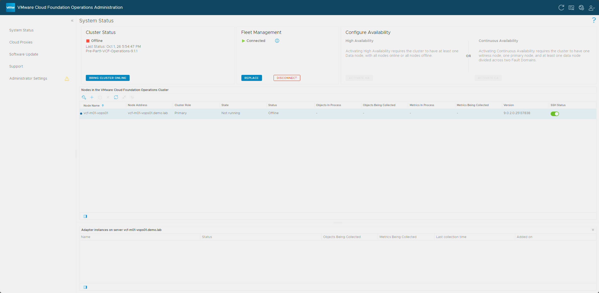

   For the snapshots themselves, I used PowerCLI while the cluster was offline.

   ```powershell
   Connect-VIServer -Server vcf-m01-vc01.demo.lab

   'vcf-m01-vops01','vcf-m01-vopsfm01','vcf-m01-vopscp01' | ForEach-Object {
       New-Snapshot -VM (Get-VM -Name $_ -ErrorAction Stop) `
           -Name 'Pre-Part1-VCF-Operations-9.1.1' `
           -Description 'Before VCF Operations upgrade to 9.1.1' `
           -Memory:$false -Quiesce:$false
   }
   ```

   I confirmed all three snapshots existed before moving on, with one row per appliance, each named `Pre-Part1-VCF-Operations-9.1.1`.

   ```powershell
   Get-VM 'vcf-m01-vops01','vcf-m01-vopsfm01','vcf-m01-vopscp01' |
       Get-Snapshot |
       Select-Object VM, Name, Created, @{N='SizeGB';E={[math]::Round($_.SizeGB,2)}}, PowerState |
       Format-Table -AutoSize
   ```

   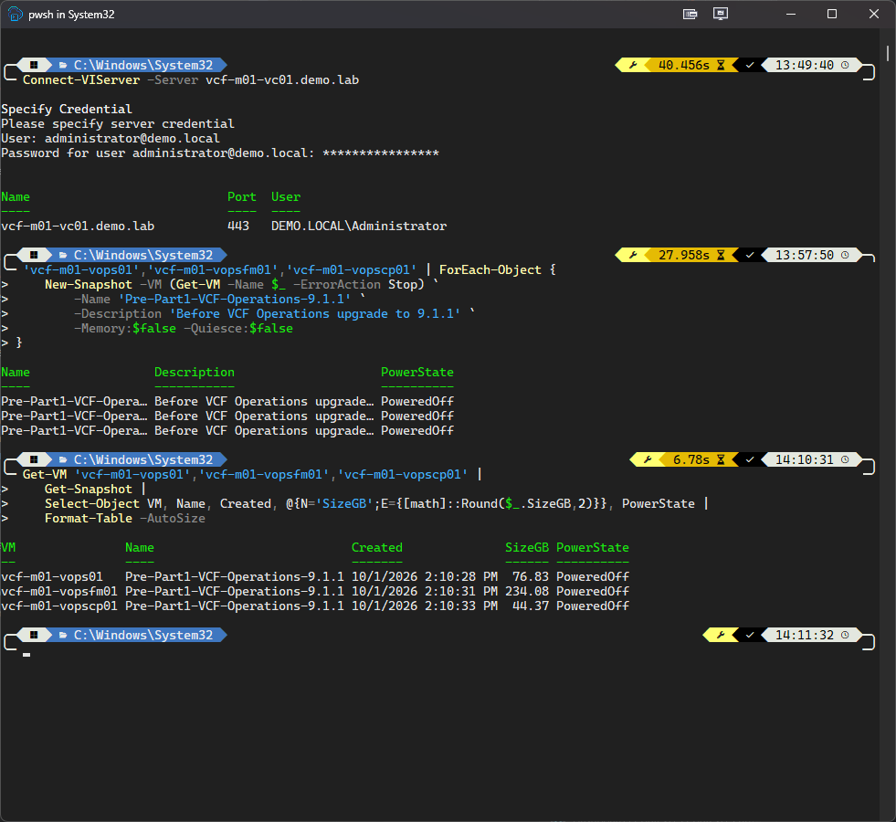

   `PoweredOff` shows in the PowerState column, but that isn't the appliance's current state.  All three appliances were still running.

   With the snapshots confirmed, I brought the cluster back **Online** from the same System status page.

   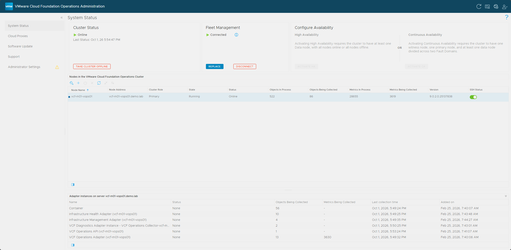

   I left these snapshots in place until the upgrade was verified.

2. **Back up your customized VCF Operations content** if you've built any: alert definitions, symptom definitions, recommendations, and custom views.  The upgrade resets out-of-the-box alerts, symptoms, recommendations, dashboards, views, reports, and widgets to their defaults, so anything you edited in place is lost.  Export your own content first.

3. **Download the VCF Operations 9.1.1 PAK** from the Broadcom Support Portal.  The [9.1.1 release notes](https://techdocs.broadcom.com/us/en/vmware-cis/vcf/vcf-9-0-and-later/9-1/release-notes/vmware-cloud-foundation-9-1-1-0-release-notes.html) say a 9.0.x environment going straight to 9.1.1 starts right here, with VCF Operations 9.1.1.  The file is `Operations-Upgrade-9.1.1.0.25679887.pak`.  One oddity: the download tool lists this bundle as `9.1.1.0.25679751`, while the PAK file and the Software Update page both say `25679887`.  The node itself reports `25679751` once the upgrade finishes, so I treated them as the same release.

4. **Open the VCF Operations admin interface** at `https://vcf-m01-vops01.demo.lab/admin` and head to **Software Update**.

   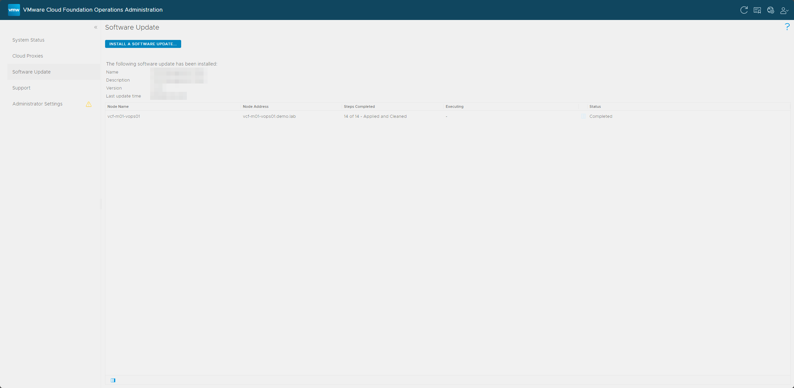

5. Click **Install A Software Update**, upload the `.pak` file, and kick off the install.  The wizard has four pages: select the update, accept the license agreement, review the update information, and install.  On the first page, once the upload hits 100%, you'll see the PAK details and a green check that the file signature is valid, along with a warning that the update restarts the cluster for the entirety of the update.  From there the appliance works through the update and reboots on its own.

   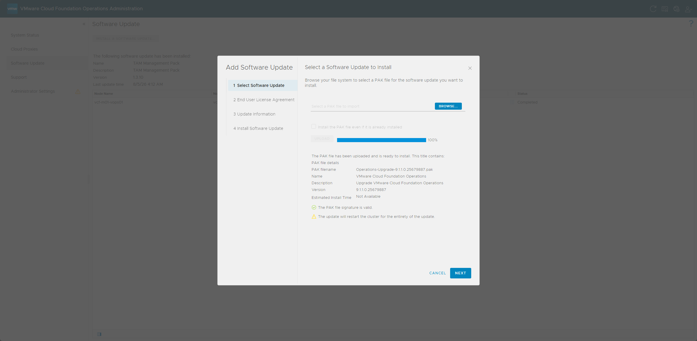

6. **After the reboot, log back into the admin UI.**  The upgrade wizard will prompt you for the **root password of the Fleet Management appliance** (`vcf-m01-vopsfm01.demo.lab`).  This is the step that authorizes the inventory migration, so I had that password ready.  The dialog, titled **Fleet Management v9.0 Node Data Migration to VCF Operations**, lists what it wants you to have done first, which is the pre-validation list from earlier plus snapshots, with a reminder that starting with VCF 9.1, implicit backups are no longer performed before upgrades.  It also warns that if your Identity Broker is an external 9.0.x appliance on a non-management network, such as an overlay, you need to migrate it to the management network before upgrading VCF Operations.  Tick the checkbox confirming you've reviewed the reference documentation, enter the root password, and click **OK**.  The dialog also offers **Cancel Upgrade** and **Do Not Migrate**, which skips the inventory migration, and I left both alone.

   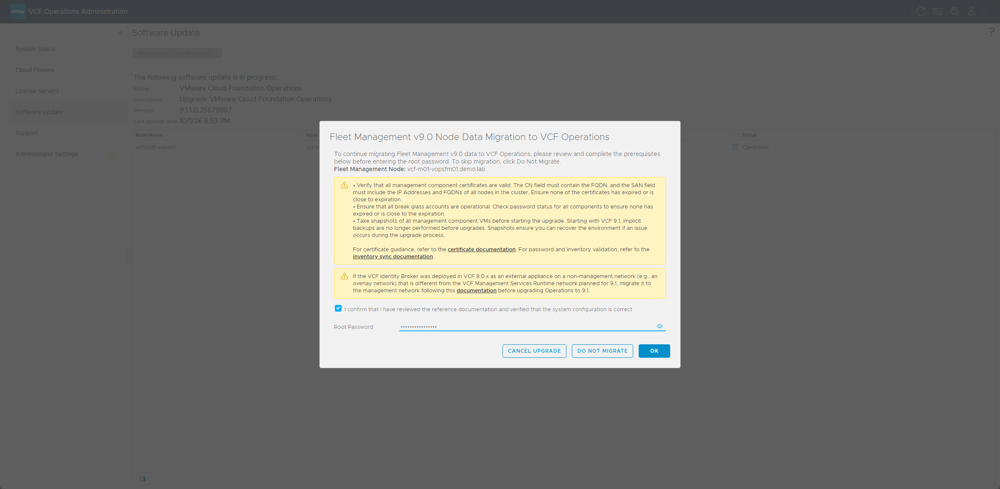

7. **Let it run.**  VCF Operations pulls in the inventory, certificates, and service accounts from Fleet Management.  When it's done, the Fleet Management appliance is decommissioned and powers off, and your Cloud Proxy upgrades in the background.  How long this takes varies by environment, and in my nested lab the whole stage took about 30 minutes.

   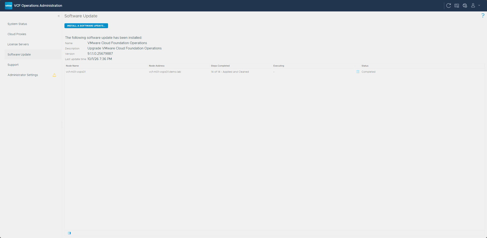

<aside class="info-block"><p>Two things happen quietly in the background here.  Data collection <strong>pauses on the cloud proxies</strong> while they upgrade and resumes once they finish.  The proxy upgrade starts after VCF Operations itself finishes, and in my lab it ran for about 25 minutes, so the stage isn't done until the Cloud Proxies page shows it Complete.  On certificates, internal certs are renewed as part of the upgrade.  In my lab that showed up as a new five-year certificate on the Cloud Proxy, and any <strong>custom certificates are left untouched</strong>.</p></aside>

## Verifying the upgrade

Once it settled, I checked these before calling Part 1 done:

- The **VCF Operations admin interface** showed the cluster **Online** with a message that the upgrade completed successfully, and the node reported version `9.1.1.0.25679751`.
- The **VCF Operations 9.1 UI** loaded, and its About dialog showed the same version, `9.1.1.0.25679751`.
- The **Fleet Management appliance** (`vcf-m01-vopsfm01.demo.lab`) was powered off and decommissioned.  The VM stays in vCenter.
- My **Cloud Proxy** showed **Healthy** on the Cloud Proxies page, with its upgrade **Complete** and the version at 9.1.1 (`9.1.1.0.25679891`).
- My **inventory and certificates** had carried over.  Under **Manage → Fleet Management → Certificates**, the Cloud Proxy's certificates showed as active.

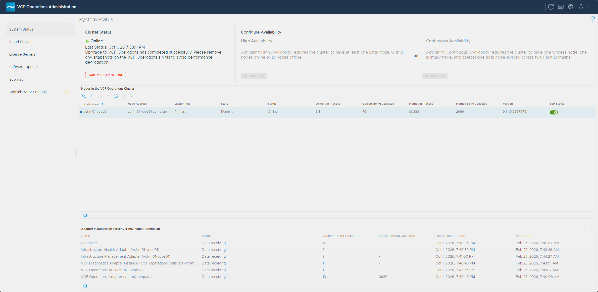

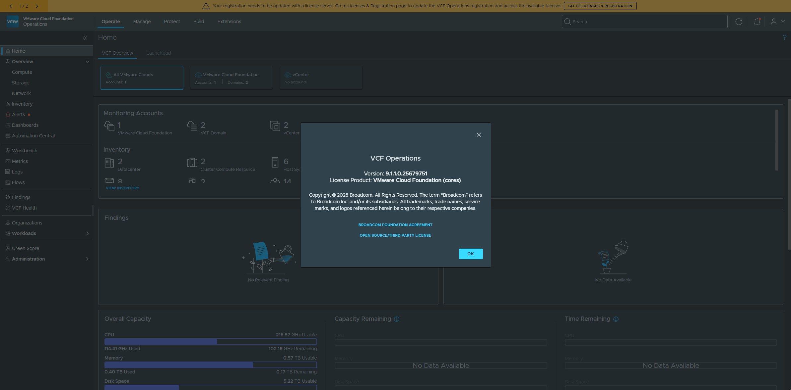

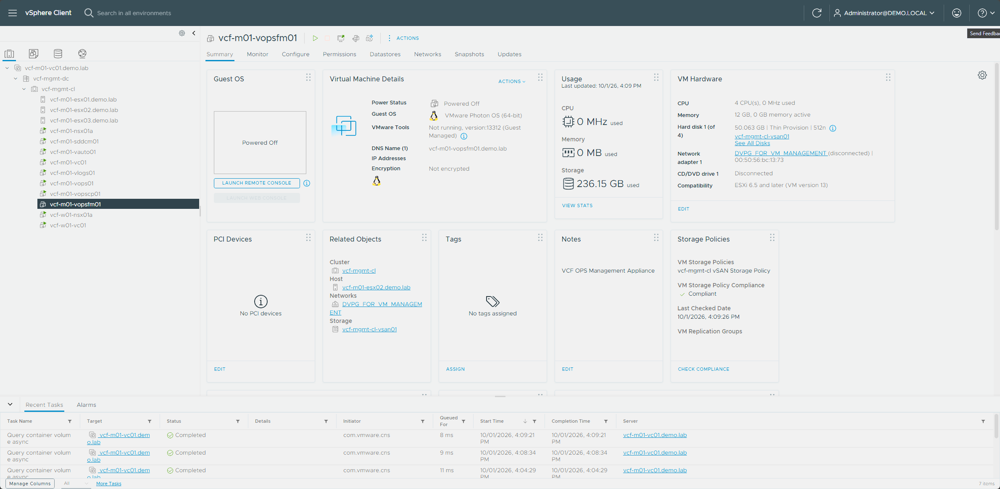

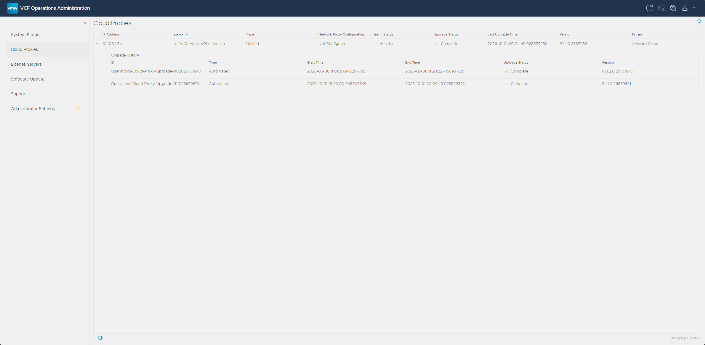

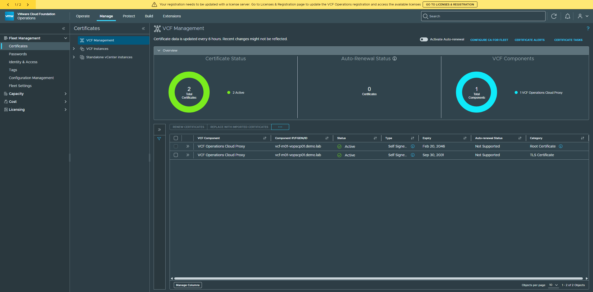

In my lab I saw a **Licenses could not be synchronized with vCenter instances** error, a banner across the top of the VCF Operations UI saying the registration needs to be updated with a license server, and no Identity Broker or log management certificates.  The license error clears once the management services and License Server are deployed in [Part 2](/posts/vcf-9-1-upgrade-part-2-sddc-manager-management-services/).

All of that checked out, so the operations layer was on 9.1 and I was ready for the next stage.

## Clean up the snapshots

With the upgrade verified, I deleted the snapshots, because snapshots degrade performance if they're left in place.  The Fleet Management appliance powers off but stays in vCenter, so its snapshot sticks around until the VM is deleted.

```powershell
Get-VM 'vcf-m01-vops01','vcf-m01-vopscp01' | Get-Snapshot -Name 'Pre-Part1-*' | Remove-Snapshot -Confirm:$false
```

PowerCLI waits for the vSphere delete tasks to finish, and in my lab that took about 11 minutes.

Then I confirmed they were gone.  Only `vcf-m01-vopsfm01` was still listed, and deleting that VM removes its snapshot along with it.

```powershell
Get-VM 'vcf-m01-vops01','vcf-m01-vopsfm01','vcf-m01-vopscp01' | Get-Snapshot | Select-Object VM, Name, Created
```

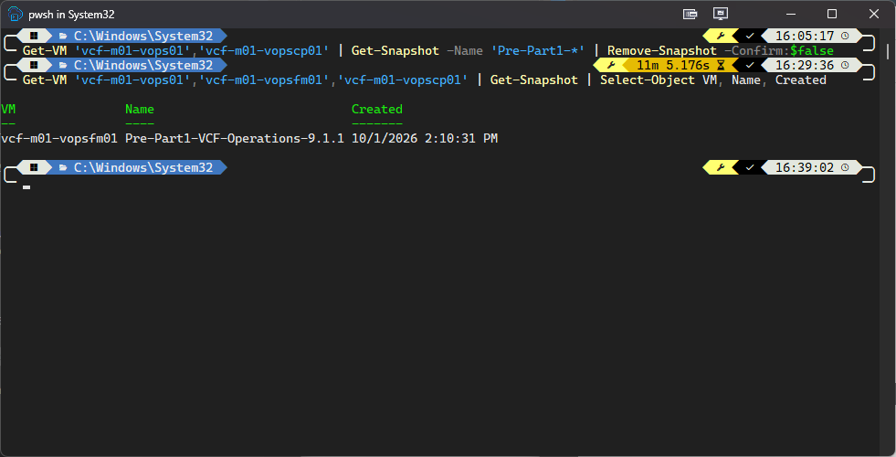

## What's next

In **[Part 2](/posts/vcf-9-1-upgrade-part-2-sddc-manager-management-services/)**, I upgrade **SDDC Manager** to 9.1 and then deploy the brand new **VCF Management Services** runtime and **License Server**, which pick up the lifecycle work the Fleet Management appliance was handling, and then transfer my licenses over.

Thanks for reading, and if you're running this in your own lab, drop a comment and let me know how it went.  See you in Part 2, where SDDC Manager and the new management services take the stage.

-virtualex-
