{
  "title": "VMware Cloud Foundation 9.1 Upgrade - Part 2: SDDC Manager and VCF Management Services",
  "date": "2026-10-05T11:00:00-04:00",
  "lastmod": "2026-10-05T11:00:00-04:00",
  "slug": "vcf-9-1-upgrade-part-2-sddc-manager-management-services",
  "url": "/posts/vcf-9-1-upgrade-part-2-sddc-manager-management-services/",
  "draft": false,
  "description": "Part 2 of my VMware Cloud Foundation 9.0.2 to 9.1 upgrade series: upgrading SDDC Manager, then deploying the new VCF Management Services runtime that takes over lifecycle management in 9.1, plus the License Server.",
  "featured_image": "part-2-management-services.png",
  "categories": [
    "Home Lab",
    "How-To's"
  ],
  "tags": [
    "VCF",
    "VMware",
    "vSphere",
    "NSX",
    "vSAN",
    "SDDC Manager",
    "VCF Operations",
    "Upgrade",
    "homelab"
  ],
  "years": [
    "2026"
  ],
  "aliases": [],
  "comments": []
}

In [Part 1](/posts/vcf-9-1-upgrade-part-1-vcf-operations/) I upgraded VCF Operations to 9.1, watched the old Fleet Management appliance decommission itself, and let the Cloud Proxy auto-upgrade along the way.  With the operations layer on 9.1, next up is SDDC Manager and the new management services.

This stage gets its own post.  I upgrade **SDDC Manager** to 9.1, then deploy the brand new **VCF Management Services** runtime and **License Server**.

## What's actually changing here

In 9.0.x the lifecycle work was handled by the standalone Fleet Management appliance that Part 1 decommissioned.  In 9.1 it's handled by Fleet Lifecycle and SDDC Lifecycle, which are part of a new runtime called **VCF Management Services** ([upgrade docs](https://techdocs.broadcom.com/us/en/vmware-cis/vcf/vcf-9-0-and-later/9-1/deployment/upgrading-cloud-foundation.html)).  When it deploys, a set of services stands up at once:

- **Fleet Lifecycle** and **SDDC Lifecycle** (the two lifecycle services)
- **Software Depot** (central binary management)
- **Salt master and Salt RaaS** (configuration management)
- **Telemetry**
- **License Server** (the new home for your VCF licenses)

All of that rides on a **VCF services runtime**, which is the cluster the wizard actually stands up.  Credit to [William Lam's write-up](https://williamlam.com/2026/09/vcf-9-1-1-adopting-the-reduced-vcf-management-services-vcfms-footprint-after-an-upgrade.html) and [KB 455842](https://knowledge.broadcom.com/external/article/455842) for the detail here: VCF 9.1.0 sized the runtime for the largest optional service you might ever add, while 9.1.1 sizes it for the components you deploy on day one, which for a Simple deployment means one less worker node.  Broadcom's [VCF Fleet Sizing Models](https://techdocs.broadcom.com/us/en/vmware-cis/vcf/vcf-9-0-and-later/9-1/design/vmware-cloud-foundation-concepts/vcf-fleet-sizing-models-9-x.html) page lists the Simple size as one control plane node and two worker nodes, and mine came up as three runtime nodes.  The License Server is a separate appliance.  All of that lands on the management cluster at once.

<aside class="info-block"><p>With the two-step route, landing on 9.1.0 first, the smaller footprint isn't applied when moving to 9.1.1.  Broadcom has a script for that, the one in the KB I linked above.  Two catches: it only works while the runtime is still hosting just the day one components, so it bails out without changing anything if Log Management or Real-time Metrics is installed, and it rolls the worker nodes, so it belongs in a maintenance window.</p></aside>

The deployment also stands up a **VCF Identity Broker**, and how that plays out depends on what's running today.

With a **standalone Identity Broker appliance** (9.0.x in appliance mode), the wizard skips deploying a 9.1 Identity Broker entirely, and the existing appliance is upgraded separately afterward.

With an **embedded Identity Broker** (the vCenter SSO route, which is what I run), the embedded broker gets upgraded to 9.1 automatically during the vCenter upgrade in [Part 4](/posts/vcf-9-1-upgrade-part-4-nsx-vcenter/), **but an Identity Broker 9.1 instance is also deployed right here as part of Management Services.**  So an address and FQDN has to be reserved for it, even though "embedded" makes it sound like it wouldn't.  The embedded instance can also be migrated onto the highly available one down the road.

So this part goes from SDDC Manager on 9.1 to VCF Management Services and the License Server deployed.

## Planning the IPs and DNS first

This is the prep that can stop the Management Services deployment cold in the middle.  The wizard needs a block of addresses and a set of pre-created DNS records, and it expects them ready to go.

It comes down to two things:

1. **A CIDR block** in your management network, reserved purely as the runtime pool.  The minimum is 12 addresses (a `/28` block) and 30 (a `/27`) is recommended, and that extra headroom exists for new services or scaling out existing ones on future upgrades.  I went with the `/27`.  There's no per-host DNS for these, and I just reserved the range in IPAM so nothing else would grab them.  From 9.1.0.400 on, the wizard also takes a comma-separated list of individual addresses, contiguous or not, and lets you exclude specific addresses from a CIDR, which helps a lot on a crowded management network.
2. **Five lowercase FQDNs**, each on a unique free IP **outside** that pool, each with **both forward (A) and reverse (PTR)** DNS records.

Here's the exact allocation I used in my lab against my `10.100.1.0/24` management network:

| Purpose | FQDN | IP | DNS |
| --- | --- | --- | --- |
| Runtime pool (reserve in IPAM only) | n/a | `10.100.1.128/27` (.128-.159) | none per-host |
| VCF services runtime | `vcf-m01-vcfms01` | `10.100.1.64` | A + PTR |
| Fleet component | `vcf-m01-fleet01` | `10.100.1.65` | A + PTR |
| Instance component | `vcf-m01-vcfinst01` | `10.100.1.66` | A + PTR |
| Identity Broker | `vcf-m01-idb01` | `10.100.1.67` | A + PTR |
| License Server | `vcf-m01-vcflic01` | `10.100.1.68` | A + PTR |

<aside class="info-block"><p>A few rules here are easy to miss.  The License Server is <strong>IPv4 only at deployment</strong>.  And <strong><code>.local</code> domains are not supported</strong>: FQDN validation follows RFC1034 and RFC1123, and <code>.local</code> is rejected because it isn't an internet top-level domain.  My <code>demo.lab</code> domain passed that validation.  The forward and reverse records have to be in place and resolving <em>before</em> the deployment starts, not during.</p></aside>

<aside class="info-block"><p>There's one more piece of planning the wizard won't flag up front.  The VCF services runtime uses an <strong>internal CIDR block of <code>198.18.0.0/15</code></strong>.  If that overlaps anything on the infrastructure networks (management, VM, or IP pool ranges), the result is routing conflicts and lost connectivity to and from the runtime cluster.  It can be switched to <code>240.0.0.0/15</code> or <code>250.0.0.0/15</code> instead, and on a 9.1.1 target the wizard gives that choice directly, which the 9.1.0.x UI didn't.</p></aside>

## Upgrade SDDC Manager

With 9.1 in play, SDDC Manager is no longer upgraded from its own UI.  It's driven from VCF Operations now.  For vSphere Replication, VMware Live Site Recovery, vSAN Data Protection, or Avi Load Balancer, Broadcom's [upgrade order](https://techdocs.broadcom.com/us/en/vmware-cis/vcf/vcf-9-0-and-later/9-1/deployment/upgrading-cloud-foundation.html) has steps too.  None of them runs in my management domain, so this series skips them.

The prerequisites for this upgrade are a recent **SDDC Manager SFTP backup** and a fresh **appliance snapshot**.

For the backup, the SDDC Manager UI's **Administration → Backup** page shows when the last one ran and has a **Backup Now** button if it's stale.

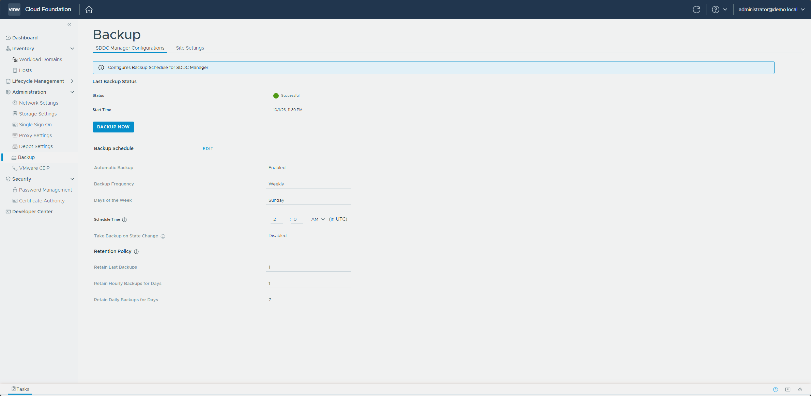

The SDDC Manager snapshot is a prerequisite, but the settings aren't spelled out, so I used the same no-memory, no-quiesce snapshot as Part 1.  In PowerCLI that looks like this, in the same `Connect-VIServer` session:

```powershell
Get-VM -Name 'vcf-m01-sddcm01' -ErrorAction Stop |
    New-Snapshot -Name 'Pre-Part2-SDDC-Manager-9.1.1' `
        -Description 'Before SDDC Manager upgrade to 9.1.1' `
        -Memory:$false -Quiesce:$false
```

I confirmed it existed before moving on.  I saw `PoweredOff` in the PowerState column here as well, same as in Part 1.

```powershell
Get-VM -Name 'vcf-m01-sddcm01' | Get-Snapshot | Select-Object VM, Name, Created
```

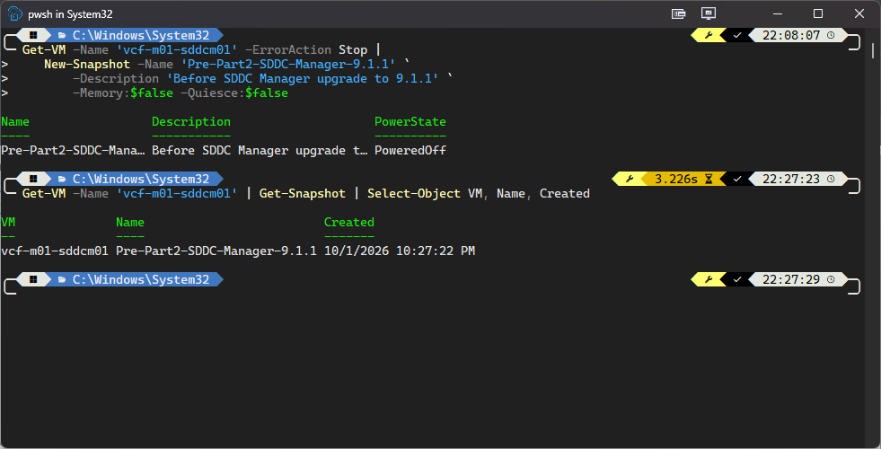

1. In VCF Operations, go to **Build → Lifecycle → VCF Instances** and open the **SDDC Manager** lifecycle page for your instance.
2. Select **Download** to pull the SDDC Manager 9.1.1 binary, the one tagged **Latest Compatible**, not the 9.1.0.0 entry listed below it.  The download is queued and runs in the background, and when it finishes the page shows **Download completed and Validated**.

   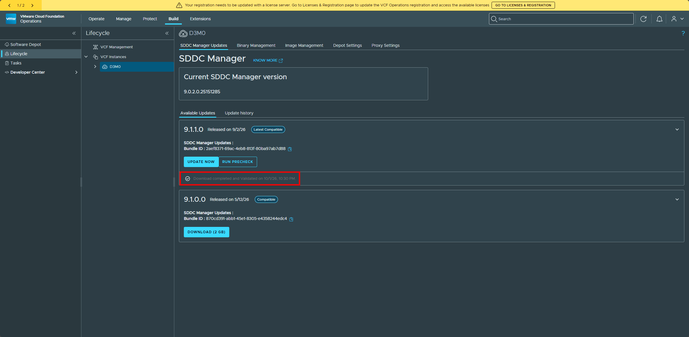

3. Once the binary download completes, select **Update Now**.
4. The SDDC Manager LCM prompts you to confirm, with a warning that you'll be disconnected from the SDDC Manager UI until the upgrade is complete.  Select **Start Upgrade**.

   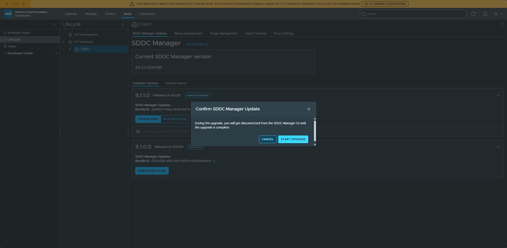

5. The upgrade is queued and starts.  The update status page walks through the stages in order: the VCF prerequisite check, setting up the common appliance platform, the services and platform upgrades and RPM updates, a reboot of SDDC Manager, a custom certificate refresh, and a post-upgrade validation.  How long it takes varies by environment, and in my nested lab the whole thing took about 22 minutes.

   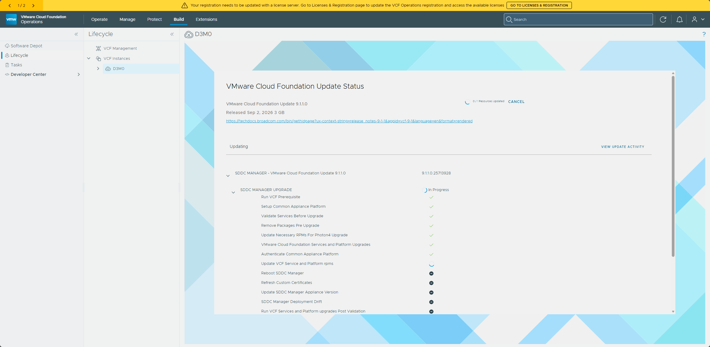

   I used **View Update Activity** to watch the list of pending and completed tasks as the LCM worked through it.

   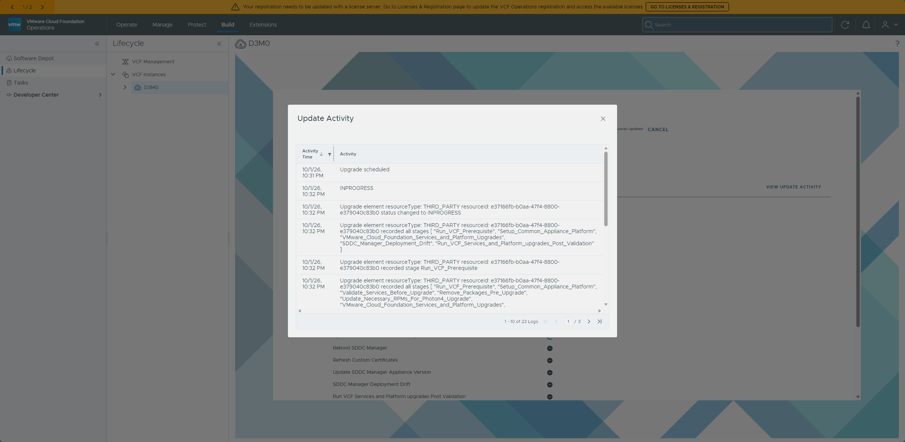

When it finished, the status page showed a green banner with the elapsed time and a **Finish** button, which I clicked.

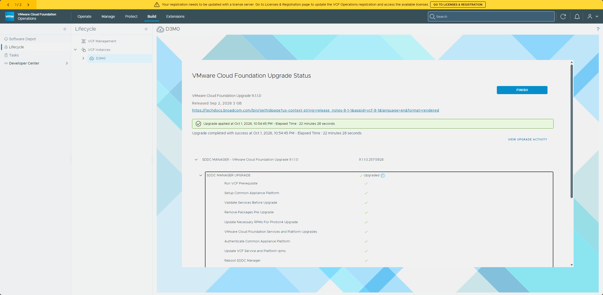

Back on the lifecycle page for my instance, the current SDDC Manager version read `9.1.1.0.25713928`.  The page also gained an **Install Management Services** tab, which lays out the rest of Part 2 as three steps: **Configure Depot**, **Download Binaries**, and **Install Components**.  It already showed Configure Depot as completed.

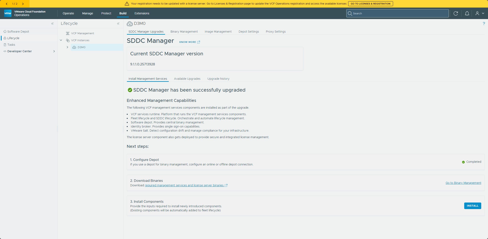

I double-checked the build in the About dialog of the SDDC Manager UI, and confirmed that both my management and workload domains were still **ACTIVE**.

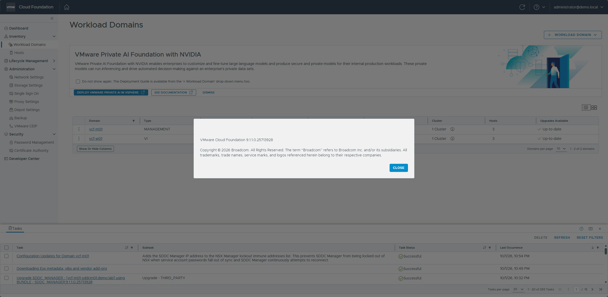

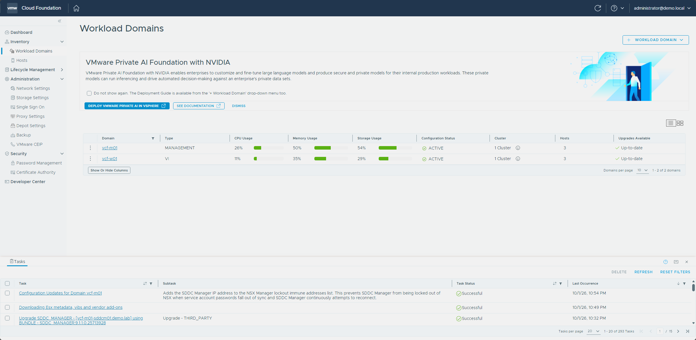

I left the snapshot in place until the management services deployment below had succeeded, since that's the next big change to SDDC Manager.

## Stage the install binaries

<aside class="info-block"><p>The first step in the Install Management Services panel is <strong>Configure Depot</strong>, and what it means depends on the kind of depot.  With an <strong>online depot</strong>, after the SDDC Manager 9.1 upgrade, the depot is reconfigured under <strong>Administration → Depot Settings</strong> in SDDC Manager with an <strong>activation code</strong> from the VCF Business Services console instead of a download token (<a href="https://techdocs.broadcom.com/us/en/vmware-cis/vcf/vcf-9-0-and-later/9-1/deployment/upgrading-cloud-foundation/apply-cloud-foundation-5-2-update-bundle.html">upgrade docs</a>, <a href="https://knowledge.broadcom.com/external/article/443647/download-token-has-been-replaced-by-acti.html">KB 443647</a>).  I use an <strong>offline depot</strong>, a web server I run myself, and its connection still showed <strong>Depot Connection Active</strong> on the <strong>Depot Settings</strong> tab of my instance's lifecycle page, with Configure Depot already marked as completed, so there was nothing for me to change.</p></aside>

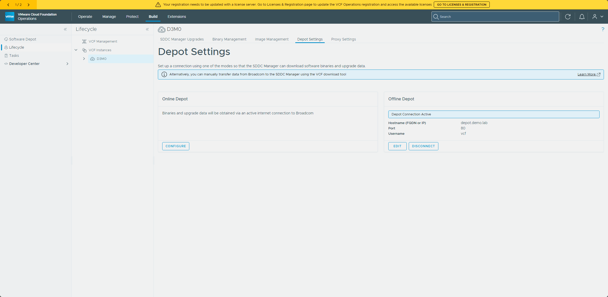

Two things have to happen between the SDDC Manager upgrade and the big deployment, and they're easy to blow straight past: the install binaries for the components about to be deployed have to be in the software depot, and SDDC Manager has to download them from it.  Broadcom's list for the first VCF instance is the VCF services runtime, SDDC lifecycle, Salt master, Telemetry, Software depot, Salt RaaS, Fleet lifecycle, Identity broker, and the License server ([deploy docs](https://techdocs.broadcom.com/us/en/vmware-cis/vcf/vcf-9-0-and-later/9-1/deployment/upgrading-cloud-foundation/deploy-vcf-management-services.html)).  They don't show up on my instance's **Binary Management** tab in VCF Operations.  Even with **Install Binaries** selected, mine only listed VMware NSX, VMware vCenter, VCF Operations, SDDC Manager, VCF Automation, and the Cloud proxy.  SDDC Manager's own **Binary Management** page is where they appear, and I get to that below.

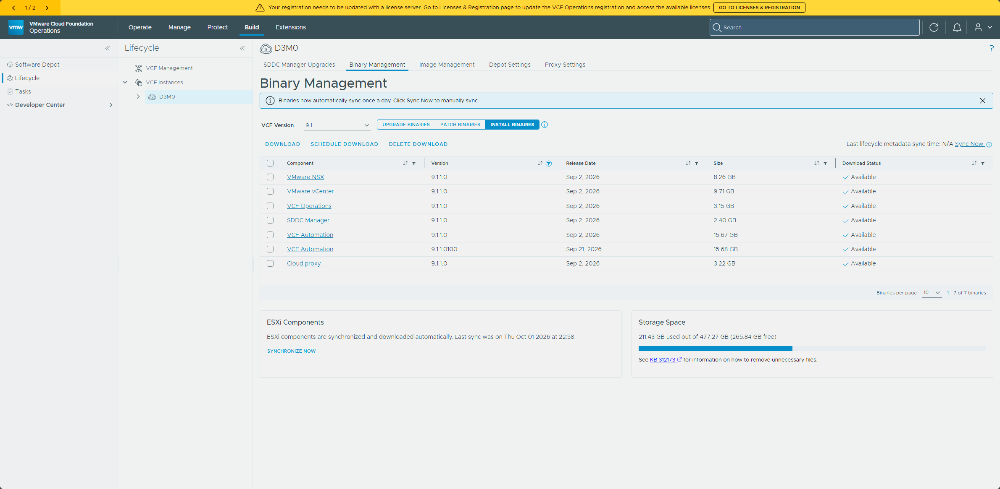

With an offline depot like mine, this is a VCF Download Tool job instead.  The tool's install-type list for 9.1.1.0 includes the License server and all of the management services components, and all nine are sitting in my depot's `PROD/COMP` folders.  This is the command I used to list them:

```bash
./vcf-download-tool binaries list --vcf-version 9.1.1.0 --sku=VCF --type=INSTALL --depot-download-activation-code-file ~/activation_code
```

<aside class="info-block"><p>A quick note on that last flag.  The 9.1 VCF Download Tool authenticates with an activation code, and <a href="https://knowledge.broadcom.com/external/article/443647/download-token-has-been-replaced-by-acti.html">KB 443647</a> says activation codes replace download tokens starting with 9.1, so that's what I used.  I got one by generating a software depot ID with <code>./vcf-download-tool configuration generate --software-depot-id</code> and registering it in the VCF Business Services console.  The tool's own help text marks <code>--depot-download-token-file</code> as superseded and says it will stay available until 5.x is end of life.</p></aside>

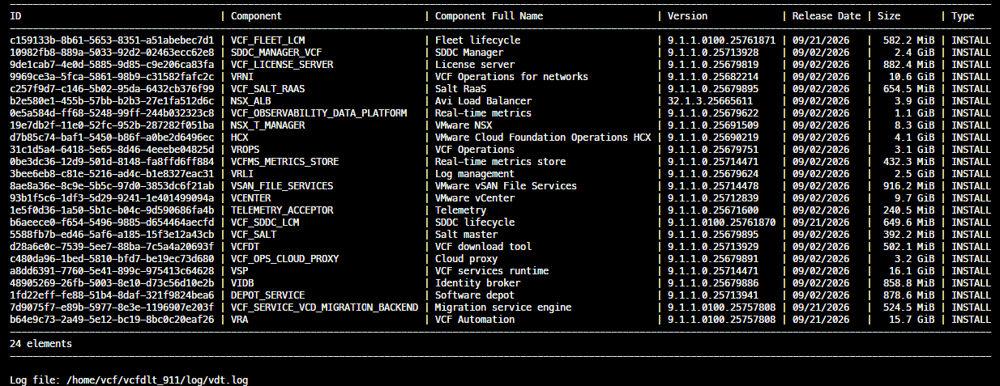

Fleet lifecycle and SDDC lifecycle both have a 9.1.1.0100 build released on September 21st, and the install-type list shows those two at 9.1.1.0100 while everything else is 9.1.1.0, so those are the builds to take.

### Sync and download them in SDDC Manager

Having the files in the depot isn't the finish line.  SDDC Manager has to download them from the depot too, and I found that out the hard way.  Do the download before you start the deploy below and you'll skip the failure I hit.  With all nine sitting in my depot but not downloaded, the **Deploy VCF Management Components** task failed at **Generate VMware Components Image Location Path** with "Failed to fetch install image path for component VSP with version null".

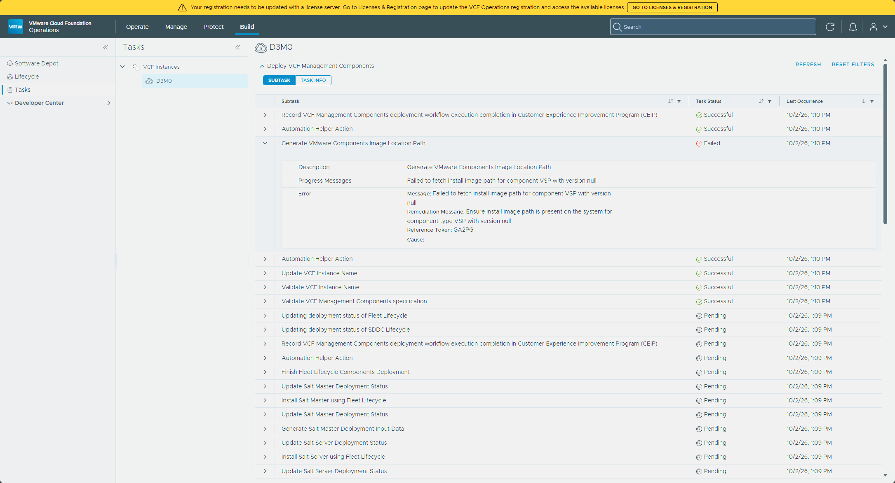

That's from my first attempt.  I then applied the workaround in [KB 441930](https://knowledge.broadcom.com/external/article/441930) and restarted the SDDC Manager services, and the retry showed the real version (9.1.1.0.25714471) but still no image path.  The failure only went away once the binaries were downloaded to SDDC Manager, because the files in my depot weren't enough on their own.

The place to fix that is SDDC Manager's own **Lifecycle Management → Binary Management** page, not the one in VCF Operations.

1. Click **Sync Now** at the top right.  Mine said "Last lifecycle metadata sync time: N/A" before I did, so nothing had synced since the upgrade.

   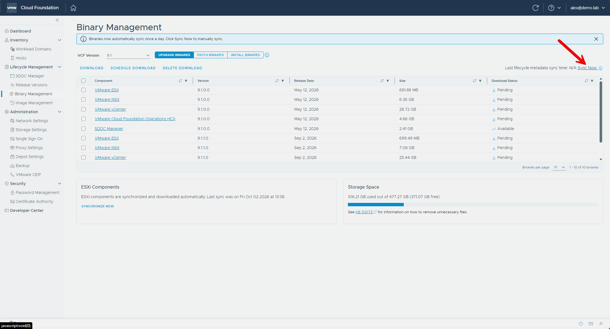

2. Open the **Install Binaries** tab.  After the sync, the management services components show up as **Available**, which means SDDC Manager can see them in the depot, not that it has them yet.
3. Tick these nine, and click **Download**.  The list is spread across pages and the table scrolls inside the page, so check each page for hidden rows.

   - SDDC lifecycle (9.1.1.0100)
   - Fleet lifecycle (9.1.1.0100)
   - VCF services runtime
   - Software depot
   - Salt RaaS
   - Salt master
   - Telemetry
   - License server
   - Identity broker

4. Open the Tasks panel and look for a **Download BUNDLE** task for each of the nine.  My first pass ended up with a download for the Migration service engine and none for the VCF services runtime, and the page still looked fine.  The VCF services runtime is the big one, and it took about eight minutes in my lab.

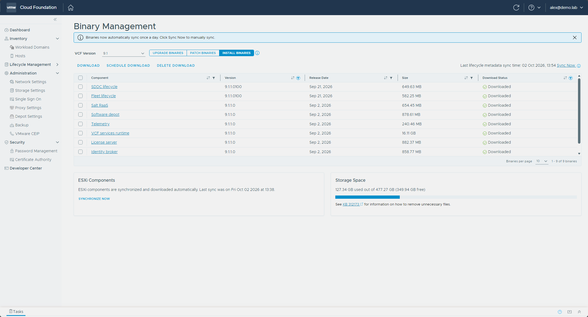

Once all nine showed **Downloaded**, I went back to the failed task and retried it, and this time it got past **Generate VMware Components Image Location Path**.

## Deploy VCF Management Services and the License Server

<aside class="info-block"><p>If a license server already exists, the deployment workflow doesn't deploy a second one (<a href="https://techdocs.broadcom.com/us/en/vmware-cis/vcf/vcf-9-0-and-later/9-1/deployment/upgrading-cloud-foundation/deploy-vcf-management-services.html">deploy docs</a>).</p></aside>

Both VCF Operations and SDDC Manager need to be at 9.1 before the deployment, which they now were.

1. In VCF Operations, go to **Build → Lifecycle → VCF Instances**, select your instance, and open the **SDDC Manager Upgrades** tab, then the **Install Management Services** tab.  Under **Next steps**, step 3 is **Install Components**, and its button just says **Install**.
2. Enter your **VCF Operations FQDN and admin credentials**, then click **Connect**.

   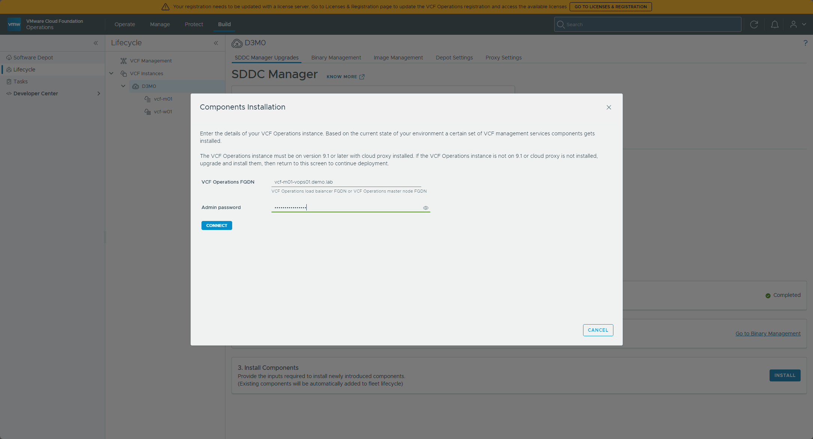

3. Fill in the configuration.  This is the moment all that DNS prep pays off, and there's more on this page than just addresses:

   - **Deployment network and Gateway CIDR:** new in 9.1.1.  Pick the network the runtime and License Server land on and, if you pick one, enter its gateway in CIDR notation.  Leave the network blank and they deploy to the VM management network.
   - **VCF services runtime IP pool:** the `/27` you reserved.
   - **VCF services runtime, fleet component, and instance component FQDNs:** the three you created, lowercase.
   - **VCF services runtime size:** this one sizes everything.  You pick a size for the runtime and every other management services component is sized from it, you don't size them individually.  The dropdown offers **Small**, **Small (High Availability)**, **Medium**, and **Large**, and Broadcom's [VCF Fleet Sizing Models](https://techdocs.broadcom.com/us/en/vmware-cis/vcf/vcf-9-0-and-later/9-1/design/vmware-cloud-foundation-concepts/vcf-fleet-sizing-models-9-x.html) page has the numbers behind each one.  I went with **Small**, which is what the planner called for in my scenario, and with my management cluster running FTT = 0, the extra nodes in the HA sizes wouldn't buy me any real resilience anyway.
   - **VCF services runtime password:** for the local `vmware-system-user` and `admin@vsp.local` accounts.
   - **Internal cluster CIDR IPv4:** the block you picked in the planning section above.
   - **Identity Broker and License Server FQDNs:** per the rules above.

   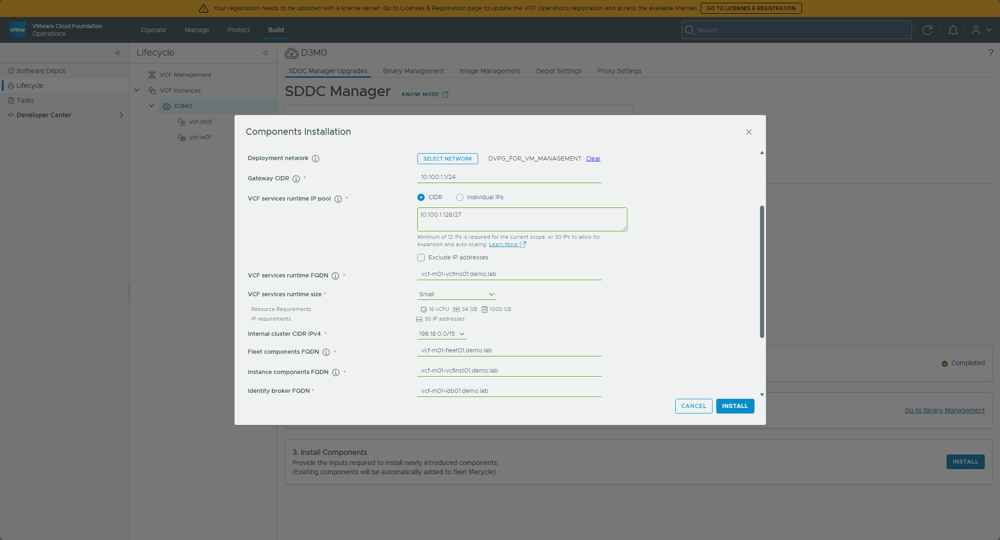

4. Click **Install**, and watch the deployment from the **Tasks** panel.

   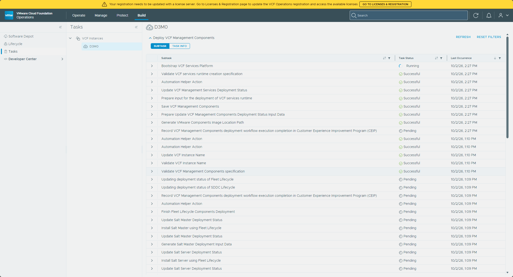

The run that completed took about three hours in my nested lab.  The **Bootstrap VCF Services Platform** subtask ran close to an hour on its own, and the four Fleet Lifecycle installs at the end (Telemetry, Identity Broker, Salt Server, and Salt Master) took about 15 minutes each.

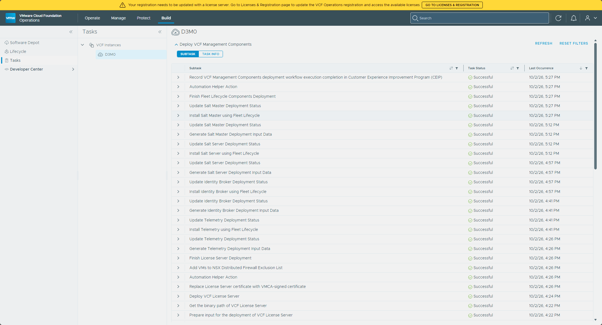

## After the deployment

<aside class="info-block"><p>Hard rule (<a href="https://techdocs.broadcom.com/us/en/vmware-cis/vcf/vcf-9-0-and-later/9-1/deployment/upgrading-cloud-foundation/deploy-vcf-management-services.html">deploy VCF Management Services</a>): <strong>after deployment, do not move the VCF Management Services VMs to a different resource pool or VM folder.</strong>  Doing so breaks subsequent patching, deployment, and scale-out operations.  The same applies to storage: <strong>Storage vMotion of these VMs is not supported</strong>, and from 9.1 EP2 onward Storage DRS is disabled for them by default.  That means leaving them exactly where the wizard puts them.</p></aside>

Before moving on, I confirmed the fleet-level software depot picked up my depot connection.  The deployment installs a software depot component for the whole fleet, and the depot settings from SDDC Manager are transferred to it on upgrade, but it should be configured before you upgrade the remaining components ([deploy docs](https://techdocs.broadcom.com/us/en/vmware-cis/vcf/vcf-9-0-and-later/9-1/deployment/upgrading-cloud-foundation/deploy-vcf-management-services.html), [Binary Management](https://techdocs.broadcom.com/us/en/vmware-cis/vcf/vcf-9-0-and-later/9-1/lifecycle-management/binary-management-for-vmware-cloud-foundation.html)).  In VCF Operations, that's **Build → Software Depot**, and if the connection isn't there, **Edit** is where the depot details go ([Configure a Software Depot Connection Mode](https://techdocs.broadcom.com/us/en/vmware-cis/vcf/vcf-9-0-and-later/9-1/lifecycle-management/binary-management-for-vmware-cloud-foundation/connect-sddc-manager-to-a-software-depot-for-downloading-bundles.html)).  Mine showed my offline depot as **Connected**, so there was nothing to change.

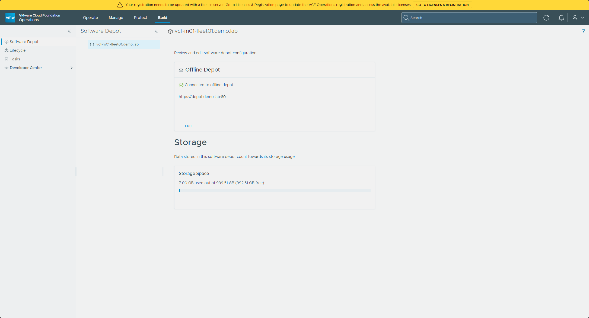

<aside class="info-block"><p>The deployment also generates a system-managed service account password for the management services components, and there's a documented way to retrieve it if you ever need it (<a href="https://techdocs.broadcom.com/us/en/vmware-cis/vcf/vcf-9-0-and-later/9-1/deployment/deploying-a-new-vmware-cloud-foundation-or-vmware-vsphere-foundation-private-cloud-/troubleshooting-vmware-cloud-foundation-or-vmware-vsphere-foundation-deployments.html">Retrieve VCF Management Services Passwords</a>).  The procedure turns on HTTP access to the vault on SDDC Manager and restarts <code>domainmanager</code>, so it's something to do only when the password is actually needed.</p></aside>

### Deleting the SDDC Manager snapshot

With the deployment finished, I deleted the snapshot from the SDDC Manager upgrade.

```powershell
Get-VM -Name 'vcf-m01-sddcm01' | Get-Snapshot -Name 'Pre-Part2-*' | Remove-Snapshot -Confirm:$false
```

In my lab that took about a minute and a half.  Then I confirmed it was gone, and this time the listing came back empty.

```powershell
Get-VM -Name 'vcf-m01-sddcm01' | Get-Snapshot | Select-Object VM, Name, Created
```

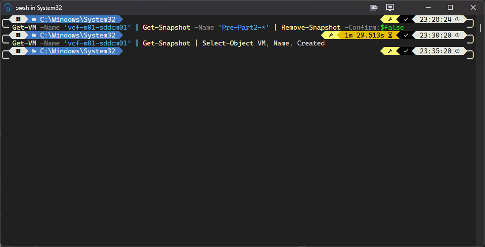

### Getting the ESX component data into an offline depot

One more thing showed up after the deployment, and it only matters with an offline depot like mine.  The **Downloading Esx metadata, vibs and vendor add-ons** task, the one SDDC Manager runs to keep its ESX component data current, started failing with "Failed to execute UMDS command: /opt/vmware/vmware-umds/bin/vmware-umds -D -m ...", with no remediation message and no reference token.

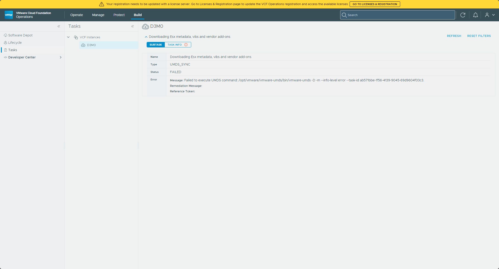

ESX component data is its own download for an offline depot, and the VCF Download Tool handles it with its `esx` commands ([Download Binaries to an Offline Depot by Using the VCF Download Tool](https://techdocs.broadcom.com/us/en/vmware-cis/vcf/vcf-9-0-and-later/9-1/lifecycle-management/binary-management-for-vmware-cloud-foundation/download-bundles-to-an-offline-depot.html)).  There are three steps, in this order: choose which host platforms to download first, then download, then synchronize.

**1. Choose the host platforms.**  I ran the tool with its defaults first, and it downloads patch content for every host platform it supports.  `./vcf-download-tool esx configuration --get` lists nine, from 6.7 up to 9.1, and I only run 9.x.  William Lam's [VCF Download Tool cheatsheet](https://williamlam.com/2026/05/vcf-9-1-vcf-download-tool-vcfdt-cheatsheet.html) suggests disabling the versions you don't need to cut the storage the depot takes, including the `esxio` platforms that are used by DPU-based hosts and `armEsx` for ESX on Arm.  This disables the seven I don't run and then shows the result:

```bash
./vcf-download-tool esx configuration -D embeddedEsx-6.7-INTL -D embeddedEsx-7.0-INTL -D embeddedEsx-8.0-INTL -D esxio-8.0-INTL -D esxio-9.0-INTL -D esxio-9.1-INTL -D armEsx-9.1-INTL
./vcf-download-tool esx configuration --get
```

Mine now lists only `embeddedEsx-9.0-INTL` and `embeddedEsx-9.1-INTL` under "Host Versions for which patch content will be downloaded".  It belongs before the first download.  I stopped my first run partway, so I removed the partial `patch-store` folder from `PROD/COMP/ESX_HOST` before running it again.

**2. Download.**  The `esx download` command authenticates with the same kind of activation code ([KB 443647](https://knowledge.broadcom.com/external/article/443647/download-token-has-been-replaced-by-acti.html) covers the change from tokens to activation codes).  I ran the download against the root of my depot:

```bash
./vcf-download-tool esx download --depot-store=/mnt/nfs/depot --depot-download-activation-code-file=~/activation_code
```

I left off `--force`, which the tool's help describes as cleaning up existing content before it downloads, and my depot store holds everything else too.  The run took about 20 minutes and finished with "1260 VIBs added out of 1260 expected VIBs".

**3. Synchronize.**  On SDDC Manager's **Binary Management** page, I clicked **Synchronize Now** on the **ESXi Components** card, and it finished successfully in about 12 minutes.

## Transferring the licenses

With the License Server live, the VCF licenses needed to move onto it.  How that works depends on whether VCF Operations is registered in connected or disconnected mode, and VCF Operations 9.1 runs in evaluation mode for up to 90 days after the upgrade, so registering and licensing it has to happen inside that window ([registration docs](https://techdocs.broadcom.com/us/en/vmware-cis/vcf/vcf-9-0-and-later/9-1/licensing/register-vcf-operations.html)).

In VCF Operations, I went to **Manage → Licensing → Licenses & Registration**.  Before I did anything, the yellow banner at the top still said my registration needed to be updated with a license server.

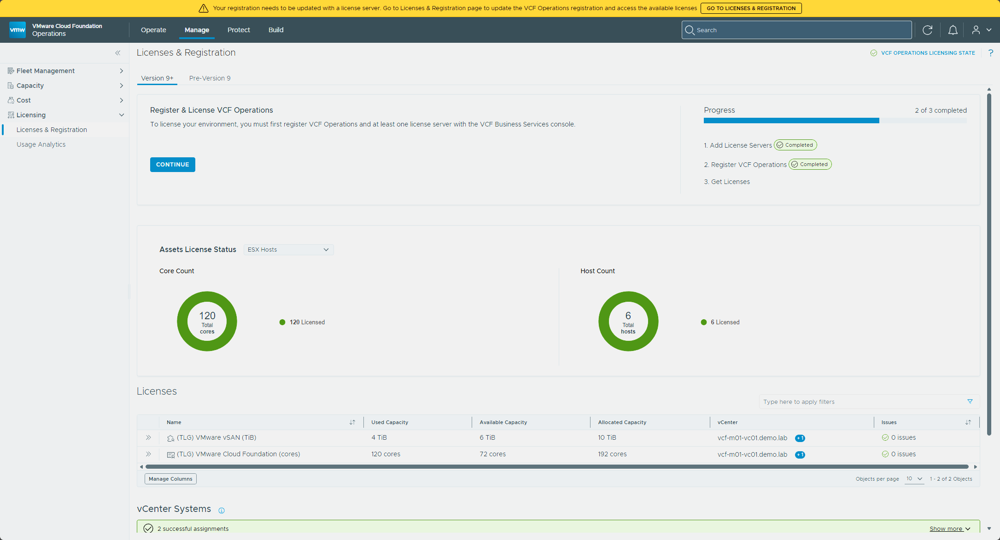

In connected mode, the license server is registered and the licenses transfer automatically, so there's nothing to do by hand ([transfer docs](https://techdocs.broadcom.com/us/en/vmware-cis/vcf/vcf-9-0-and-later/9-1/deployment/upgrading-cloud-foundation/transfer-your-licenses-after-you-upgrade-vcf-operations.html)).  Mine is in disconnected mode, the manual path where the files are moved by hand, which is a separate question from whether there's an offline depot.  I clicked **Continue** under **Register & License VCF Operations**, and the workflow opened with eight steps.  The first two were already complete for me, **Add a License Server** and **Select Connection Mode**, because the upgrade deployed the license server, and the connection mode already showed as complete.

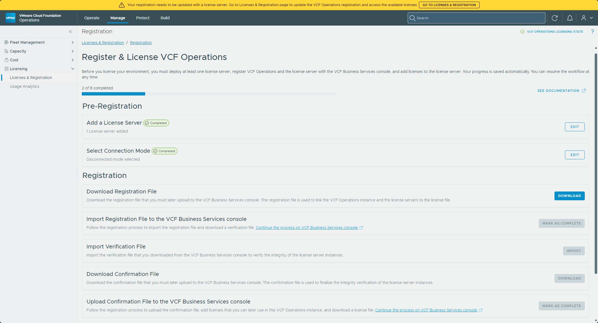

The rest follows Broadcom's [procedure](https://techdocs.broadcom.com/us/en/vmware-cis/vcf/vcf-9-0-and-later/9-1/deployment/upgrading-cloud-foundation/transfer-your-licenses-after-you-upgrade-vcf-operations.html), in the order the cards unlock.  Each one stays grayed out until the one before it is done.

1. **Download Registration File.**  Click **Download** and save the file somewhere you can reach from a computer with an internet connection.
2. **Import Registration File to the VCF Business Services console.**  Use **Continue the process on VCF Business Services console** on that card to open the console at `vcf.broadcom.com`, sign in with your Broadcom Support Portal credentials, and pick your Site ID.  Under **Licensing → VCF Operations Registrations**, upload the registration file and give the VCF Operations instance a name, and the console hands you a verification file.  Back in VCF Operations, click **Mark as Complete**.
3. **Import Verification File.**  Click **Import**, browse to the verification file, and click **Complete**.
4. **Download Confirmation File**, then upload it with the link on the **Upload Confirmation File to the VCF Business Services console** card.  The console then adds your licenses and gives you a license file to download.  Back in VCF Operations, click **Mark as Complete**.
5. **Import License File**, which sits under its own **Download Licenses** heading.  Click **Import**, browse to the license file, and click **Complete**.

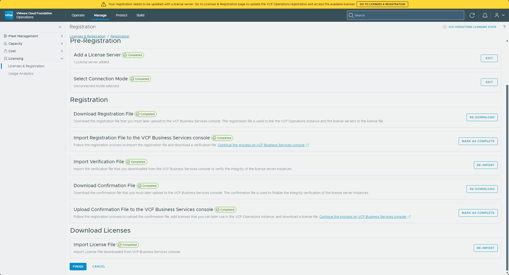

<aside class="info-block"><p>One caution: a registration file that has already registered another VCF Operations instance fails with an error if it's uploaded again.</p></aside>

After the import, a **License File Imported** dialog lists what came in.  Mine showed the licenses from the new license server, and it marked two more entries **Removed**.

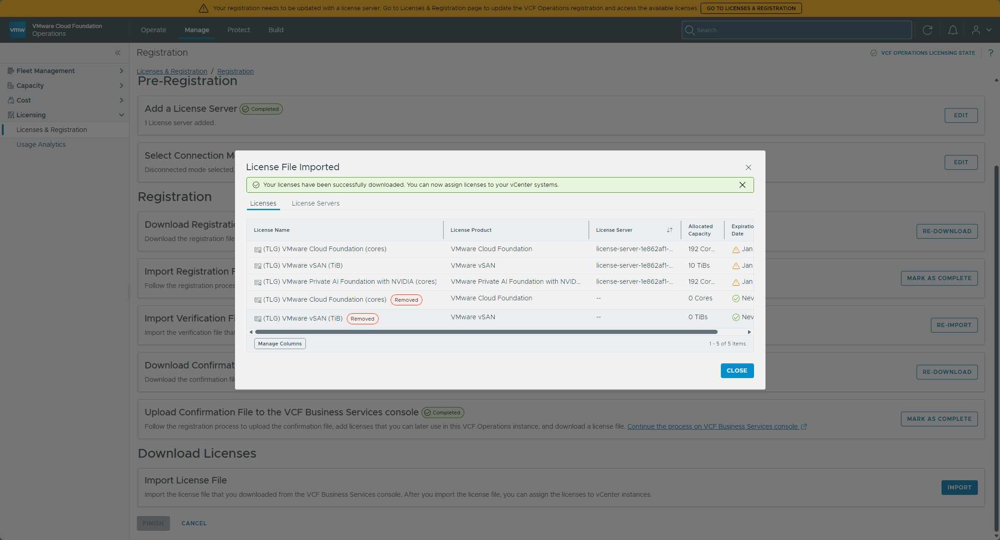

I clicked **Finish**, and the Licenses & Registration page showed the reporting mode as Disconnected.  The list afterward held five licenses, and the pair carrying my vCenter assignments had a "1 issue" link while the other three showed 0 issues.  The duplicates are supposed to disappear when the transfer completes.

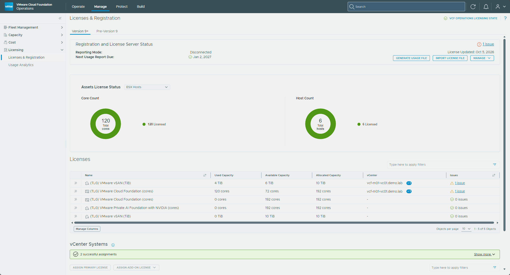

<aside class="info-block"><p><strong>Don't assign licenses while the transfer is running</strong>, because assignments made in that window might fail.  I waited until all eight steps of the workflow showed complete before I assigned anything, and the assignments went through on the first try, even though the duplicates were still listed.</p></aside>

The duplicates didn't clear right away for me.  The page also threw a dialog saying the managed vCenter systems weren't licensed by the licenses I'd just added and that I had to assign a new license to them, along with a banner saying one or more licenses were no longer associated with this VCF Operations instance but couldn't be removed.  So the licenses were not reassigned to my vCenters automatically in disconnected mode, and I did it by hand.

<aside class="info-block"><p>That's different from the transfer procedure, which says the licenses are reassigned automatically.</p></aside>

Under **vCenter Systems**, I selected both vCenters and clicked **Assign Primary License**.  The picker lists two licenses, and only one of them is marked assignable, so I picked that one and clicked **Assign**.  Then I selected both vCenters again, opened **Assign Add-on License**, and picked the assignable add-on license the same way.  Each assignment showed "in progress" for a short while and then a green "successful assignment" banner.

Once both finished, the Registration and License Server Status card showed 0 issues.  The two old licenses with nothing assigned to them still carried a "1 issue" link at that point, and it repeated the banner's wording: the license is no longer associated with this VCF Operations instance but could not be fully removed, and to complete the removal, a new license has to be assigned to the vCenter instances that have it assigned.  I left them alone, and they cleared on their own after about 15 minutes.  The list was down to the current licenses, all with 0 issues.

[KB 440715](https://knowledge.broadcom.com/external/article/440715) covers this exact situation for disconnected mode.  Its steps are to generate a usage file, upload it to the VCF Business Services console, download the matching license file, import it, and then assign the licenses to the vCenter to clear the errors.  I didn't do the usage file round trip, because my license file came out of the registration workflow above, which uses a registration file instead of a usage file.  The last step is the one that matched my situation.

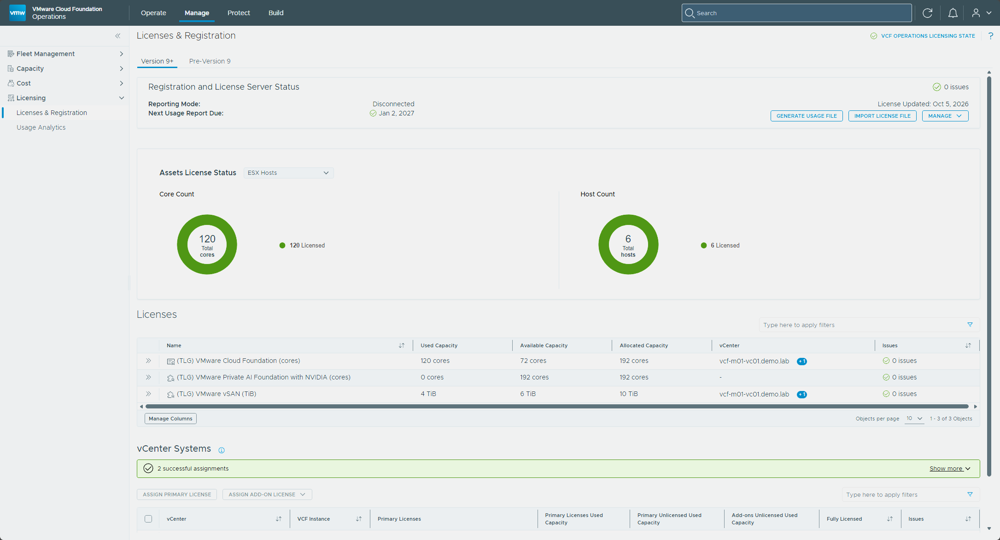

## Deleting the old Fleet Management appliance

I did this later than the rest of Part 2, once the ESX precheck in [Part 5](/posts/vcf-9-1-upgrade-part-5-esxi-nsx-edge/) flagged storage on the cluster.  The VCF Operations upgrade in Part 1 powered off `vcf-m01-vopsfm01` but left it in vCenter, with its snapshot, and the management services that replace it are now deployed.  Deleting the VM also removes the snapshot.  The first line below shows the VM, its power state, and the space it uses, and the second deletes it.

```powershell
Get-VM -Name 'vcf-m01-vopsfm01' | Select-Object Name, PowerState, UsedSpaceGB
Get-VM -Name 'vcf-m01-vopsfm01' | Remove-VM -DeletePermanently -Confirm:$false
```

The VM was powered off when I deleted it.

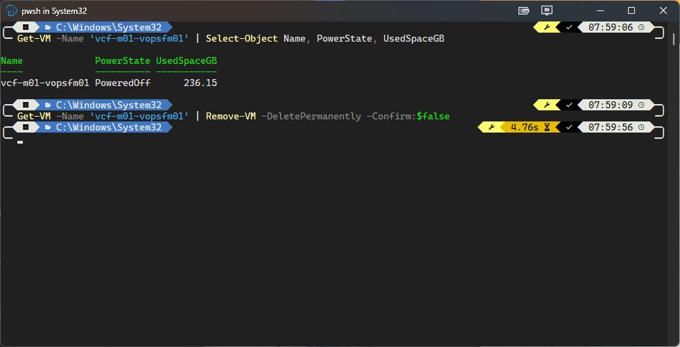

## Where things stand

At this point SDDC Manager is on 9.1, the VCF Management Services runtime and the License Server are deployed, and my licenses have moved over.

## What's next

In **[Part 3](/posts/vcf-9-1-upgrade-part-3-automation-logs/)**, I take on **VCF Automation** and **VCF Operations for Logs**, and I'll say up front that neither one is a straight in-place upgrade.  Both want their own addresses and FQDNs, so there's a second round of planning ahead.

Thanks for following along.  Drop a comment if the Management Services deployment threw you any curveballs, I'd like to hear how it went.  On to Part 3, where I tackle VCF Automation and Logs.

-virtualex-
