{
  "title": "VMware Cloud Foundation 9.1 Upgrade - Part 3: VCF Automation and Operations for Logs",
  "date": "2026-10-06T14:00:00-04:00",
  "lastmod": "2026-10-06T14:00:00-04:00",
  "slug": "vcf-9-1-upgrade-part-3-automation-logs",
  "url": "/posts/vcf-9-1-upgrade-part-3-automation-logs/",
  "draft": false,
  "description": "Part 3 of my VMware Cloud Foundation 9.0.2 to 9.1 upgrade series: upgrading VCF Automation and VCF Operations for Logs, the two components that lift the cert and password freeze window for Automation and Logs.",
  "featured_image": "part-3-automation-logs.png",
  "categories": [
    "Home Lab",
    "How-To's"
  ],
  "tags": [
    "VCF",
    "VMware",
    "vSphere",
    "VCF Operations",
    "VCF Automation",
    "Upgrade",
    "homelab"
  ],
  "years": [
    "2026"
  ],
  "aliases": [],
  "comments": []
}

With SDDC Manager and the new VCF Management Services runtime in place after [Part 2](/posts/vcf-9-1-upgrade-part-2-sddc-manager-management-services/), Part 3 tackles two more components: **VCF Automation** and **VCF Operations for Logs**.

These two matter for a reason beyond just version numbers.  As the [series overview](/posts/vcf-9-1-upgrade-series-overview/) explains, the cert and password freeze window kicked in the moment I upgraded VCF Operations back in [Part 1](/posts/vcf-9-1-upgrade-part-1-vcf-operations/).  VCF Automation and Logs are two of the four components stuck behind that freeze (the Identity Broker and VCF Operations for Networks are the others), so getting them to 9.1 lifts it for them.

## Two conditional steps around Automation

Two components can slot in around VCF Automation depending on how the environment is built, and neither applies in my lab, so I'll flag them and move on.  An **Identity Broker in appliance mode** is upgraded from the **Build → Lifecycle → VCF Management → Upgrade** tab, and it goes **before** Automation in the official order.  A **standalone VCF Operations Orchestrator** upgrades on its own **after** Automation, and it's an ISO-based upgrade ([Upgrade to VCF Operations Orchestrator 9.1](https://techdocs.broadcom.com/us/en/vmware-cis/vcf/vcf-9-0-and-later/9-1/deployment/upgrading-cloud-foundation/upgrade-a-standalone-or-clustered-vrealize-orchestrator-8-0-1-deployment-with-iso-image.html)).  I'm on the embedded broker, which upgrades with vCenter in [Part 4](/posts/vcf-9-1-upgrade-part-4-nsx-vcenter/), so neither shows up in my walkthrough.

## Upgrading VCF Automation

VCF Automation (the product formerly known as Aria Automation) is driven from the VCF Operations Lifecycle UI, and the important thing to understand is that **this is not an in-place upgrade.**  The 9.1 upgrade stands up a brand new VCF Automation instance on its own dedicated VCF services runtime, transfers the existing FQDN to it, and then shuts down the old nodes ([Upgrading to VCF Automation 9.1](https://techdocs.broadcom.com/us/en/vmware-cis/vcf/vcf-9-0-and-later/9-1/deployment/upgrading-cloud-foundation/phase-3-import-and-upgrade-aria-automation-8-to-vcf-automation-9.html)).

That side-by-side approach means there's address prep to do first, same as there was for Management Services back in Part 2.

### Planning the addresses

For a Simple, Small deployment, the requirements are:

| Purpose | What's needed |
| --- | --- |
| VCF Automation node IP pool *(new)* | Five addresses are required: 3 consumed by the nodes and 2 held as a buffer.  The wizard takes a CIDR such as a `/29`, which covers eight addresses, or five individual IPs, contiguous or not |
| VCF services runtime FQDN *(new)* | One new lowercase FQDN, resolving outside that pool |
| VCF Automation VIP *(re-used)* | Nothing to do, the existing Automation FQDN carries over automatically |

Here's what I reserved in my lab, on the same `10.100.1.0/24` management network my current Automation nodes use:

| Purpose | FQDN | IP | DNS |
| --- | --- | --- | --- |
| Automation node pool (reserve in IPAM only) | n/a | `10.100.1.160/29` reserved in IPAM, entered as a CIDR in the wizard | none per-host |
| Automation services runtime | `vcf-m01-vautort01` | `10.100.1.69` | A + PTR |
| VCF Automation VIP *(unchanged)* | `vcf-m01-vauto01` | `10.100.1.55` | already exists |

<aside class="info-block"><p>The new addresses have to sit on the <strong>same network the current Automation nodes live on</strong>.  The CIDR block and FQDN from the Management Services runtime I deployed in Part 2 can't be reused, because this runtime is dedicated to Automation.  The old 9.0.x nodes are shut down rather than deleted, so their addresses are free again once they're deleted.</p></aside>

Two more prerequisites.  The existing 9.0.x VCF Automation must be deployed in the **management domain**, not in a workload domain ([upgrade docs](https://techdocs.broadcom.com/us/en/vmware-cis/vcf/vcf-9-0-and-later/9-1/deployment/upgrading-cloud-foundation.html)).  And the **Subject Alternative Name** field on the VCF Automation certificate needs to contain the FQDNs and IP addresses of all Automation nodes plus the load balancer or VIP ([upgrade docs](https://techdocs.broadcom.com/us/en/vmware-cis/vcf/vcf-9-0-and-later/9-1/deployment/upgrading-cloud-foundation/phase-3-import-and-upgrade-aria-automation-8-to-vcf-automation-9.html)).

Beyond those, a short pre-flight list.  The fleet-level software depot from Part 2 has to be configured, with the upgrade binaries downloaded into it.  The **Check Required Binaries** panel on the **Upgrade** tab lists what the target version expects, and for me that was VCF Automation 9.1.1.0100.25757808 and log management 9.1.1.0.25679624.  The cloud accounts for the VCF Automation integration also have to be validated with **validate connection** in VCF Operations before the wizard relies on them, and the Data Services Manager upgrade guidance has to be worked through first if DSM is integrated with Automation.  The vSphere account VCF Operations uses needs the documented Aria Suite Lifecycle role privileges on the management vCenter ([upgrade docs](https://techdocs.broadcom.com/us/en/vmware-cis/vcf/vcf-9-0-and-later/9-1/deployment/upgrading-cloud-foundation/phase-3-import-and-upgrade-aria-automation-8-to-vcf-automation-9.html)), which is a long table but comes down to broad rights over VMs, datastores, networks, content libraries, and service accounts.  And the management cluster needs room for the new instance, because the existing instance stays active while the new one is provisioned, so for a stretch it carries both.

### Running the upgrade

<aside class="info-block"><p><strong>Backing up the 9.0.2 components didn't work for me.</strong>  I tried an on-demand backup of VCF Automation and log management from <strong>Back Up Now</strong>, and it failed right away with "version '9.0.2.0100.25300779' which is invalid for backup generation", so that button isn't an option for the 9.0.2 components.  Broadcom's 9.0 documentation also describes an on-demand backup from the VCF Automation component page, but that page has no backup option on my 9.0.2 instance.  There's no documented snapshot procedure for VCF Automation either, and I didn't take one myself, because the platform's health checks include one that fails when any cluster node has a VM snapshot (<a href="https://knowledge.broadcom.com/external/article/389510">KB 389510</a>).</p></aside>

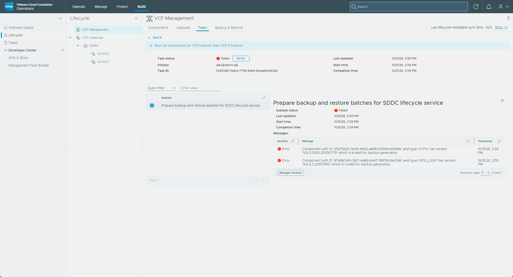

1. **Set up the backup location first.**  Configure the SFTP backup location under **Build → Lifecycle → VCF Management → Backup & Restore → Add Backup Location**.  It's a prerequisite for patching or upgrading VCF management services components, and it's where the automatic backups taken during upgrades go ([Configure an External SFTP Server for VCF Management Services and VCF Automation Backups](https://techdocs.broadcom.com/us/en/vmware-cis/vcf/vcf-9-0-and-later/9-1/fleet-management/backup-and-restore-of-cloud-foundation/configure-backup-target-and-schedules-in-vmware-cloud-foundation/configure-sftp-backup-target-in-vmware-cloud-foundation-operations.html)).
2. In VCF Operations, go to **Build → Lifecycle**, click **VCF Management**, and open the **Upgrade** tab.
3. Next to the VCF Automation instance, select **Configure**.

   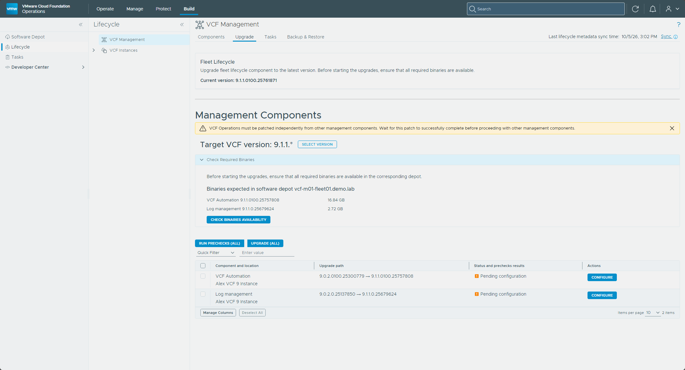

4. On the **Parameters** page, fill in the runtime nodes IP pool, the new VCF services runtime FQDN, and a password for the Automation `vmware-system-user` and `admin@vsp.local` accounts.  It needs at least 15 characters and a special character from `@ ! # $ % ? ^`.  The password field has **Copy to clipboard** and **Re-generate** links and warns that you won't be able to see the password again after the deployment, so save it somewhere safe first.  The IP pool takes either a **CIDR** or **Individual IPs**, with a minimum of five, and I entered `10.100.1.160/29`.  The page also carries a warning that support for public cloud endpoints is deprecated starting with VCF Automation 9.1.1 and will be turned off by default upon upgrade.  Select **Next**.

   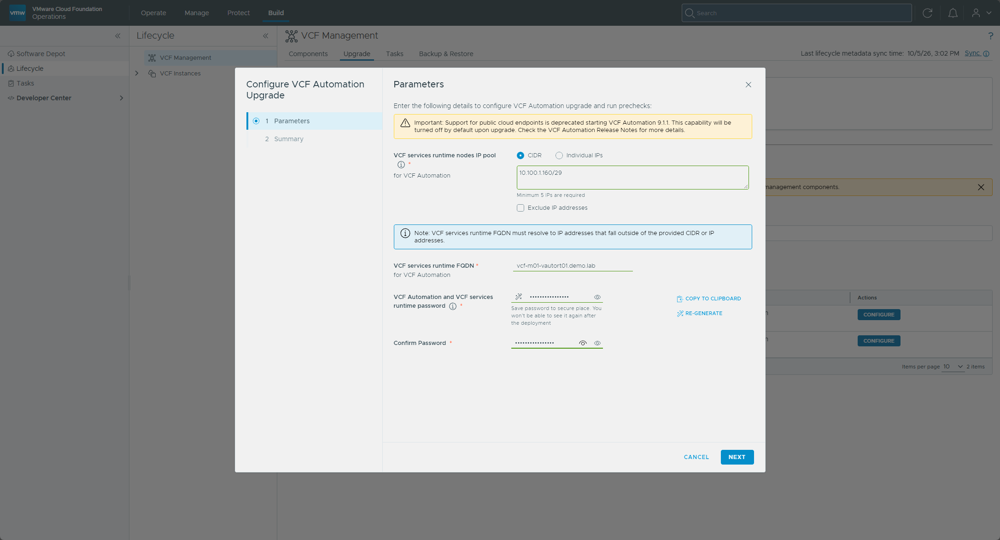
5. Review the **Summary** and select **Finish**.
6. Back on the **Upgrade** tab, select **Run Prechecks**.  Watch via **Precheck details**, remediate any failures, and run them again until clean.  Mine failed the first time, which I cover in the note after these steps.

   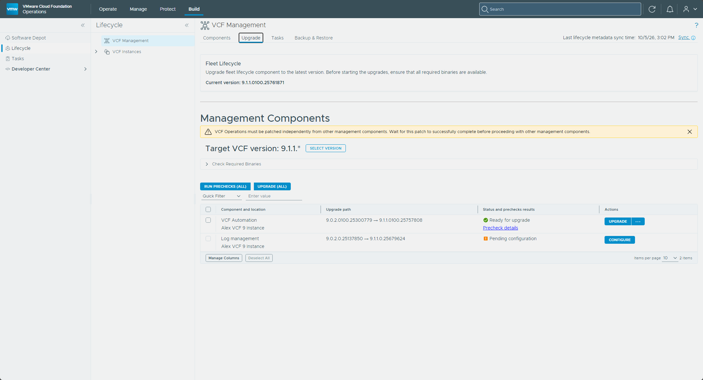
7. With prechecks green, the **Run Prechecks** button becomes **Upgrade**.  Select it and track the task under **Tasks**.  The **...** menu next to it has a **Reconfigure** option if you need to change the parameters.

   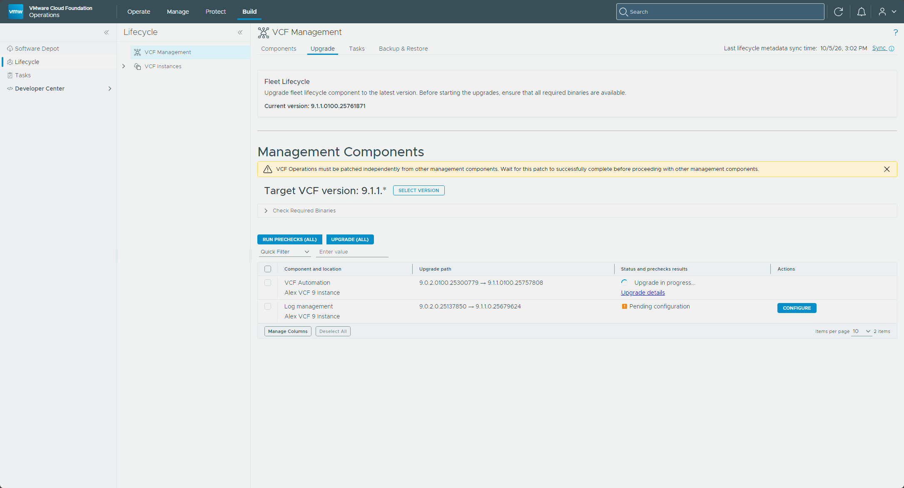

<aside class="info-block"><p><strong>My first precheck failed.</strong>  It stopped in the <strong>Import Source Component Configuration</strong> stage with "Platform Health Check Error [platform-deployments-core : 1 of 27 resources are not ok: synthetic-checker: wrong resource state: Failed - Progress deadline exceeded;] [VCFMS-HEALTH-002]", and the UI showed nothing more than In Progress for a while.  On the 9.0.2 Automation node, 976 pods were stuck in Pending.  The kube-scheduler had stopped, but containerd still listed its container as running, so nothing ever restarted it and no new pod could be scheduled.  I deleted the stale cronjob Jobs, killed the orphaned containerd shim for the scheduler pod, and restarted containerd.  The kubelet then started a fresh scheduler, the backlog cleared, every health check went green, and clicking <strong>Retry</strong> on the failed task picked up at the import stage and passed.</p></aside>

The platform's own health check is the quick way to see what it thinks of itself.  It lives on the VIP at port 30006, returns HTTP 200 when every test passes and 218 when some fail, and the body lists each test ([KB 389510](https://knowledge.broadcom.com/external/article/389510)).

```bash
curl -k -s -o /dev/null -w "%{http_code}\n" https://<vcf-automation-vip>:30006/status
```

[VMware's deep dive](https://blogs.vmware.com/cloud-foundation/2026/07/27/modernizing-infrastructure-a-deep-dive-into-the-vmware-cloud-foundation-automation-9-0-to-9-1-upgrade-precheck-and-execution-stages/) describes what the workflow does.  It creates a `vcf-automation` folder on the management vCenter and spins up a temporary bootstrap VM that clones the new 9.1 nodes and hands them addresses from the CIDR.  Once the new cluster is ready, it takes a full backup of the source, scales the source services down, transfers the data across, powers off the old 9.0.x nodes, finishes the Postgres upgrade, and registers the new instance with Fleet Lifecycle.  The prechecks need SSH on port 22 open to the existing Automation nodes and enough disk I/O headroom to pass a 30-second latency test against the Postgres pods.

Once it completes, check **Build → Lifecycle → VCF Management**.  In my lab the **Components** tab listed VCF Automation at `9.1.1.0100.25757808` on `vcf-m01-vauto01.demo.lab`, and the About dialog in the Automation UI showed `9.1.1-0100-25757808`.

<aside class="info-block"><p>The migration service engine wasn't listed there as its own component.  It has its own 9.1.1.0100 patch, and if it needs patching, that should happen only <em>after</em> Automation is on 9.1.1, because the engine needs database changes that only ship with Automation 9.1.1 and patching it first fails after a timeout that runs for several hours (<a href="https://techdocs.broadcom.com/us/en/vmware-cis/vcf/vcf-9-0-and-later/9-1/release-notes/patch-releases-9-1-1-x/vcf-automation/migration-service-engine-9-1-1-0100-release-notes.html">migration service engine release notes</a>, <a href="https://techdocs.broadcom.com/us/en/vmware-cis/vcf/vcf-9-0-and-later/9-1/release-notes/vmware-cloud-foundation-9-1-1-0-release-notes/vcfautomation-9-1-1-0-release-notes.html">VCF Automation 9.1.1 release notes</a>).</p></aside>

The upgrade task succeeded in my lab.  When it finished, the old node `vcf-m01-vauto01-gnww7` was powered off and still in vCenter, and the Automation VIP answered on the new cluster.  I could sign in to the new Automation UI as `admin`, and it opened on the Welcome to VCF Automation page.

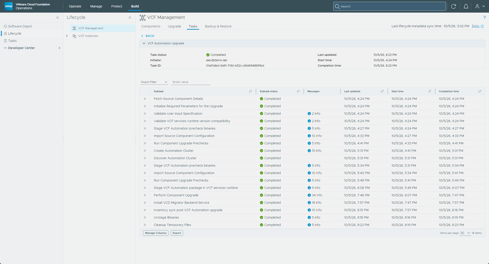

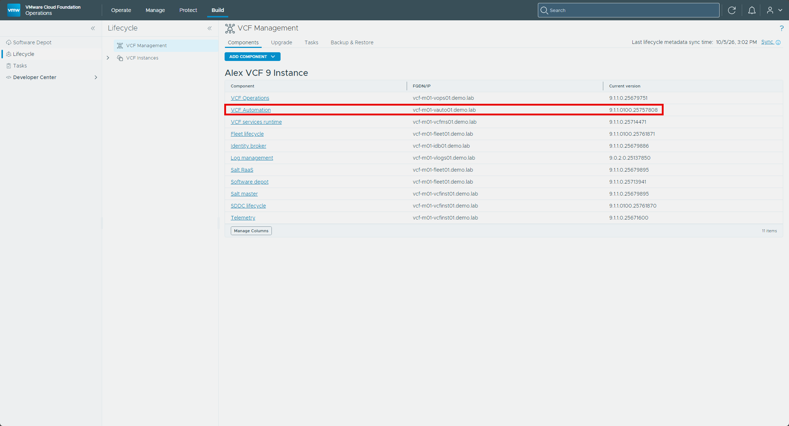

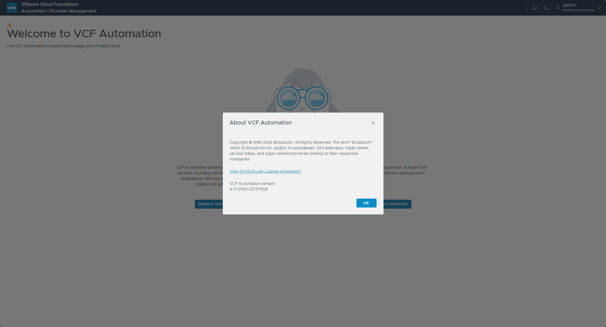

## VCF Operations for Networks

I don't run VCF Operations for Networks (the product formerly known as Aria Operations for Networks, and vRealize Network Insight before that) in this lab, so it isn't part of my hands-on walkthrough.  This is where it would slot in, though: the upgrade order places it after VCF Automation (and after a standalone Orchestrator, if there is one) and just before Logs ([upgrade order](https://techdocs.broadcom.com/us/en/vmware-cis/vcf/vcf-9-0-and-later/9-1/deployment/upgrading-cloud-foundation.html)).

Broadcom's [Upgrade to VCF Operations for Networks 9.1](https://techdocs.broadcom.com/us/en/vmware-cis/vcf/vcf-9-0-and-later/9-1/deployment/upgrading-cloud-foundation/phase-4-upgrade-additional-management-components-in-vcf-9.html) procedure covers it.

## Upgrading VCF Operations for Logs

Next up is **VCF Operations for Logs** (the log management appliance, formerly Aria Operations for Logs, and Log Insight before that).  In my lab this is a deployed, powered-on appliance.

<aside class="info-block"><p>One thing I noticed after Part 1.  With VCF Operations on 9.1, the <strong>Log Collection</strong> page under <strong>Administration → Configurations</strong> turned into a "Start Monitoring with Logs" page with an <strong>Install Log Management</strong> button, even though my 9.0.x Logs appliance was still running.  Broadcom's <a href="https://techdocs.broadcom.com/us/en/vmware-cis/vcf/vcf-9-0-and-later/9-1/deployment/upgrading-cloud-foundation/upgrade-vcf-operations-for-logs.html">upgrade page</a> has the upgrade run from the lifecycle <strong>Upgrade</strong> tab described below, not from that button.</p></aside>

Like VCF Automation, this one isn't a straight in-place upgrade either.  In 9.1 log management becomes part of VCF Management Services, and the wizard puts it this way: to upgrade log management to 9.1.1 you **deploy a new instance and migrate data manually after the deployment**.  After the post-upgrade configuration you can shut down and remove the legacy appliance, and for 90 days after the upgrade you can query the old cluster's logs ([upgrade page](https://techdocs.broadcom.com/us/en/vmware-cis/vcf/vcf-9-0-and-later/9-1/deployment/upgrading-cloud-foundation/upgrade-vcf-operations-for-logs.html)).

### Planning the FQDN

Log management 9.1 needs **one new, unique FQDN**, resolving to an address on the same network as the VCF Management Services.  It has to be lowercase, and it can't point into the IP range I handed to Management Services back in Part 2.  In my lab that's `vcf-m01-vlogs02` on `10.100.1.59`, with A and PTR records, sitting right next to the 9.0.x appliance (`vcf-m01-vlogs01` on `.58`) it's replacing.  The wizard says the FQDN of the existing 9.0.x appliance can't be reused.

<aside class="info-block"><p>One blocker to check before anything else: if the current Logs appliance sits on a <strong>custom NSX overlay network</strong>, log management 9.1 can't be deployed there (<a href="https://techdocs.broadcom.com/us/en/vmware-cis/vcf/vcf-9-0-and-later/9-1/deployment/upgrading-cloud-foundation/upgrade-vcf-operations-for-logs.html">upgrade page</a>).</p></aside>

### Running the upgrade

1. In VCF Operations, go to **Build → Lifecycle**, click **VCF Management**, and open the **Upgrade** tab.
2. Next to the log management component, select **Configure**.

   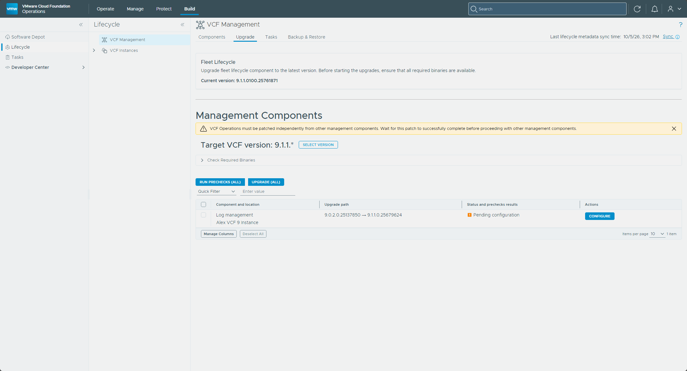

3. In the **Configure Log Management Upgrade** wizard, enter your new **log management FQDN**, pick a **size** (Small, Medium, or Large), and set the **number of replicas**.  I picked Small, and the replicas field started at 1, with a note that the max for the small size is 19.  Select **Next**, and the **Summary** lists the version (`9.1.1.0.25679624`), the FQDN, the size, and the number of replicas.  Select **Finish**.

   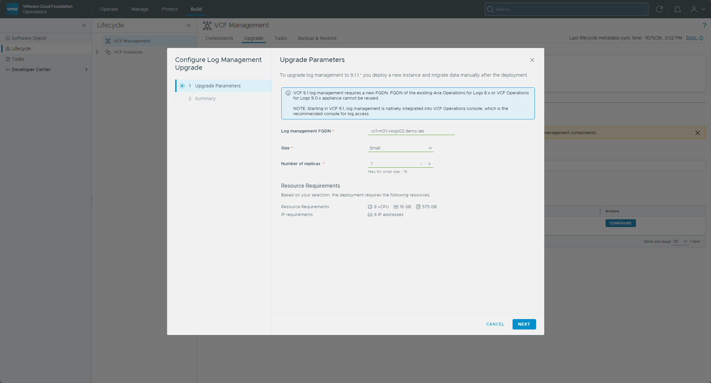
4. Back on the **Upgrade** tab, the row shows **Configuration in progress** for a bit and then **Ready for upgrade**, with an **Upgrade** button next to the log management component.  Select it, and track it via **Upgrade details**.
5. Broadcom's procedure ends with the upgrade report: after the upgrade completes, open the **Tasks** tab, click the log management task, then the **Upgrade report** icon to download it ([upgrade page](https://techdocs.broadcom.com/us/en/vmware-cis/vcf/vcf-9-0-and-later/9-1/deployment/upgrading-cloud-foundation/upgrade-vcf-operations-for-logs.html)).  Mine never got that far.

<aside class="info-block"><p><strong>My log management upgrade failed, and retrying didn't help.</strong>  The new instance deployed, but the task sat in <strong>Deploy Log management Cluster</strong> and finally failed with "Fleet LCM migrate task timed out".  In VCF Operations, the step that pulls the old appliance's configuration into the new instance had failed with OPSLOGS00003, "Failed to pull legacy configurations to Log management".  Fleet Lifecycle kept retrying the registration with VCF Operations on its own, and every attempt failed the same way.</p></aside>

The real error was in VCF Operations' own logs.  Under **Operate → Administration → Control Panel → Support Logs**, I expanded my VCF Operations node, then the **OTHER** folder, and opened **component-manager-plugin.log**.  Searching it for `componentCategory` and reading the lines just above the stack trace showed VCF Operations calling the new instance at `https://vcf-m01-vlogs02.demo.lab:9543/api/v2/log-configs/legacy/pull`, and the new instance answering HTTP 500 with `Cannot invoke "String.equals(Object)" because "config.componentCategory" is null`.

That pull reads the log collection records stored on the old 9.0.2 appliance.  The log collection setting on the vCenter's account in VCF Operations was grayed out with "Log Management component is required", and the old appliance's vSphere integration page listed no servers.

So I took the documented way out.  Broadcom's cleanup script from [KB 441333](https://knowledge.broadcom.com/external/article/441333/scripted-components-cleanup-from-vcf-ope.html) removes a failed log management deployment from Fleet Lifecycle and from the VCF services runtime, and the KB notes that the existing Operations for Logs instance continues to function.  The `list` command shows the component IDs, and `delete` removes one after asking for confirmation.  Both ask for the `admin@vsp.local` password, which the KB says is the same as the runtime's `vmware-system-user` password.  In my lab, Fleet is `vcf-m01-fleet01.demo.lab` and the runtime is `vcf-m01-vcfms01.demo.lab`.

```bash
python cleanup_component.py list vsp-component --fleet-fqdn <fleet-fqdn> --vcf-services-runtime-fqdn <runtime-fqdn> --vcf-services-runtime-username admin@vsp.local
python cleanup_component.py delete vsp-component --component-id <log-management-id> --fleet-fqdn <fleet-fqdn> --vcf-services-runtime-fqdn <runtime-fqdn> --vcf-services-runtime-username admin@vsp.local
```

With the old record gone from Fleet Lifecycle and the runtime, I deployed log management fresh instead of upgrading.  In VCF Operations that's **Build → Lifecycle → VCF Management**, then **Components → Add component → Log management** ([Deploy Log Management](https://techdocs.broadcom.com/us/en/vmware-cis/vcf/vcf-9-0-and-later/9-1/deployment/deploying-a-new-vmware-cloud-foundation-or-vmware-vsphere-foundation-private-cloud-/manual-deployment-of-components-to-complete-your-vcf-platform/installing-vcf-logs.html)).  I chose version 9.1.1.0, left **Import configurations from an existing log management 8.x or 9.0.x instance** unticked, because the import is the step that failed, and entered the same FQDN, `vcf-m01-vlogs02.demo.lab`, which was free again.  I picked Small with 1 replica.  A yellow warning said deploying it requires resizing VCF Management Services on my instance, may disrupt existing components on that cluster while it resizes, and recommended a maintenance window, with a box to tick to continue.  I ticked it and started the deployment, and the Tasks panel showed it as an install task.

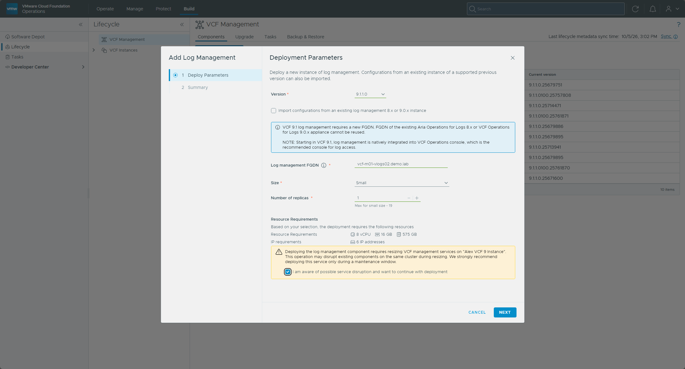

This one finished.  The **Components** tab now lists **Log management** on `vcf-m01-vlogs02.demo.lab` at `9.1.1.0.25679624`.

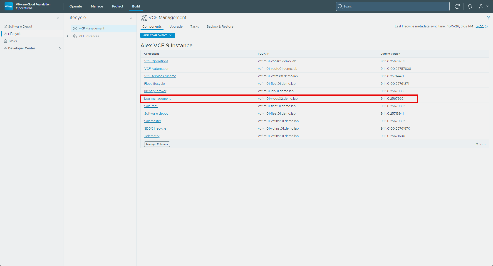

### What's left after the deployment

Broadcom's follow-up list is written for the import case, where the new instance receives the old configuration, and it's the checklist for an upgrade that goes the normal way ([Deploy Log Management](https://techdocs.broadcom.com/us/en/vmware-cis/vcf/vcf-9-0-and-later/9-1/deployment/deploying-a-new-vmware-cloud-foundation-or-vmware-vsphere-foundation-private-cloud-/manual-deployment-of-components-to-complete-your-vcf-platform/installing-vcf-logs.html), [upgrade page](https://techdocs.broadcom.com/us/en/vmware-cis/vcf/vcf-9-0-and-later/9-1/deployment/upgrading-cloud-foundation/upgrade-vcf-operations-for-logs.html)).  Here is the post-upgrade list:

- **Agents.**  With an import from 9.0 and log collection configured in the VCF Operations 9.0 UI, the agent and log source reconfiguration is automatic.
- **Log sources.**  Anything that didn't transition on its own needs repointing at the new instance.
- **Log forwarding.**  Imported forwarders are copied over but are **not active**, so they have to be re-enabled by hand, and any forwarder that points at the old cluster has to be reconfigured to use the new log management FQDN.
- **Custom content.**  Dashboards, queries, and alerts are not transferred automatically.  The path is to bundle them into a Content Pack, run the conversion tool to turn that into a Management Pack, then install it into VCF Operations.
- **Historical log data.**  You can use the log data transfer utility, import archived data and query it in the new UI, or, for 90 days after the upgrade, query the old cluster through the new 9.1 UI.

Once that configuration is finished, the legacy appliances can be shut down and removed.

I skipped the import, so none of that was copied across for me.  Once log management existed, the **Activate Log Collection** box on both of my vCenter accounts in VCF Operations was usable and already ticked, and the **Log Collection** page under **Administration → Configurations** listed both vCenters under Log Sources, with the cloud proxy as the collector and a status of **Configured**.  On each vCenter's log collection configuration page, **vCenter Events, Tasks and Alarms Collection** was ticked and **vCenter Log Collection** was not, so I turned on **vCenter Log Collection** for both vCenters and saved.  The 90-day query of the old cluster is promised after an *upgrade*, and I haven't confirmed that it works after a fresh deployment, so I'd check before removing an appliance that holds logs I want.

NSX didn't follow.  On the **Log Collection** page both NSX sources show a status of **Failed**, with "Unexpected Status Code - Status code: 404" and a pointer to [KB 433089](https://knowledge.broadcom.com/external/article/433089/known-issues-and-limitations-for-log-col.html).  Both NSX sources showed **Received** by the end of the series, which I come back to in [Part 6](/posts/vcf-9-1-upgrade-part-6-housekeeping-workload-domain/).

With the vCenters sending to the new instance, I powered off `vcf-m01-vlogs01`.  Powering off is reversible, which is why that comes before deleting it.

## Deleting the old appliances

I did this later than the rest of Part 3, once the ESX precheck in [Part 5](/posts/vcf-9-1-upgrade-part-5-esxi-nsx-edge/) flagged storage on the cluster.  The upgrade shut down the old 9.0.x Automation node `vcf-m01-vauto01-gnww7` rather than deleting it, and `vcf-m01-vlogs01` is the old Logs appliance I powered off after the fresh deployment.  Both are still in vCenter.  Deleting `vcf-m01-vlogs01` also ends the option of querying its old logs.

```powershell
Get-VM -Name 'vcf-m01-vauto01-gnww7','vcf-m01-vlogs01' | Select-Object Name, PowerState, UsedSpaceGB
Get-VM -Name 'vcf-m01-vauto01-gnww7','vcf-m01-vlogs01' | Remove-VM -DeletePermanently -Confirm:$false
```

Both were powered off before I deleted them.

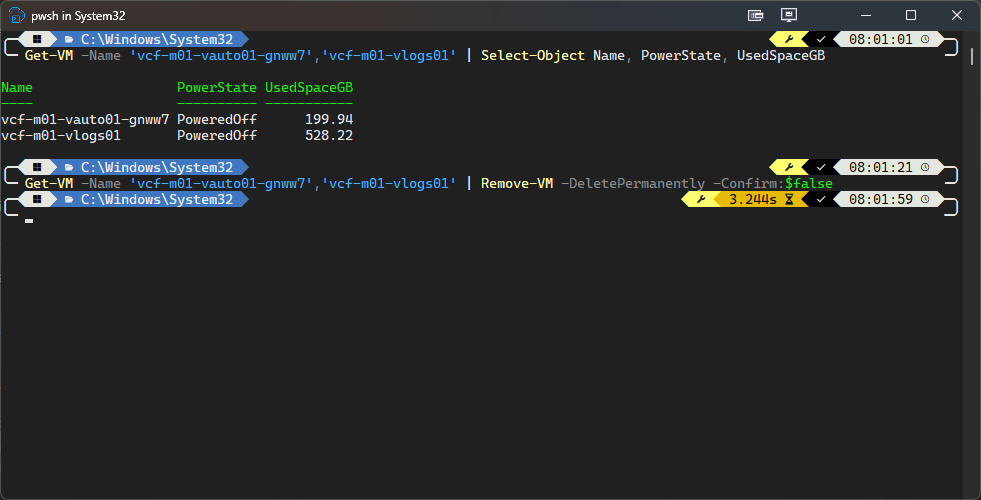

## The freeze window lifts

With VCF Automation and VCF Operations for Logs both on 9.1 (plus VCF Operations for Networks, where there is one), the cert and password freeze window from Part 1 is lifted for those components.  The Identity Broker is the other component behind it, and it comes along in Part 4 if it's embedded.  Any cert rotations or password resets parked because of the freeze can be picked back up for those components now.

## What's next

In **[Part 4](/posts/vcf-9-1-upgrade-part-4-nsx-vcenter/)**, I move into the core infrastructure with **NSX Manager** and **vCenter**.

Drop a comment and let me know how the Automation and Log Management steps went for you.

-virtualex-
