{
  "title": "VMware Cloud Foundation 9.1 Upgrade - Part 4: NSX and vCenter",
  "date": "2026-10-07T20:00:00-04:00",
  "lastmod": "2026-10-07T20:00:00-04:00",
  "slug": "vcf-9-1-upgrade-part-4-nsx-vcenter",
  "url": "/posts/vcf-9-1-upgrade-part-4-nsx-vcenter/",
  "draft": false,
  "description": "Part 4 of my VMware Cloud Foundation 9.0.2 to 9.1 upgrade series: planning and running the NSX Manager and vCenter upgrades from the VCF Operations Lifecycle UI.",
  "featured_image": "part-4-nsx-vcenter.png",
  "categories": [
    "Home Lab",
    "How-To's"
  ],
  "tags": [
    "VCF",
    "VMware",
    "vSphere",
    "NSX",
    "vCenter",
    "VCF Operations",
    "Upgrade",
    "homelab"
  ],
  "years": [
    "2026"
  ],
  "aliases": [],
  "comments": []
}

With the management components handled in Parts [1](/posts/vcf-9-1-upgrade-part-1-vcf-operations/) to [3](/posts/vcf-9-1-upgrade-part-3-automation-logs/), Part 4 moves to the core infrastructure: **NSX Manager** and **vCenter**.  The [series overview](/posts/vcf-9-1-upgrade-series-overview/) has the environment details and prerequisites.

Everything here is driven from the VCF Operations Lifecycle UI, the same place I've worked since [Part 2](/posts/vcf-9-1-upgrade-part-2-sddc-manager-management-services/).  Broadcom's flow is to plan the domain upgrade, run the prechecks, then work through the sequence one component at a time, NSX Manager first and then vCenter ([Upgrading vCenter and NSX Manager](https://techdocs.broadcom.com/us/en/vmware-cis/vcf/vcf-9-0-and-later/9-1/deployment/upgrading-cloud-foundation/upgrade-the-management-domain-to-vmware-cloud-foundation-5-2/updating-vcenter-and-nsx.html)).

## Where I'm starting from

Before touching anything, I checked where everything stood.  Both domains were ACTIVE, and both vCenters and both NSX Managers were still on 9.0.2.  Each domain has a single NSX Manager node.

## What has to be in place first

Broadcom's prerequisites call for backups of SDDC Manager and every vCenter and NSX Manager instance, either file-based or image-based, plus a cold snapshot of SDDC Manager ([upgrade prerequisites](https://techdocs.broadcom.com/us/en/vmware-cis/vcf/vcf-9-0-and-later/9-1/deployment/upgrading-cloud-foundation/upgrade-the-management-domain-to-vmware-cloud-foundation-5-2/upgrade-prequisites.html)).

The prerequisites page lists a few more things.  None of the vCenters should be joined to an Active Directory domain, and there shouldn't be any expired or soon-to-expire passwords or certificates on the components being upgraded.  The vSAN HCL database has to be updated by hand, and the hardware has to be on the HCL.  There should be no failed workflows, nothing in an activating or error state, and no active alarms.  ESX hosts with TPM modules in use need the latest 2.0 firmware, and if they aren't in use they must be disabled in the BIOS ([KB 312159](https://knowledge.broadcom.com/external/article/312159) covers TPM support).  The vCenters also have to be licensed through the new License Server from Part 2, and [KB 440471](https://knowledge.broadcom.com/external/article/440471/one-or-more-vcenter-instances-are-not-co.html) documents the licensing errors that follow the vCenter upgrade when they aren't.

<aside class="info-block"><p>The upgrade planner flags one more item for a 9.0.x vCenter going to 9.1.1.0, as its vCenter pre-update check warning.  The vCenter NTP precheck fails with "Unable to run vCenter NTP server check" on appliances configured with a non-UTC time zone, and the fix is to set the time zone to UTC on the vCenter VAMI page under <strong>Time → Time Zone</strong> (<a href="https://knowledge.broadcom.com/external/article/455439">KB 455439</a>).</p></aside>

## Getting ready

I made sure both vCenters were on UTC, ran **Backup Now** from **Administration → Backup** in SDDC Manager, ran a file-based backup of each vCenter from its VAMI page, and backed up the NSX Managers too.  Then I took the SDDC Manager snapshot, with the same no-memory, no-quiesce settings as Parts 1 and 2:

```powershell
Get-VM -Name 'vcf-m01-sddcm01' -ErrorAction Stop |
    New-Snapshot -Name 'Pre-Part4-SDDC-Manager-9.1.1' `
        -Description 'Before NSX and vCenter upgrade to 9.1.1' `
        -Memory:$false -Quiesce:$false
```

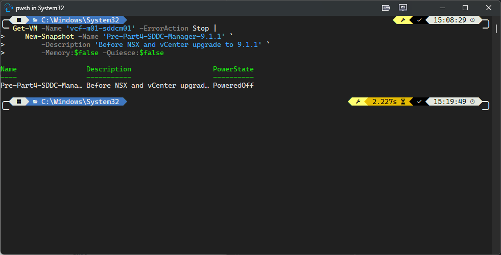

## Downloading the core component binaries

The target-version binaries have to be downloaded before the upgrade.  This time I used the **Binary Management** tab on my VCF instance in VCF Operations, under **Build → Lifecycle → VCF Instances**, with **VCF Version** set to 9.1 and the **Upgrade Binaries** tab selected.  I ticked ESX, NSX, and vCenter at 9.1.1.0 and downloaded them.  SDDC Manager already showed Downloaded from Part 2.

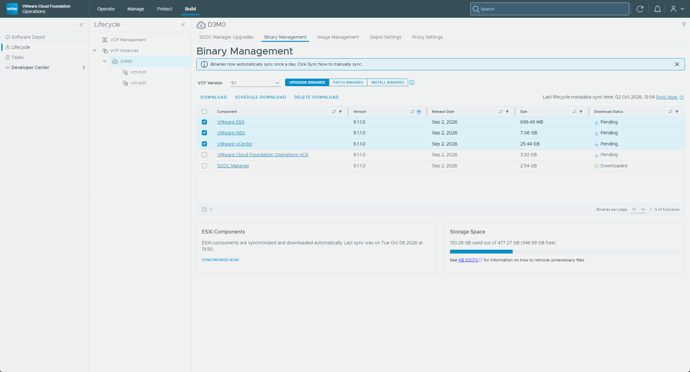

The three rows went from Pending to Scheduled and then to Downloaded.

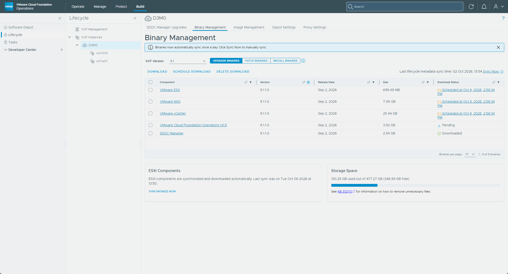

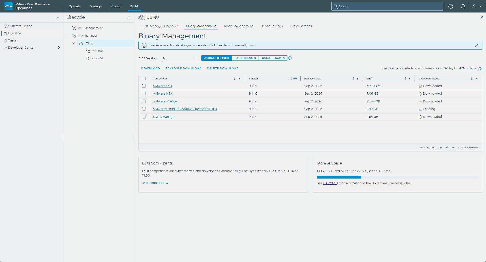

## Planning the domain upgrade

I selected `vcf-m01` under my instance in **Build → Lifecycle → VCF Instances** and opened the **Upgrades** tab ([plan an upgrade](https://techdocs.broadcom.com/us/en/vmware-cis/vcf/vcf-9-0-and-later/9-1/deployment/upgrading-cloud-foundation/upgrade-the-management-domain-to-vmware-cloud-foundation-5-2/plan-an-upgrade.html)).  It has **Plan Domain Upgrade** and **Plan Component Upgrade** buttons, and I used **Plan Domain Upgrade**, which is a four-step wizard.

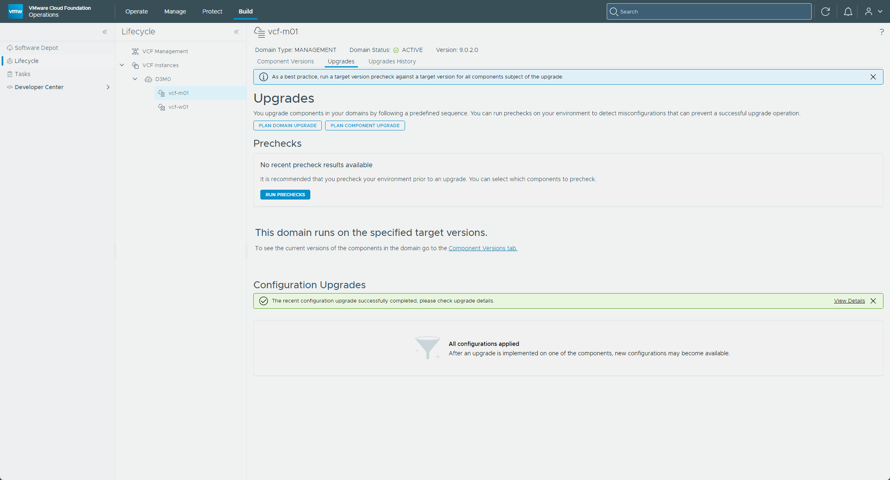

1. **Target Version.**  I picked 9.1.1.0.  A note on the page points to KB 90074 for turning the compatibility checks on the target version on or off.  The 9.1.1.0100 patch covers Fleet Lifecycle, SDDC Lifecycle, and the migration service engine, not vCenter or NSX ([patch releases](https://techdocs.broadcom.com/us/en/vmware-cis/vcf/vcf-9-0-and-later/9-1/release-notes/patch-releases-9-1-1-x.html)).

   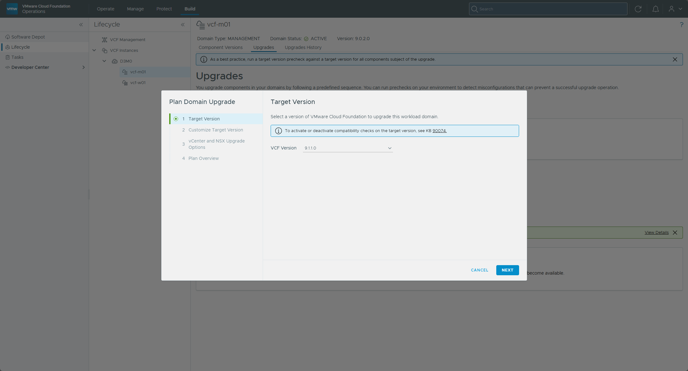

2. **Customize Target Version.**  The wizard listed the components in the domain with their current and target builds, and I left the proposed targets alone.

   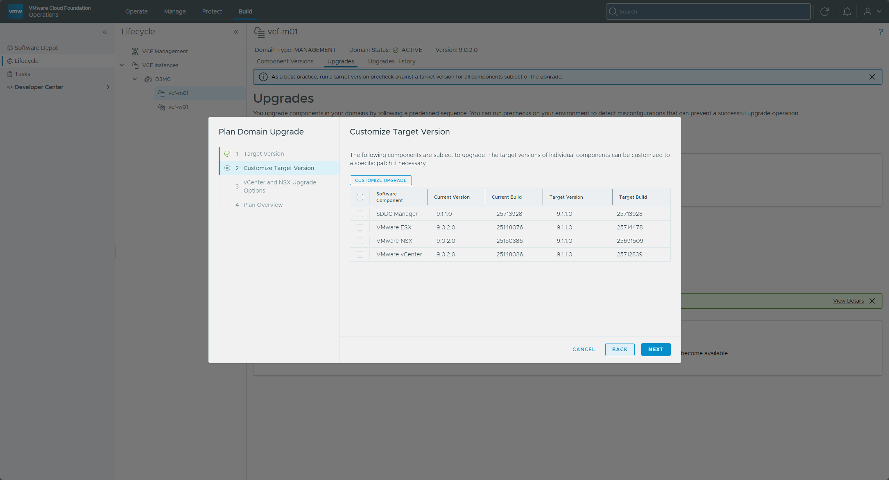

3. **vCenter and NSX Upgrade Options.**  **Optimized Maintenance Window Upgrade** does the vCenter reduced downtime preparation first, with no downtime, and then upgrades NSX Manager and does the vCenter switchover inside the maintenance window.  It requires the vCenter target version to be the same as SDDC Manager's current version.  **Sequential Upgrade** does everything in the maintenance window, NSX Manager first and then vCenter, and the vCenter can go in place or with reduced downtime.  I chose **Sequential Upgrade**, and the wizard says I can revisit that choice until I start the NSX Manager and vCenter upgrades.

   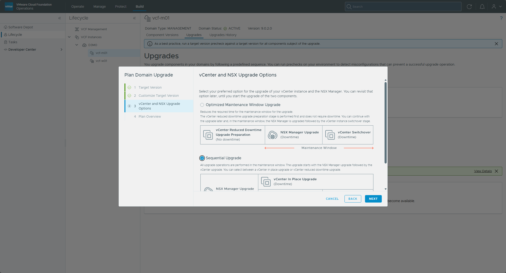

4. **Plan Overview.**  The overview laid out the order: NSX Manager, vCenter, ESX, then the NSX Edge clusters and the NSX Upgrade Finalize.

   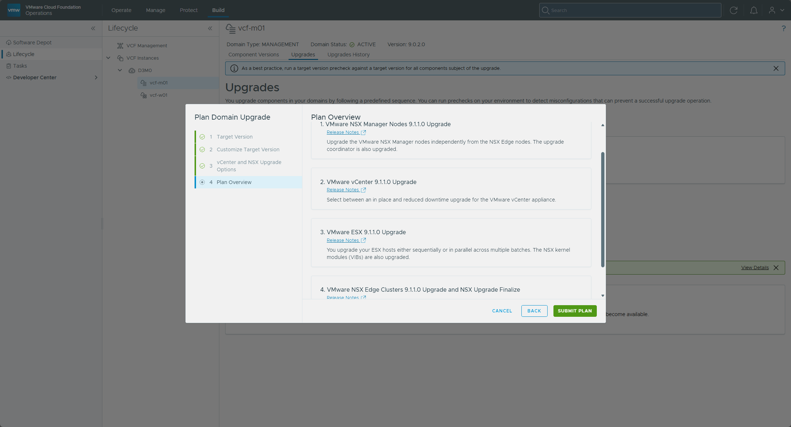

I selected **Submit Plan**.  The **Upgrades** tab then showed the plan with **Edit Plan** and **Cancel Plan** buttons, and the NSX Manager tile offered **Upgrade Now**, **Schedule**, and **Run Prechecks**, while the vCenter and ESX tiles were still grayed out.

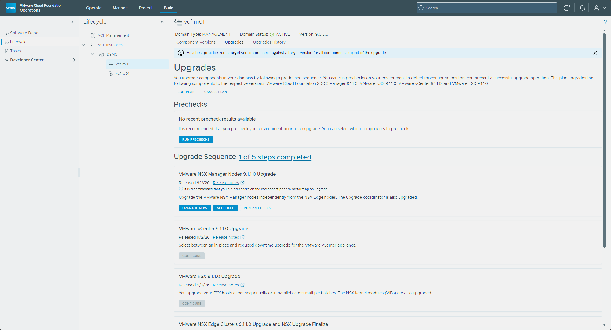

## Running the precheck

I clicked **Run Prechecks** and left it on **Target version precheck** for 9.1.1.0 with every component in scope, which covered vCenter, the `vcf-mgmt-cl` cluster, and NSX.  The dialog warns that the NSX Upgrade Coordinator is upgraded to the target version during the precheck and then rolled back to restore the original state.

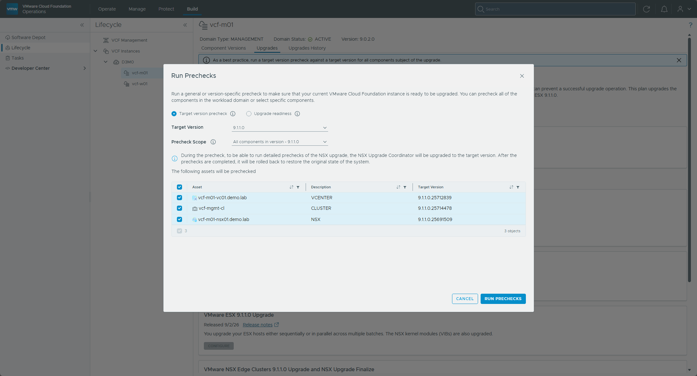

The precheck ran for about 11 minutes.

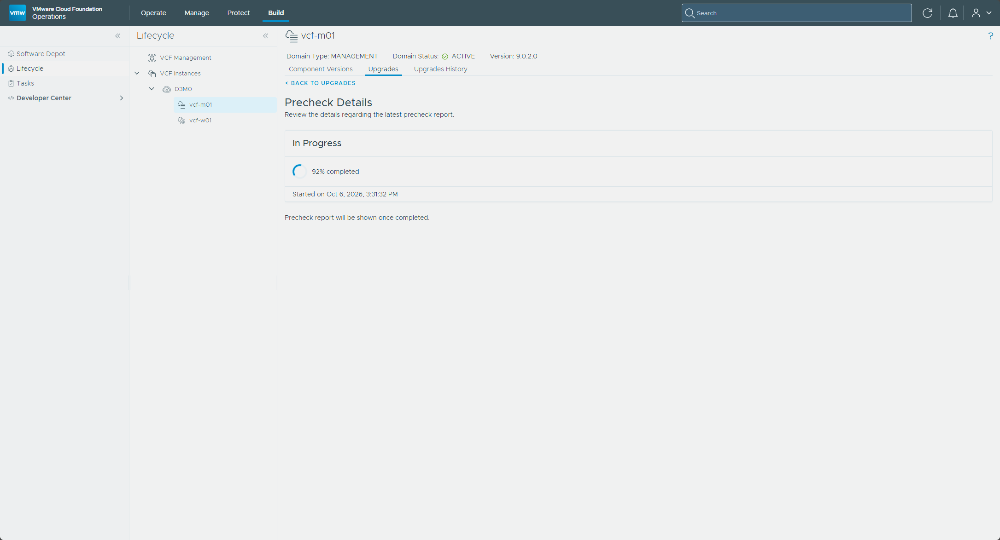

It came back with 3 errors, 5 warnings, and 1 silenced.  An upgrade can be attempted even when a precheck fails, but it's recommended to review the errors and warnings first ([perform an upgrade precheck](https://techdocs.broadcom.com/us/en/vmware-cis/vcf/vcf-9-0-and-later/9-1/deployment/upgrading-cloud-foundation/upgrade-the-management-domain-to-vmware-cloud-foundation-5-2/perform-upgrade-precheck.html)).

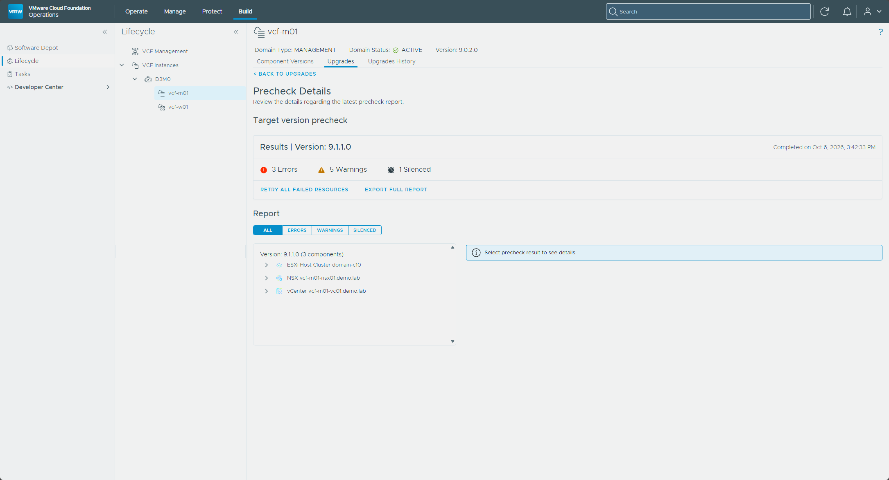

All three errors were the same vSAN data migration what-if check, one for each ESX host, with the same result.  The one I opened rates the impact High, says the what-if evacuation with "ensure access" failed, and tells me to run the what-if test manually and remediate what it reports.

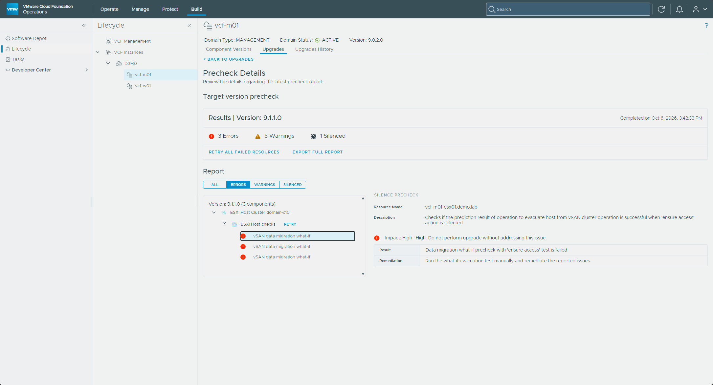

So I ran it manually, from the vSphere Client under **vcf-mgmt-cl → Monitor → vSAN → Data Migration Pre-check**, for `vcf-m01-esx01` with **Ensure accessibility**.  The host can enter maintenance mode, but all three tabs carried a warning.  One native trace object would become non-compliant.

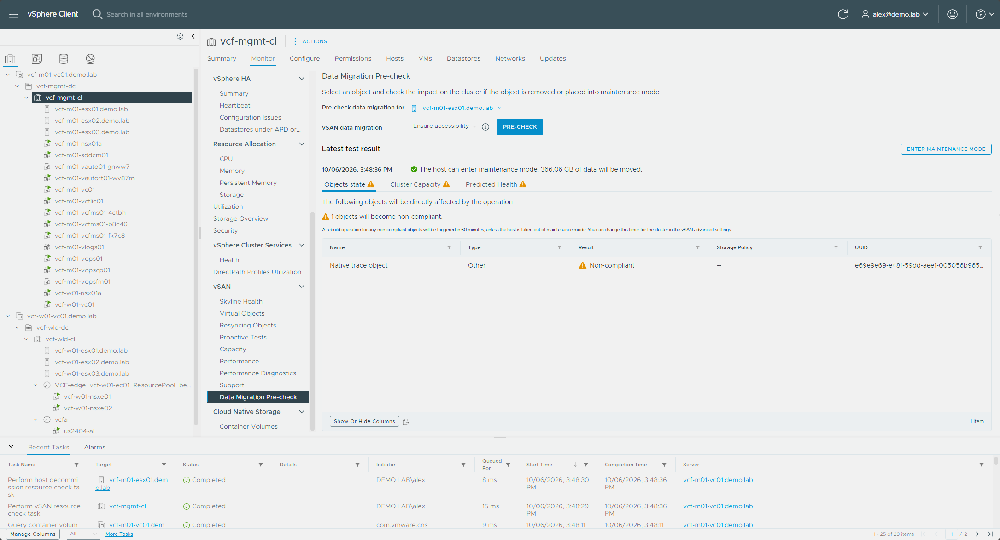

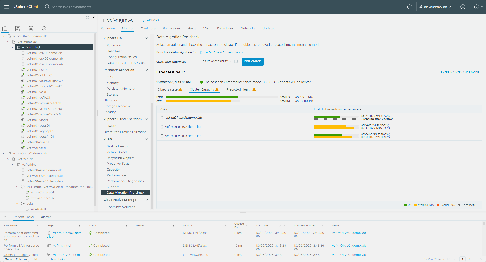

The predicted health listed one object with reduced availability and no rebuild, and storage space over the warning threshold.

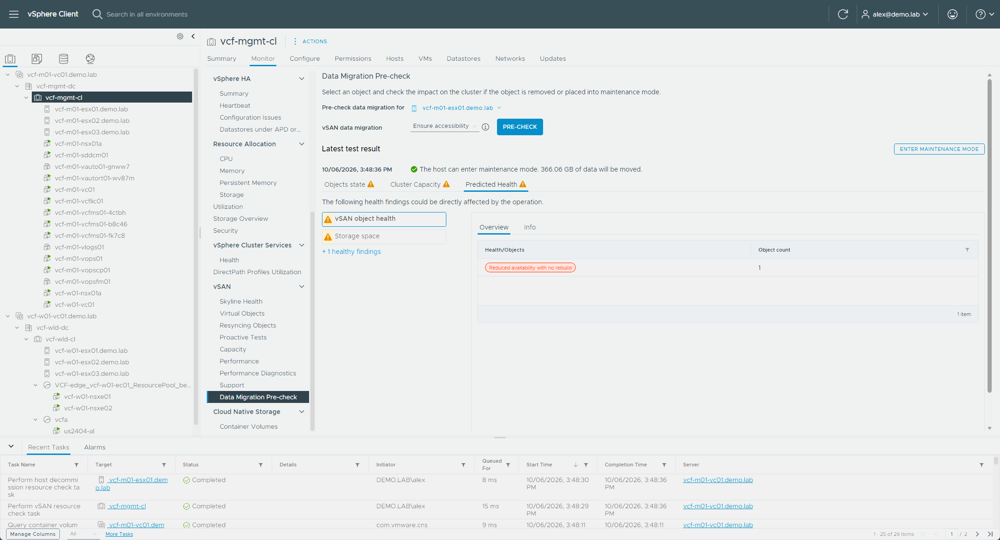

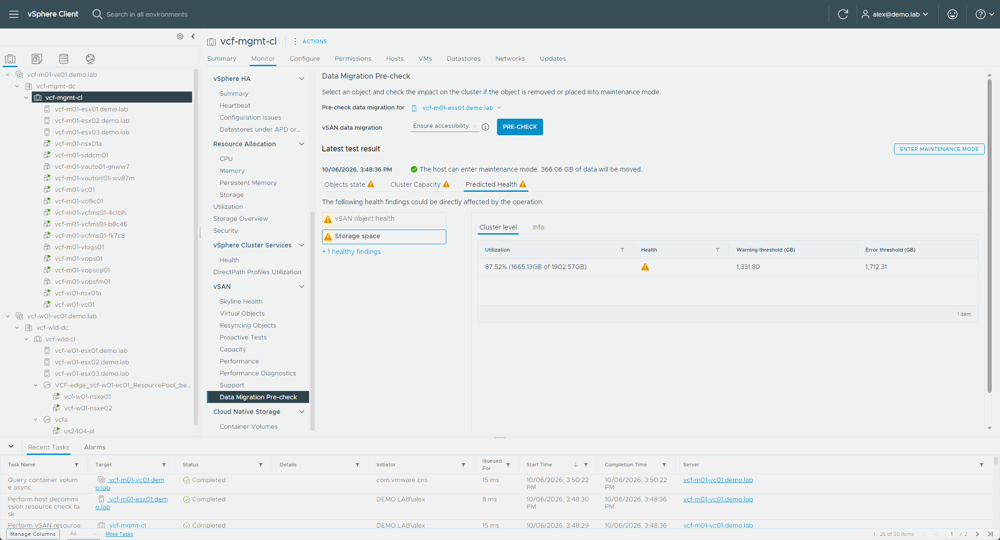

Those are predictions for a host in maintenance mode, which doesn't happen until the ESX upgrade in [Part 5](/posts/vcf-9-1-upgrade-part-5-esxi-nsx-edge/).

The five warnings split between the hosts and NSX.  Each host had a third-party VIB warning for William Lam's [Nested vSAN ESA Mock HW VIB](https://github.com/lamw/nested-vsan-esa-mock-hw-vib).  The warning says it can be ignored when a custom ISO is used to upgrade a VUM-based cluster, and asks that any custom VIBs be present in the new image.

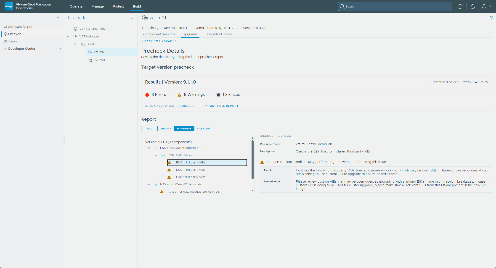

The two NSX warnings, **Check for data inconsistencies in DB** and **IP reputation outbound rules disabled warning**, were about the system-created `FPROT` context profile and the default malicious IP rule.  The context profile contains an App ID that vDefend 9.1 no longer supports, and [KB 410572](https://knowledge.broadcom.com/external/article/410572) says no action is needed beyond acknowledging the warning.  After the upgrade is finalized, the unsupported App ID has to be removed from the profile before the profile is used in a rule.

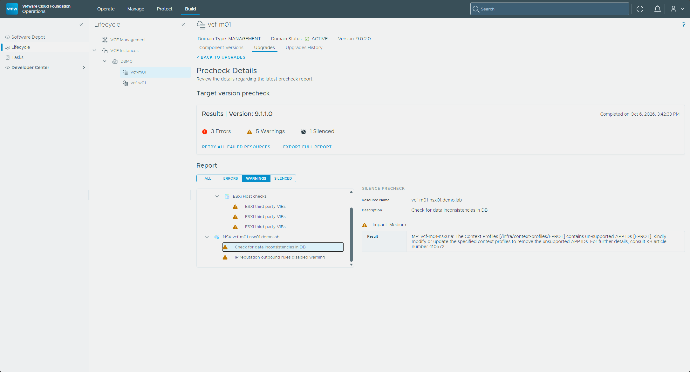

The other one said the upgrade will disable the default 'Malicious IP at Destination Rule.'  That's the 9.1.1 default, and the outbound rule can be activated manually if I want it ([Default Outbound Rule](https://techdocs.broadcom.com/us/en/vmware-security-load-balancing/vdefend/vdefend-firewall/9-1/vdefend-distributed-firewall/outbound-default-state-for-malicious-ip-filtering/upgrade-behavior-for-mailicious-ip-outbound-rule.html), [Activate Malicious IP Filtering Feed](https://techdocs.broadcom.com/us/en/vmware-security-load-balancing/vdefend/vdefend-firewall/9-1/vdefend-distributed-firewall/outbound-default-state-for-malicious-ip-filtering/malicious-ip-feeds.html)).

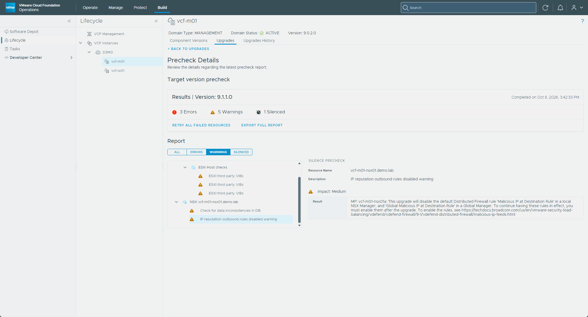

The silenced result was the vSAN disk group mode check on `vcf-mgmt-cl`, skipped because that vSAN health test is silenced in vSAN.  vCenter had no errors or warnings.

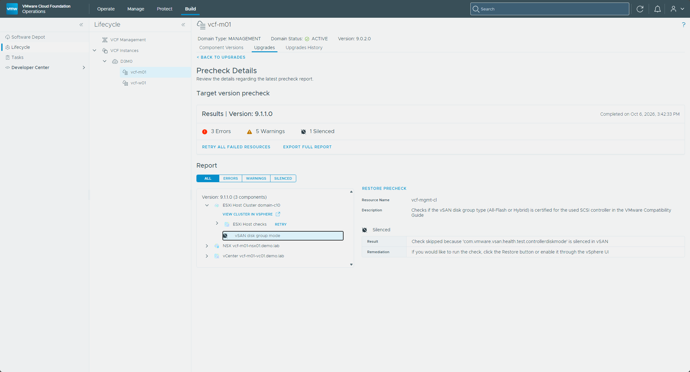

## Updating NSX Manager

The **Upgrade Sequence** on the **Upgrades** tab lists the NSX Manager, vCenter, ESX, and NSX Edge and Finalize tiles in that order.  The ESX hosts, the Edge clusters, and the finalize are all in [Part 5](/posts/vcf-9-1-upgrade-part-5-esxi-nsx-edge/).

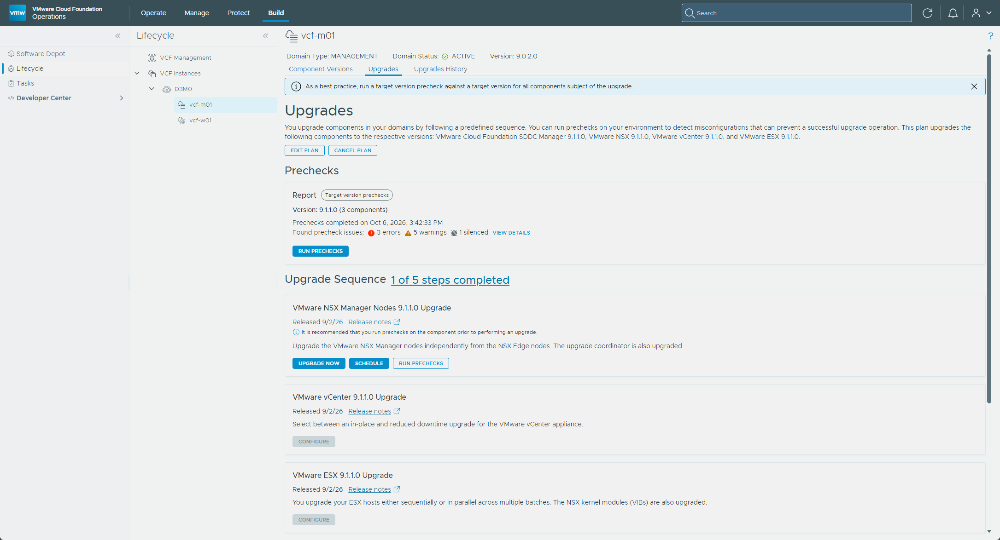

Broadcom's sequential procedure and the planner's NSX Local Managers phase both start with **Configure** under **VMware NSX Manager Nodes Upgrade** ([sequential upgrade](https://techdocs.broadcom.com/us/en/vmware-cis/vcf/vcf-9-0-and-later/9-1/deployment/upgrading-cloud-foundation/upgrade-the-management-domain-to-vmware-cloud-foundation-5-2/updating-vcenter-and-nsx/sequential-update-of-vcenter-and-nsx-manager.html)).

<aside class="info-block"><p>My NSX tile doesn't have a <strong>Configure</strong> button.  It has <strong>Run Prechecks</strong>, <strong>Upgrade Now</strong>, and <strong>Schedule</strong>, and its description says the NSX Manager nodes are upgraded independently from the NSX Edge nodes and that the upgrade coordinator is upgraded too.</p></aside>

<aside class="info-block"><p>For an NSX instance shared across domains, the NSX precheck runs on every domain that shares it, and the NSX, vCenter, and ESX upgrades have to happen on all of them (<a href="https://techdocs.broadcom.com/us/en/vmware-cis/vcf/vcf-9-0-and-later/9-1/deployment/upgrading-cloud-foundation/upgrade-the-management-domain-to-vmware-cloud-foundation-5-2/updating-vcenter-and-nsx.html">upgrading vCenter and NSX Manager</a>).  Each of my domains has its own NSX Manager, so neither applies to me.</p></aside>

<aside class="info-block"><p>Pre-version 9 licenses for NSX security features aren't supported in 9.x.  Without a valid vDefend license, those features go into 90-day evaluation mode after the upgrade (<a href="https://techdocs.broadcom.com/us/en/vmware-cis/vcf/vcf-9-0-and-later/9-1/deployment/upgrading-cloud-foundation/upgrade-the-management-domain-to-vmware-cloud-foundation-5-2/updating-vcenter-and-nsx/sequential-update-of-vcenter-and-nsx-manager.html">sequential upgrade</a>).</p></aside>

1. In VCF Operations, select **Build → Lifecycle**, expand **VCF Instances**, and select the management domain.
2. On the **Upgrades** tab, find **VMware NSX Manager Nodes Upgrade**.
3. Optionally, click **Run Prechecks** on the tile to check NSX on its own.
4. Click **Upgrade Now**, or click **Schedule** to pick another time.
5. Follow it with **View Status** and in the Tasks panel.
6. When all the NSX Manager nodes are upgraded, a green banner appears on the status page.  Back on the **Upgrades** tab, the **Upgrade Sequence** step count goes up by one.

I ran the tile's precheck just to see what it would add, and it found nothing new.  It's labeled a **Configuration precheck**, covers NSX alone, and came back with 0 errors, 2 warnings, 32 passed, and 0 silenced.  The two warnings were the same two from the target version precheck, and the vSAN what-if errors aren't in it, since they're ESX checks.

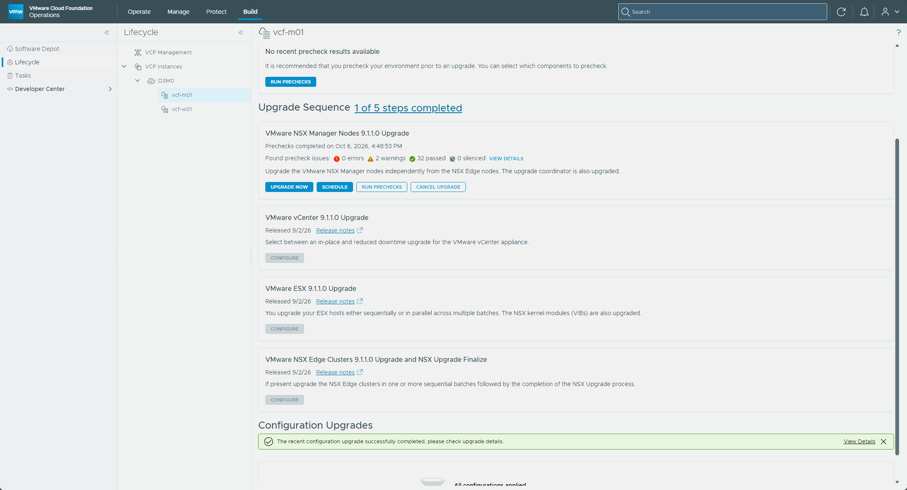

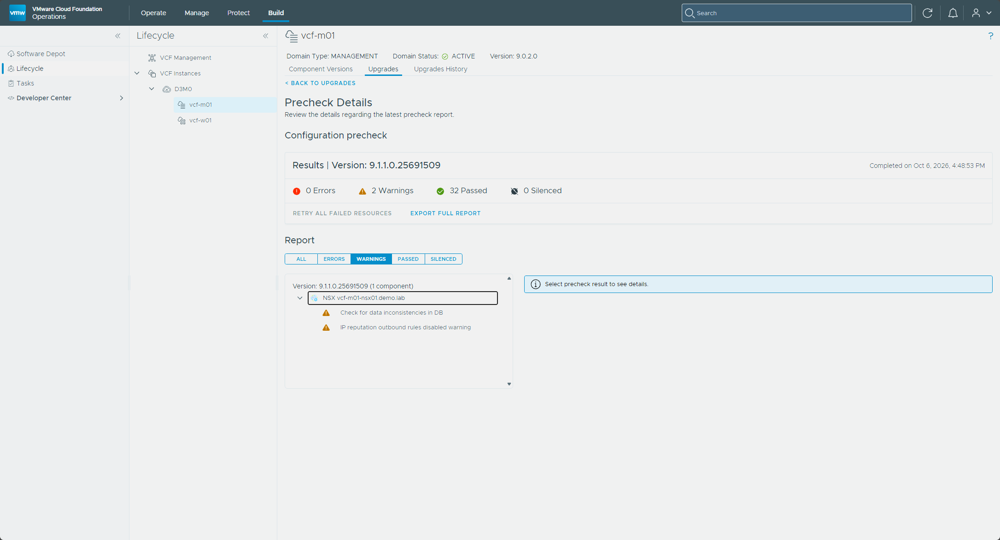

Then I clicked **Upgrade Now**, and the tile switched to "Upgrade is in progress."  In the Tasks panel it showed up as "Upgrade DOMAIN - [vcf-m01] using BUNDLE - NSX_T_MANAGER:9.1.1.0.25691509," with three subtasks: proceeding with the schedule once the precheck is complete, upgrading the upgrade coordinator, and upgrading the NSX Manager.

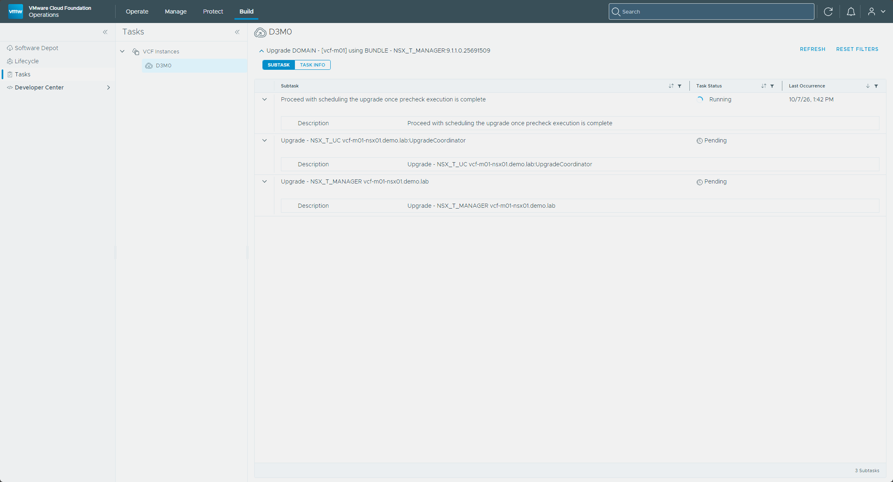

**View Status** breaks the work down further.  The upgrade coordinator goes first, with a cluster precheck, a backup, setting the upgrade payload, accepting the EULA, and updating the coordinator itself.  The Manager node follows with its own precheck, the upgrade, and a postcheck.

It finished in about 42 minutes.  The status page ended on a green banner reading "Upgrade completed with success," with the upgrade coordinator, the NSX management cluster at `9.1.1.0.25691509`, and the Manager node all marked **Upgraded**.

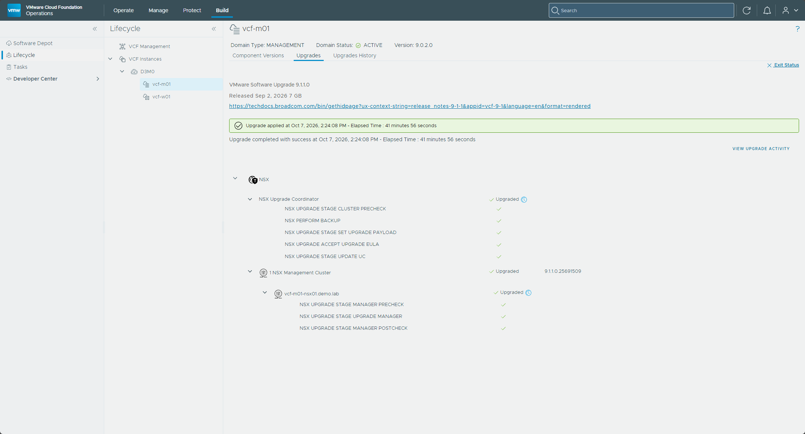

Back on the **Upgrades** tab, the **Upgrade Sequence** count had gone from 1 of 5 to 2 of 5 steps completed and the NSX Manager tile was gone from the list.  The **Configure** button on the vCenter tile was active now, and the ESX and NSX Edge and Finalize tiles were still grayed out.

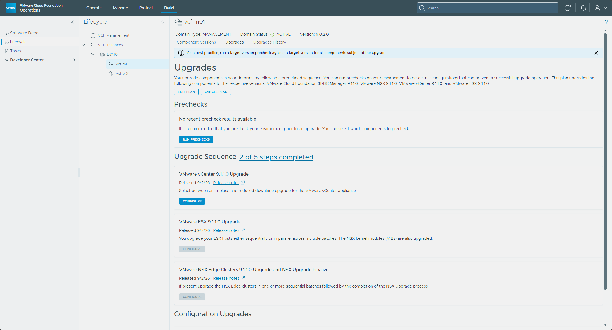

<aside class="info-block"><p>NSX isn't fully functional yet.  NSX 9.x features aren't available until every ESX host that shares the NSX Manager is upgraded and the NSX finalize completes, and both of those are in Part 5 (<a href="https://techdocs.broadcom.com/us/en/vmware-cis/vcf/vcf-9-0-and-later/9-1/deployment/upgrading-cloud-foundation/upgrade-the-management-domain-to-vmware-cloud-foundation-5-2/updating-vcenter-and-nsx/sequential-update-of-vcenter-and-nsx-manager.html">sequential upgrade</a>).</p></aside>

## Updating vCenter

The vCenter tile's **Configure** button was grayed out until the NSX Manager upgrade finished, and then it became active.  The wizard offers two mechanisms.  The **vCenter Reduced Downtime Upgrade** brings up a second appliance, migrates the configuration over, and cuts the downtime to around 5 minutes, but it needs additional capacity to run both appliances at the same time.  The **vCenter Regular Upgrade** takes vCenter down for the whole upgrade.  I chose the Regular Upgrade.

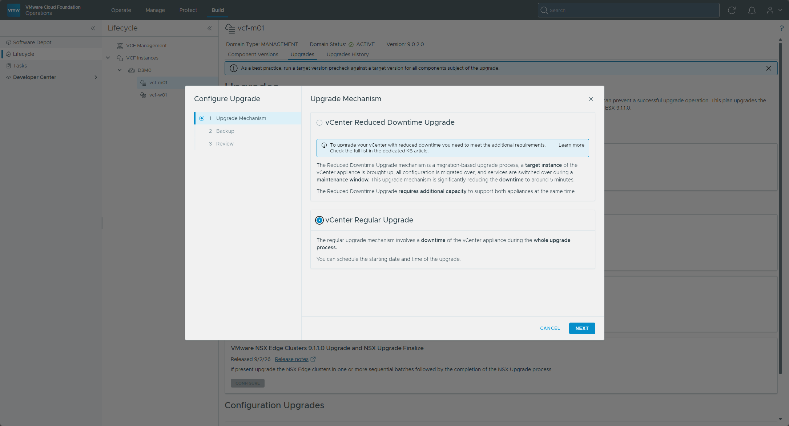

<aside class="info-block"><p>I run the <strong>embedded Identity Broker</strong> (the vCenter SSO route), and its upgrade to the 9.1 embedded identity broker is automated as part of the vCenter upgrade, so there's no separate Identity Broker step (<a href="https://techdocs.broadcom.com/us/en/vmware-cis/vcf/vcf-9-0-and-later/9-1/deployment/upgrading-cloud-foundation/upgrade-the-management-domain-to-vmware-cloud-foundation-5-2/updating-vcenter-and-nsx.html">upgrading vCenter and NSX Manager</a>).  That's separate from the Identity Broker <em>instance</em> that Management Services deployed back in Part 2.</p></aside>

1. Under **VMware vCenter Upgrade**, click **Configure**.
2. Choose **vCenter Regular Upgrade** and click **Next**.
3. Select a backup option and click **Next**.  A file-based backup of the vCenter appliance is Broadcom's best practice, and I took mine under Getting ready.  The vCenter inventory and settings shouldn't change between that backup and the end of a successful upgrade.
4. Review the configuration and click **Finish**.
5. On the tile, click **Upgrade Now**.
6. Follow the upgrade with **View Status** and in the Tasks panel.

After **Finish**, the tile said "You configured the in place upgrade for the VMware vCenter appliance," with **Upgrade Now**, **Schedule**, **Run Prechecks**, and **Cancel Upgrade**.  I clicked **Upgrade Now**, and the tile switched to "Upgrade is in progress."

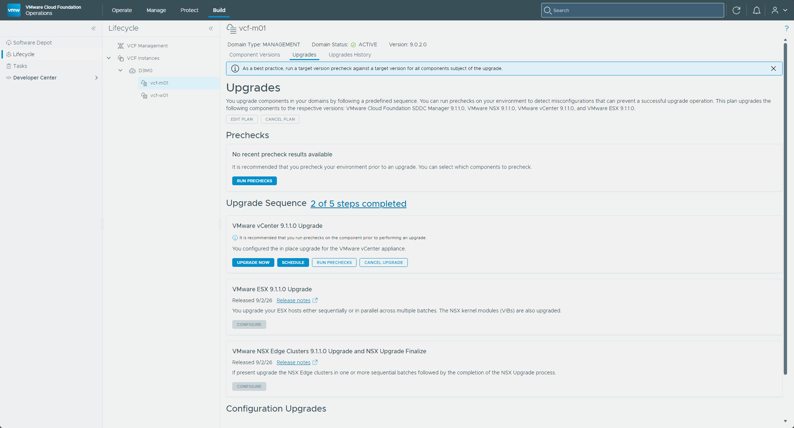

<aside class="info-block"><p>I didn't run the tile's precheck, since the target version precheck had no findings for vCenter.</p></aside>

**View Status** broke the upgrade into ten stages, starting with pre-validation, unstage, set repo, and a precheck of its own.  It finished in about 1 hour and 6 minutes, with "Upgrade completed with success" and `vcf-m01-vc01.demo.lab` marked **Upgraded** at `9.1.1.0.25712839`.

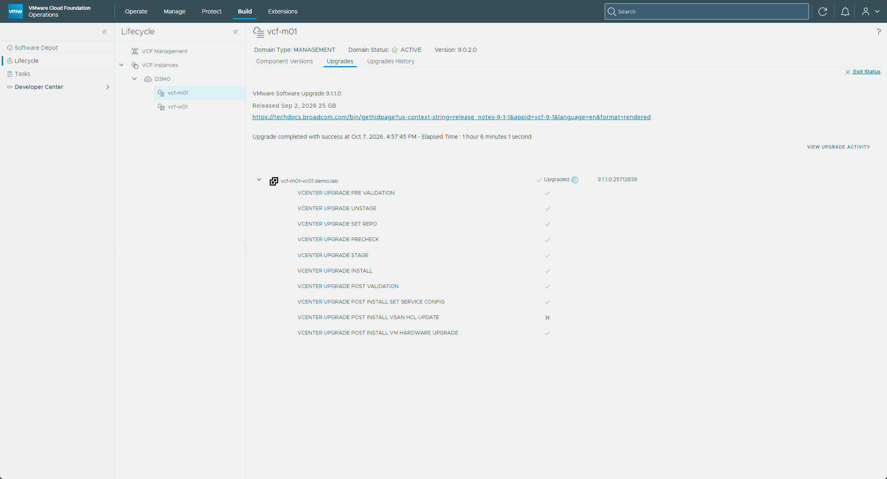

<aside class="info-block"><p>I was logged out partway through the upgrade, since I was signed in to VCF Operations with VCF SSO, so I logged back in as the VCF Operations local admin to keep monitoring it.</p></aside>

<aside class="info-block"><p>After the vCenter upgrade, about 15 minutes should pass for auto-reconciliation of configuration drift fixes before anything else is scheduled, because a second upgrade scheduled too early might get canceled or make the reconciliation fail.</p></aside>

I rechecked log collection for `vcf-m01-vc01` in VCF Operations, and **vCenter Log Collection** was still turned on.

## Configuration upgrades

Configuration upgrades can show up after a software upgrade.  One can be applied right away or after all the software upgrades are done, it has to happen in a maintenance window, and pending ones don't block later upgrades ([apply configuration upgrades](https://techdocs.broadcom.com/us/en/vmware-cis/vcf/vcf-9-0-and-later/9-1/deployment/upgrading-cloud-foundation/upgrade-the-management-domain-to-vmware-cloud-foundation-5-2/apply-configuration-updates.html)).

After the vCenter upgrade, one showed up under **Available Configuration Upgrades**: **Services config in vCenter**, type FEATURE, resource type DOMAIN.  The **Upgrade Sequence** count read 3 of 5, and **Configure** on the ESX tile was active.  I'm leaving it until the other upgrades are done, following Broadcom's upgrade order, which lists the configuration upgrades last ([upgrade order](https://techdocs.broadcom.com/us/en/vmware-cis/vcf/vcf-9-0-and-later/9-1/deployment/upgrading-cloud-foundation.html)).  I apply it in [Part 6](/posts/vcf-9-1-upgrade-part-6-housekeeping-workload-domain/).

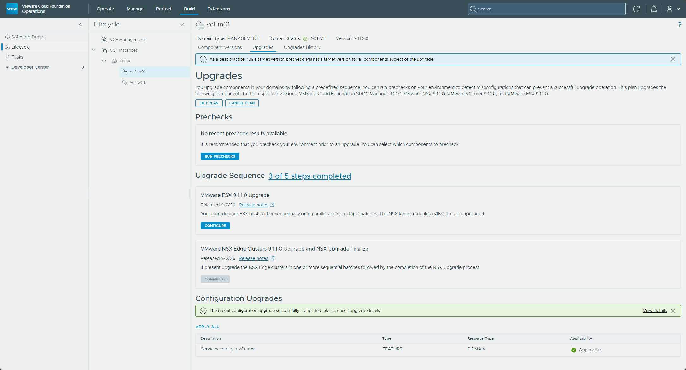

## Deleting the SDDC Manager snapshot

I did this later than the rest of Part 4, once the ESX precheck in Part 5 flagged storage on the cluster.  The NSX Manager and vCenter upgrades are done, so the `Pre-Part4-SDDC-Manager-9.1.1` snapshot from Getting ready has served its purpose.  The first line below lists the snapshot and its size, and the second removes it.

```powershell
Get-VM -Name 'vcf-m01-sddcm01' | Get-Snapshot | Select-Object VM, Name, SizeGB
Get-VM -Name 'vcf-m01-sddcm01' | Get-Snapshot -Name 'Pre-Part4-*' | Remove-Snapshot -Confirm:$false
```

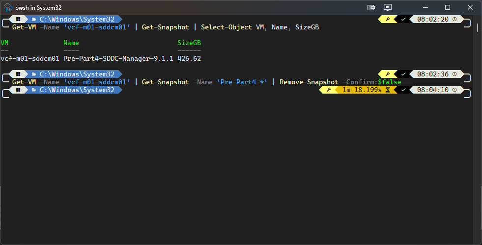

## What's next

In **[Part 5](/posts/vcf-9-1-upgrade-part-5-esxi-nsx-edge/)**, I take on the **ESX hosts** and finish the NSX upgrade.  If the NSX or vCenter stages went differently for you, drop a comment and let me know.

-virtualex-
