{
  "title": "VMware Cloud Foundation 9.1 Upgrade - Part 5: ESX Hosts and Completing the NSX Upgrade",
  "date": "2026-10-10T15:00:00-04:00",
  "lastmod": "2026-10-10T15:00:00-04:00",
  "slug": "vcf-9-1-upgrade-part-5-esxi-nsx-edge",
  "url": "/posts/vcf-9-1-upgrade-part-5-esxi-nsx-edge/",
  "draft": false,
  "description": "Part 5 of my VMware Cloud Foundation 9.0.2 to 9.1 upgrade series: upgrading the ESX hosts with vLCM image-based remediation and completing the NSX upgrade, including where the NSX Edge cluster fits if you run one.",
  "featured_image": "part-5-esxi-nsx-edge.png",
  "categories": [
    "Home Lab",
    "How-To's",
    "VMware Cloud Foundation"
  ],
  "tags": [
    "VCF",
    "VMware",
    "vSphere",
    "NSX",
    "vSAN",
    "ESXi",
    "Upgrade",
    "homelab"
  ],
  "years": [
    "2026"
  ],
  "aliases": [],
  "comments": []
}

With NSX Manager and vCenter upgraded in [Part 4](/posts/vcf-9-1-upgrade-part-4-nsx-vcenter/), it's time for the hosts.  Part 5 covers the **ESX host upgrade** with vLCM image-based remediation, and then **completing the NSX upgrade**.  My management domain doesn't have an NSX Edge cluster.  The Edges in my lab live in the workload domain, and they get their turn in [Part 6](/posts/vcf-9-1-upgrade-part-6-housekeeping-workload-domain/).

(New here?  The [series overview](/posts/vcf-9-1-upgrade-series-overview/) has the environment and prerequisites.)

## A quick detour: VKS and Supervisor

Broadcom's [upgrade order](https://techdocs.broadcom.com/us/en/vmware-cis/vcf/vcf-9-0-and-later/9-1/deployment/upgrading-cloud-foundation.html) has two stages between vCenter and ESX that I'm skipping in this lab: **vSphere Kubernetes Service (VKS)** and **Supervisor**.  They only apply if you've enabled Workload Management.  The order is VKS 3.6.0 or later first, then Supervisor, both before the ESX hosts.  My lab has no Supervisor enabled, so both stages skip.

## Upgrading the ESX hosts

VCF 9.x is image-based only, and baselines aren't supported in 9.x ([How to Upgrade to VMware Cloud Foundation 9.1](https://blogs.vmware.com/cloud-foundation/2026/06/18/how-to-upgrade-to-vmware-cloud-foundation-9-1/)).  The hosts needed an image for the 9.1 ESX release before they could be remediated.  Broadcom's flow is to create it in the vSphere Client and then import it into VCF Operations, either from the vCenter or from a file ([Upgrade ESX](https://techdocs.broadcom.com/us/en/vmware-cis/vcf/vcf-9-0-and-later/9-1/deployment/upgrading-cloud-foundation/upgrade-the-management-domain-to-vmware-cloud-foundation-5-2/upgrade-esxi-for-vmware-cloud-foundation-5-2-1.html)).

### Create and import the 9.1 ESX image

<aside class="info-block">
Build the image on the ESX version in the VCF bill of materials for the target release, <code>9.1.1.0.25714478</code>, and not on a newer patch build such as <code>9.1.1.0100</code>.  Broadcom's prerequisites say the ESX version has to be the one in the BOM (<a href="https://techdocs.broadcom.com/us/en/vmware-cis/vcf/vcf-9-0-and-later/9-1/deployment/upgrading-cloud-foundation/upgrade-the-management-domain-to-vmware-cloud-foundation-5-2/upgrade-esxi-for-vmware-cloud-foundation-5-2-1.html">Upgrade ESX</a>), and the <strong>Assign Image</strong> step only lists images on that build.  That's what happened to me, as I describe below.
</aside>

1. In the vSphere Client, create an image for the target ESX release: **Lifecycle Manager → Image Library → Create Image**.
2. In VCF Operations, go to **Build → Lifecycle**, expand **VCF Instances**, select the VCF instance, open **Image Management**, and click **Import Image**.
3. Choose **Import from a vCenter** and pick the vCenter and the image, or choose **Import from a file** and provide a name plus the JSON, ZIP, and optional ISO files exported from the vSphere Client.  Click **Import**.
4. Track the import in the Tasks panel.

I named the image `mgmt-software-spec-911` and picked ESXi version `9.1.1.0100.25782009` ([Create an Image in Image Library Manually](https://techdocs.broadcom.com/us/en/vmware-cis/vsphere/vsphere/9-1/managing-host-and-cluster-lifecycle/working-with-image-library/create-an-image-in-image-library.html)).  I also added **Nested vSAN ESA Mock HW**, the component from William Lam's mock VIB that the precheck warned about on every host, then validated the image and saved it.

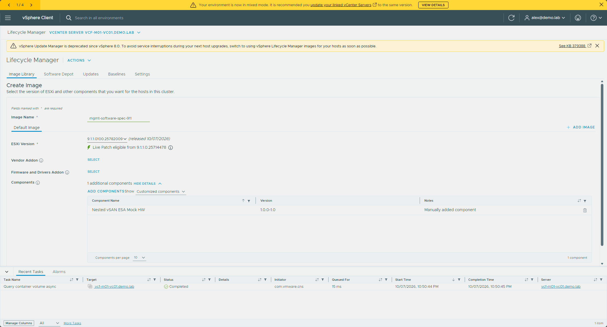

In VCF Operations, I imported `mgmt-software-spec-911` from the management vCenter.

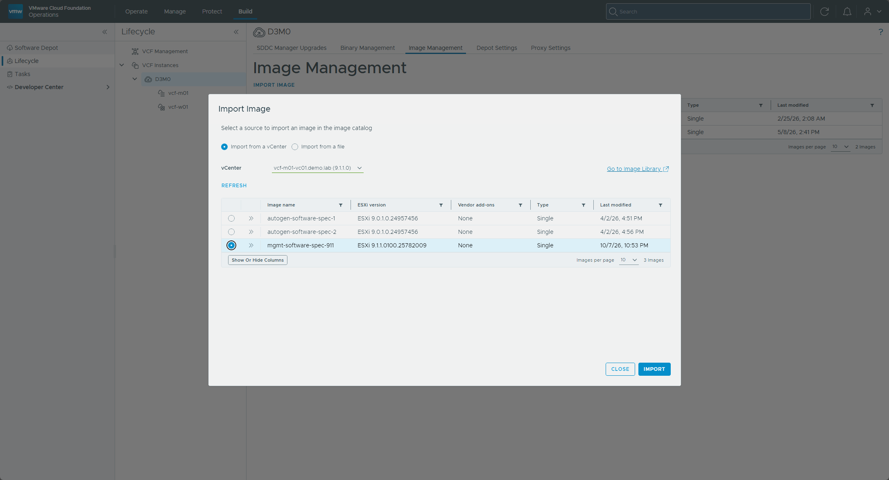

The import showed up in the Tasks panel as "vSphere Lifecycle Manager Image Upload mgmt-software-spec-911" and finished successfully.

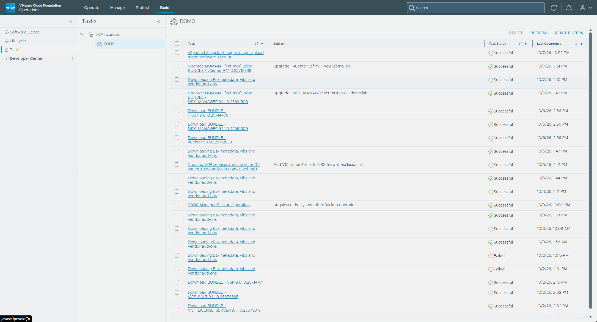

The image then appeared on the **Image Management** tab with ESX `9.1.1.0100.25782009`, no vendor add-on, no firmware and drivers add-on, and one additional component.

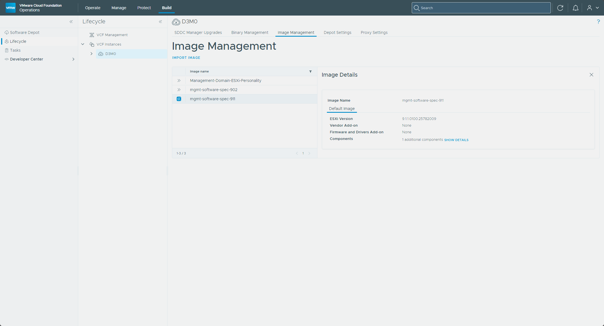

### Starting the ESX upgrade

1. On the management domain's **Upgrades** tab, click **Configure** under **VMware ESX Upgrade**.
2. Read the introduction and click **Next**.
3. Select the clusters to upgrade and click **Next**.  All clusters are selected by default, and **Customize** picks individual hosts.
4. Select the cluster, click **Assign Image**, pick the imported image, click **Assign Image** again, and click **Next**.
5. Set the upgrade options and click **Next**:
   - **Sequential or parallel clusters:** clusters upgrade in parallel by default.  If you select more than ten, the first ten run in parallel and the rest run sequentially.
   - **Quick Boot:** it can reduce the upgrade time by skipping the physical reboot of the host.
   - **Migrate Powered Off and Suspended VMs:** it migrates suspended and powered-off VMs off the hosts that have to enter maintenance mode.
   - **Retry policy:** it sets whether to retry, the delay between attempts, and the number of attempts.
   - **Live Patch:** it isn't applicable to major upgrades, so choose **Auto** or leave it off.
6. Select any standalone hosts and click **Next**.
7. Review the configuration and click **Finish**.
8. Under **VMware ESX Upgrade**, click **Run Prechecks** and review the report.
9. Click **Upgrade Now**, or click **Schedule** to pick another time, and follow it with **View Status**.

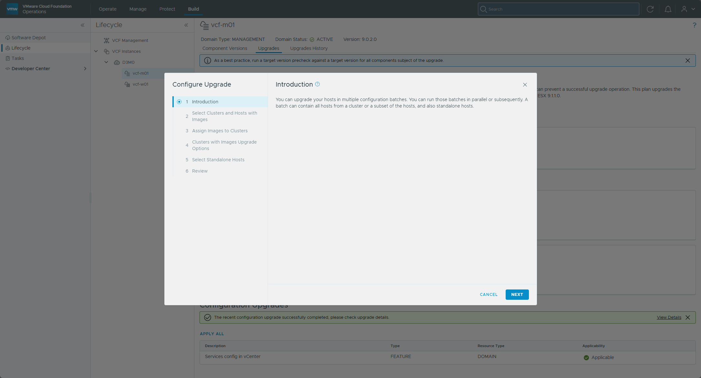

On **Assign Images to Clusters**, a warning said no images matched the required target version, and **Next** stayed grayed out.

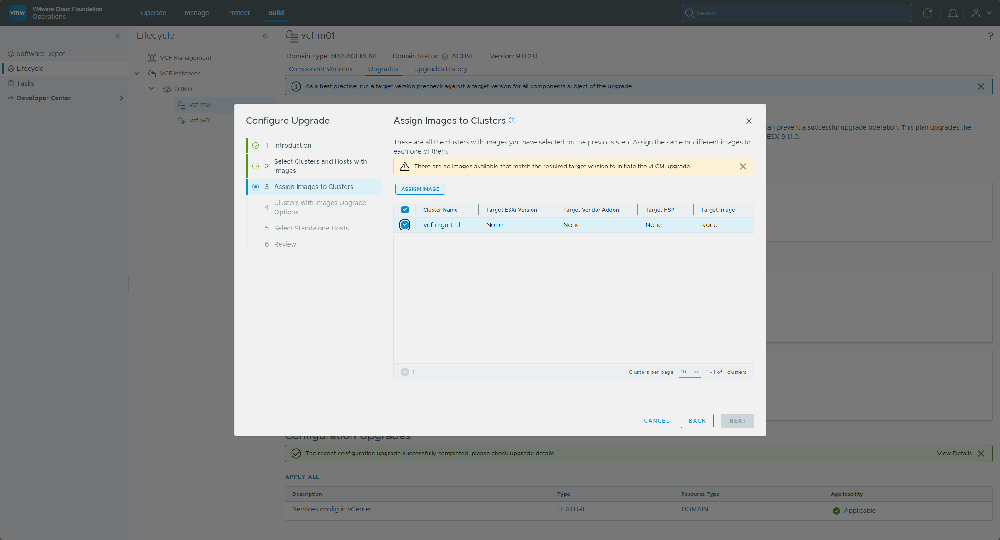

When I clicked **Assign Image**, the dialog said "Showing only images with ESXi version 9.1.1.0.25714478" and listed no images.  My image was `9.1.1.0100.25782009`, a different build, so it wasn't offered.

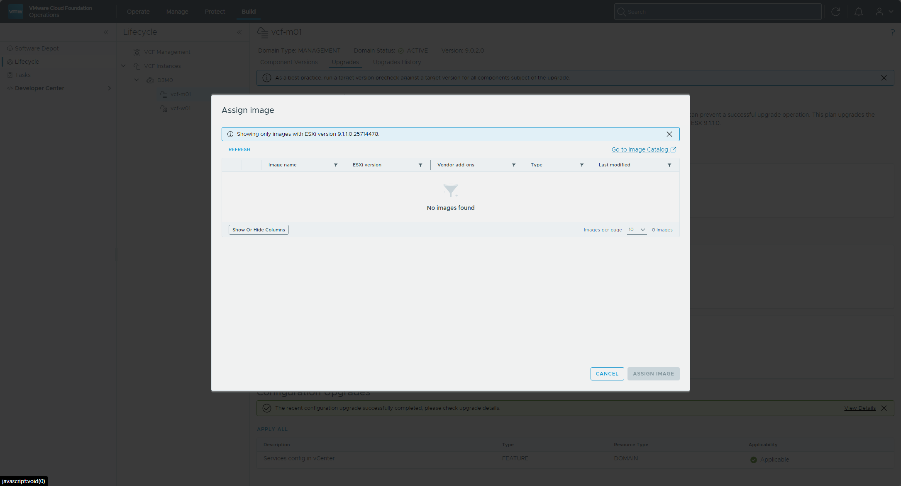

I edited the image in the vSphere Client, renaming it `mgmt-software-spec-9110` and changing the ESXi version to `9.1.1.0.25714478`, with the **Nested vSAN ESA Mock HW** component still on it.  I validated it, saved it, and imported it into VCF Operations again.  This time **Assign Image** listed it, and the wizard said the image was assigned to the cluster.

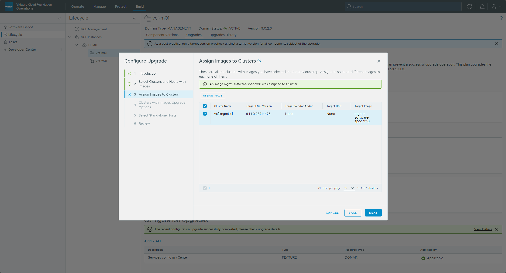

### Options, review, and precheck

On the options step, Quick Boot was enabled and the VM power state was left on "Do not change power state."

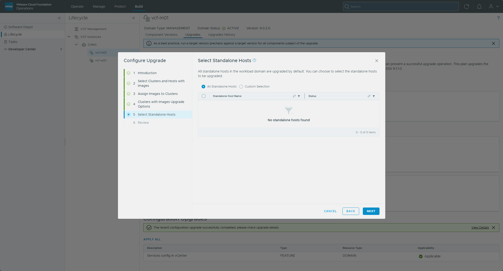

There were no standalone hosts, so I reviewed the configuration, clicked **Finish**, and ran the precheck.

It came back with 2 errors and 12 warnings.  Both errors were "Are enough resources for EMM present," one for `vcf-m01-esx02` and one for `vcf-m01-esx03`.

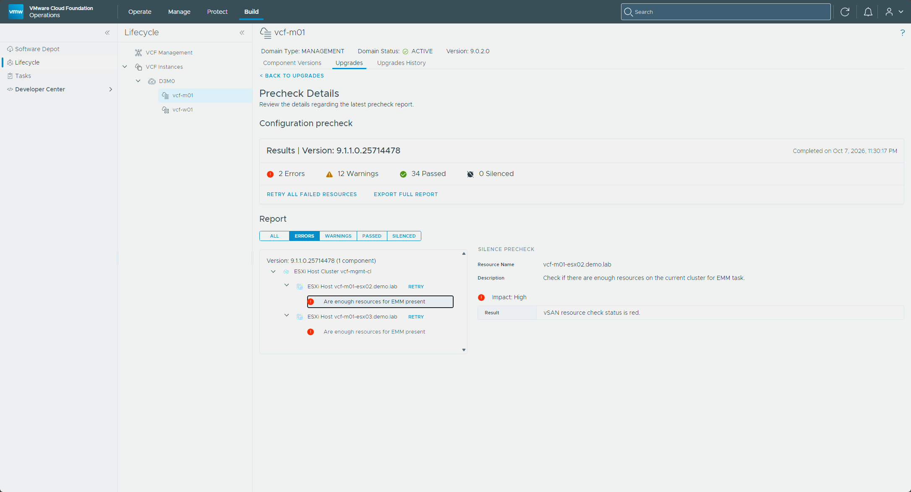

The 12 warnings were compliance and image scan results on the hosts.  The one worth noting is that the CPU isn't supported by ESXi, which can be overridden with a force remediate but is neither officially supported nor recommended ([KB 82794](https://knowledge.broadcom.com/external/article/82794)).  The remediation went through without a force remediate.

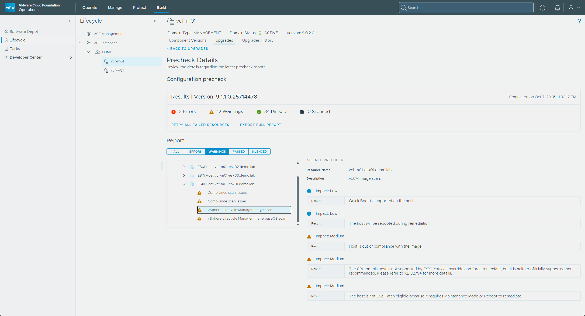

<aside class="info-block">
I was going to wait until the whole upgrade finished before cleaning up the old VMs and the SDDC Manager snapshot.  The precheck errors were about storage on the cluster, though, so I deleted them sooner, which is why they're covered at the end of Parts <a href="/posts/vcf-9-1-upgrade-part-2-sddc-manager-management-services/">2</a> to <a href="/posts/vcf-9-1-upgrade-part-4-nsx-vcenter/">4</a>.
</aside>

I ran the precheck again after the deletes.  One error was left on `vcf-m01-esx03`, and a second run a few minutes later came back clean.

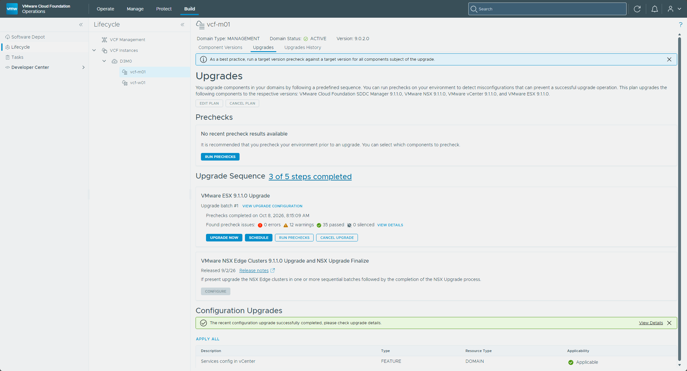

### Running the ESX upgrade

I clicked **Upgrade Now** and followed it from **View Status**.

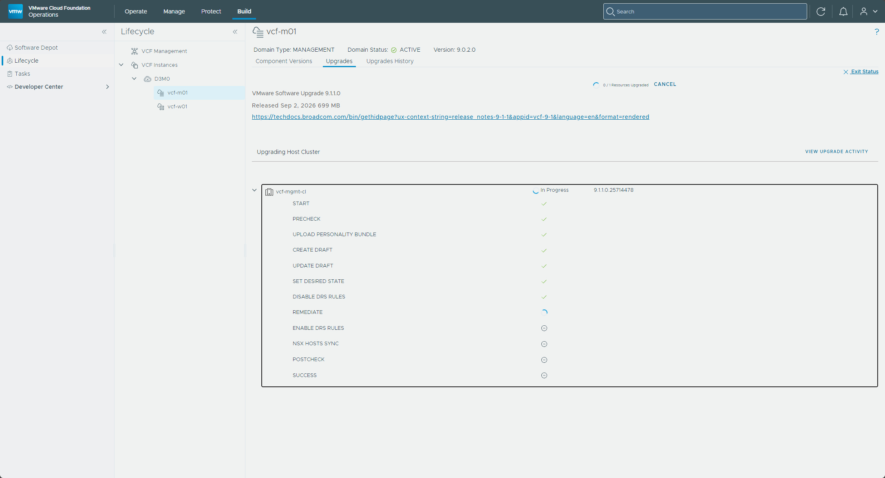

When the ESX upgrade finished, the **Upgrade Sequence** moved to 4 of 5 steps completed, the ESX tile was gone, and **Configure** was active on the **NSX Edge Clusters Upgrade and NSX Upgrade Finalize** tile.

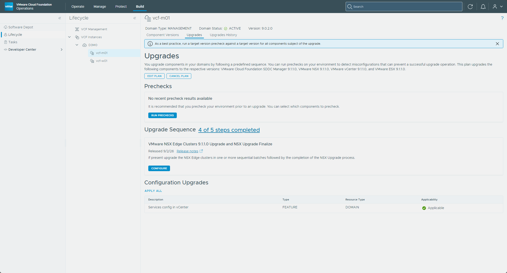

### Verify

In the vSphere Client, the **Updates** tab for `vcf-mgmt-cl` said the cluster was up to date and all hosts were compliant with `mgmt-software-spec-9110`.

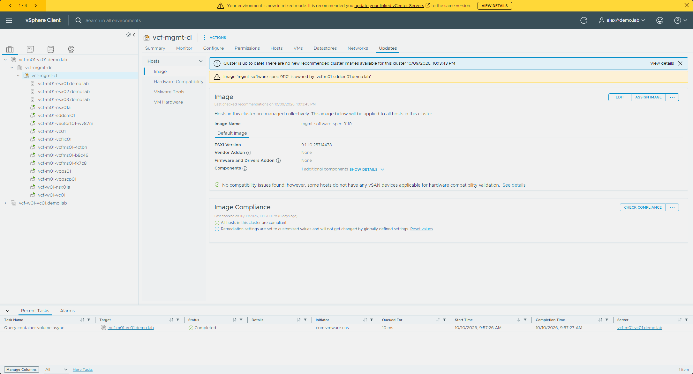

In the vSAN Skyline Health, the cluster's health score was 97, with two unhealthy findings: **Disk format version**, which says the cluster expects format version 24, and **vSAN Support Insight**.  The disk format one is the on-disk format upgrade I cover in Part 6.

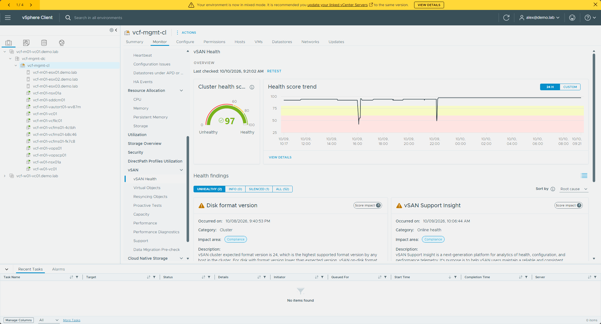

## Completing the NSX upgrade

The NSX Edge cluster upgrade shares a tile with the NSX finalize, **VMware NSX Edge Clusters Upgrade and NSX Upgrade Finalize** ([Upgrade the NSX Edge Cluster and Finalize NSX Upgrade](https://techdocs.broadcom.com/us/en/vmware-cis/vcf/vcf-9-0-and-later/9-1/deployment/upgrading-cloud-foundation/upgrade-the-management-domain-to-vmware-cloud-foundation-5-2/update-the-nsx-edge-cluster-and-finalize-nsx-update.html)).

1. On the **Upgrades** tab, click **Configure** on the **VMware NSX Edge Clusters Upgrade and NSX Upgrade Finalize** tile.
2. Select the NSX Edge clusters to upgrade, sequentially or in parallel, and click **Next**.
3. Review the configuration and click **Finish**.
4. Click **Upgrade Now**, or click **Schedule**, and follow it with **View Status**.

My management domain has no Edge clusters, so when I clicked **Configure**, the first step said "No eligible NSX Edge clusters pending upgrade," and the review step said the NSX upgrade gets finalized.  I clicked **Finish**.

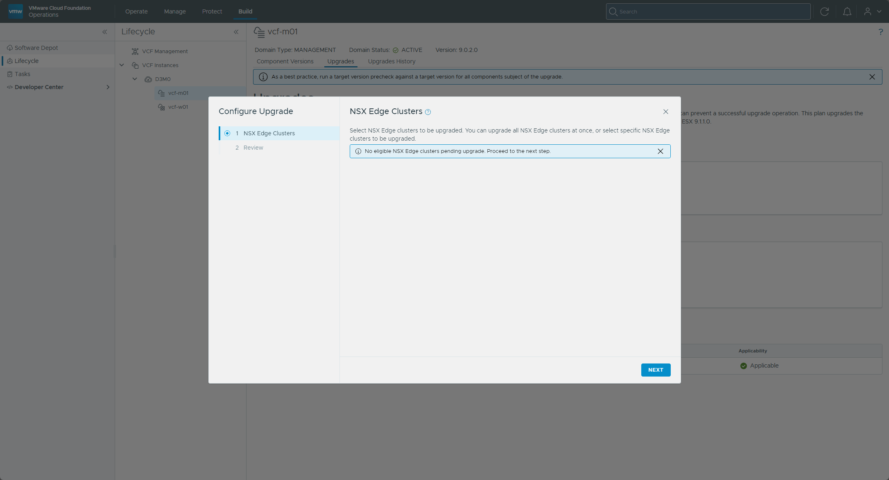

<aside class="info-block">
<strong>NSX functionality is not available until the NSX Finalize step succeeds</strong> (<a href="https://techdocs.broadcom.com/us/en/vmware-cis/vcf/vcf-9-0-and-later/9-1/deployment/upgrading-cloud-foundation/upgrade-the-management-domain-to-vmware-cloud-foundation-5-2/update-the-nsx-edge-cluster-and-finalize-nsx-update.html">upgrade the NSX Edge cluster and finalize</a>).
</aside>

I clicked **Upgrade Now**.  **View Status** showed a finalize precheck, the finalize itself, and a postcheck.

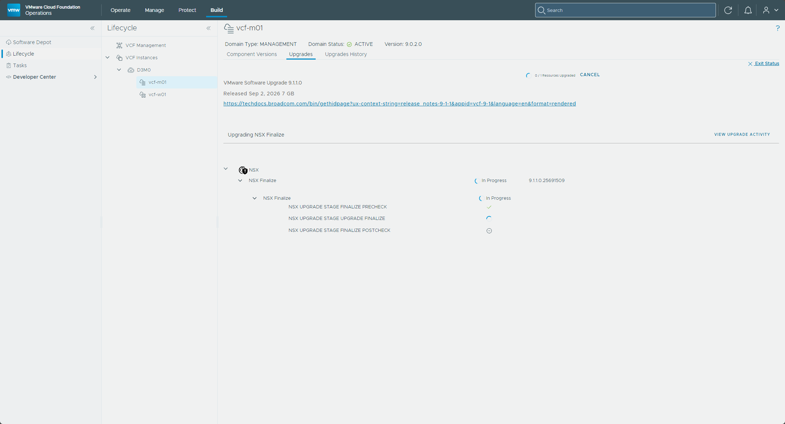

In the NSX Manager UI, **System → Upgrade** then showed Complete at `9.1.1.0.25691509`, with every step from Check Upgrade Readiness to Finalize Upgrade checked.

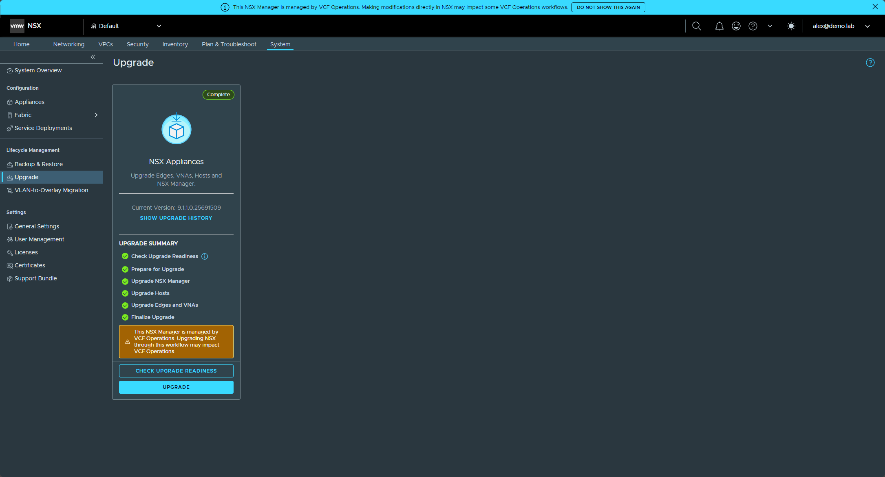

Back in VCF Operations, the management domain's version read 9.1.1.0, with the message "This domain runs on the specified target versions."

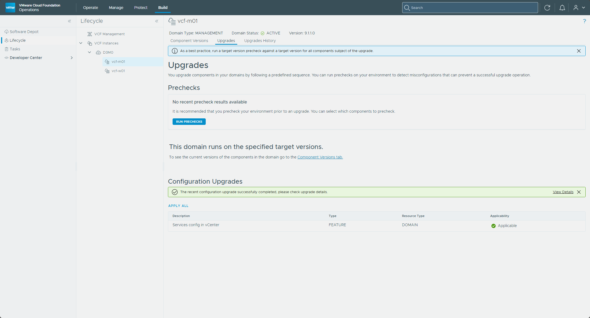

On the **Component Versions** tab in VCF Operations, SDDC Manager, NSX, vCenter, and the `vcf-mgmt-cl` ESX cluster were all On Target.

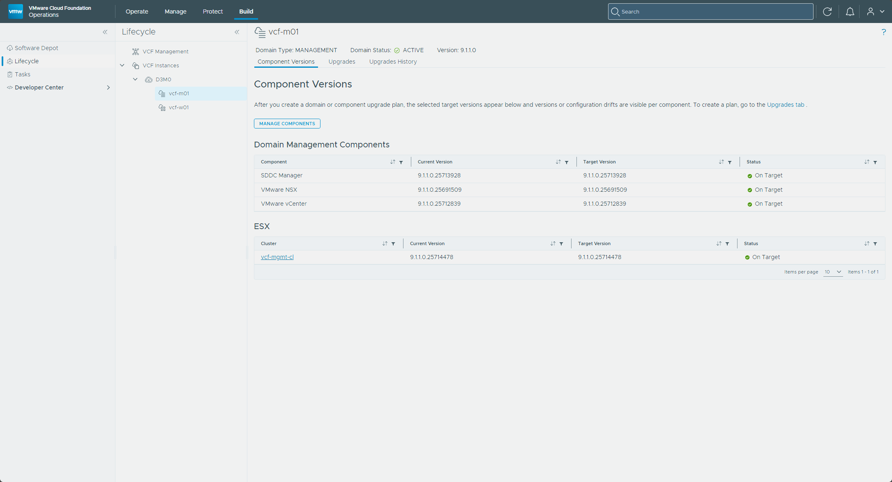

<aside class="info-block">
Allow approximately 15 minutes for post-upgrade auto-reconciliation of configuration drift fixes before you schedule another upgrade (<a href="https://techdocs.broadcom.com/us/en/vmware-cis/vcf/vcf-9-0-and-later/9-1/deployment/upgrading-cloud-foundation/upgrade-the-management-domain-to-vmware-cloud-foundation-5-2/update-the-nsx-edge-cluster-and-finalize-nsx-update.html">upgrade the NSX Edge cluster and finalize</a>).
</aside>

## What's next

In **[Part 6](/posts/vcf-9-1-upgrade-part-6-housekeeping-workload-domain/)**, I wrap up with the post-upgrade housekeeping, then repeat the relevant stages against the workload domain.  One ordering note: Broadcom's [upgrade table](https://techdocs.broadcom.com/us/en/vmware-cis/vcf/vcf-9-0-and-later/9-1/deployment/upgrading-cloud-foundation.html) puts the vSphere Distributed Switch upgrade after the NSX finalize, so it lands in Part 6.

Thanks for reading along.

-virtualex-
