{
  "title": "VMware Cloud Foundation 9.1 Upgrade - Part 6: Post-Upgrade Housekeeping and the Workload Domain",
  "date": "2026-10-12T23:45:00-04:00",
  "lastmod": "2026-10-12T23:45:00-04:00",
  "slug": "vcf-9-1-upgrade-part-6-housekeeping-workload-domain",
  "url": "/posts/vcf-9-1-upgrade-part-6-housekeeping-workload-domain/",
  "draft": false,
  "description": "Part 6 of my VMware Cloud Foundation 9.0.2 to 9.1 upgrade series: the post-upgrade housekeeping (the distributed switch, the vSAN on-disk format, and the configuration upgrade) and repeating the relevant stages for the workload domain.",
  "featured_image": "part-6-housekeeping-workload-domain.png",
  "categories": [
    "Home Lab",
    "How-To's",
    "VMware Cloud Foundation"
  ],
  "tags": [
    "VCF",
    "VMware",
    "vSphere",
    "NSX",
    "vSAN",
    "Upgrade",
    "homelab"
  ],
  "years": [
    "2026"
  ],
  "aliases": [],
  "comments": []
}

With the management domain upgraded in Parts [1](/posts/vcf-9-1-upgrade-part-1-vcf-operations/) to [5](/posts/vcf-9-1-upgrade-part-5-esxi-nsx-edge/), this final part covers the cleanup tasks that round out the upgrade, and then the workload domain.  (As always, the [series overview](/posts/vcf-9-1-upgrade-series-overview/) has the environment and prerequisites if you need them.)

## Post-upgrade housekeeping

Most of these can be scheduled for a quiet maintenance window instead of done immediately.

### vSphere Distributed Switch

Broadcom's [upgrade table](https://techdocs.broadcom.com/us/en/vmware-cis/vcf/vcf-9-0-and-later/9-1/deployment/upgrading-cloud-foundation.html) lists the vSphere Distributed Switch upgrade right after the NSX finalize, with the ESX and vCenter upgrades as the prerequisite ([docs](https://techdocs.broadcom.com/us/en/vmware-cis/vcf/vcf-9-0-and-later/9-1/deployment/upgrading-cloud-foundation/upgrade-the-management-domain-to-vmware-cloud-foundation-5-2/upgrade-vsphere-distributed-switch-versions.html)).

1. On the vSphere Client **Home** page, click **Networking** and navigate to the distributed switch.
2. Right-click the switch and select **Upgrade → Upgrade Distributed Switch**.
3. Pick the version to move to and click **Next**.
4. After the compatibility check, review the selections and click **Finish**.

The switch was on version 9.0.0, and I picked 9.1.0 and later.  Afterward, `sddc1-cl01-vds01` showed version 9.1.0 and the task completed.

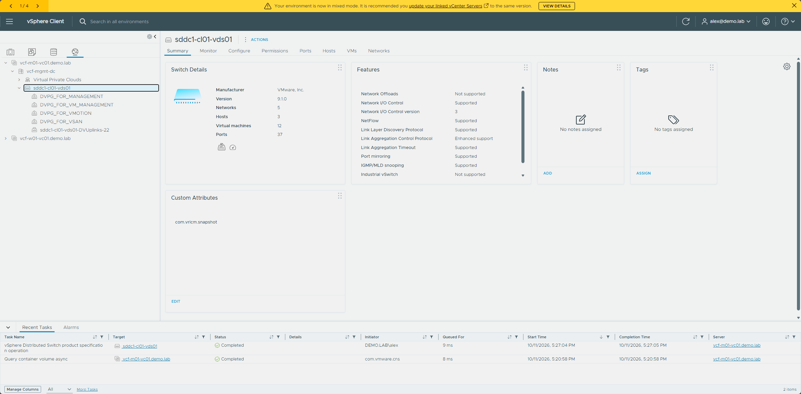

### VMware Tools

The Tools upgrade is optional, and I'm not walking through it step by step.  Upgrading to the latest version isn't always necessary, so evaluate whether your environment needs the new features ([VMware Tools docs](https://techdocs.broadcom.com/us/en/vmware-cis/vsphere/tools/13-1-0/vmware-tools-administration/upgrading-vmware-tools.html)).  You can upgrade it manually per VM, or configure your VMs to upgrade it automatically, and automatic upgrades for Windows guests are performed when you power off or restart the VM.

Tools comes before the VM compatibility bump, because the first step in upgrading a virtual machine is to upgrade VMware Tools ([docs](https://techdocs.broadcom.com/us/en/vmware-cis/vsphere/vsphere/9-1/vsphere-virtual-machine-administration/upgrading-virtual-machines.html)).

### Virtual machine compatibility

This is the VM hardware version bump.  It's optional too, and I'm not walking through it either.  You can do it from the vSphere Client, either manually or scheduled for the next reboot, or with vSphere Lifecycle Manager ([docs](https://techdocs.broadcom.com/us/en/vmware-cis/vsphere/vsphere/9-1/vsphere-virtual-machine-administration/upgrading-virtual-machines.html)).

<aside class="info-block">
Upgrading the virtual machine hardware might cause some applications or the guest operating system to stop working properly.
</aside>

### vSAN on-disk format

The ESX and vCenter upgrades are the prerequisite for this one ([docs](https://techdocs.broadcom.com/us/en/vmware-cis/vcf/vcf-9-0-and-later/9-1/deployment/upgrading-cloud-foundation/upgrade-the-management-domain-to-vmware-cloud-foundation-5-2/upgrade-vsan-on-disk-format-versions.html)).

Before starting, the disks should be healthy, no hosts in maintenance mode, and no resyncs running on the cluster.

1. In the vSphere Client, navigate to the vSAN cluster.
2. Open **Configure → vSAN → Disk Management**.
3. Click **Pre-Check Upgrade**.  It analyzes host, disk, network, and object status.
4. With the pre-check clean, click **Upgrade**, then confirm.

On `vcf-mgmt-cl`, the page said all 12 disks were on version 22.0 and to run the pre-check before upgrading.  The pre-check came back with "Ready to upgrade - pre-check completed successfully."

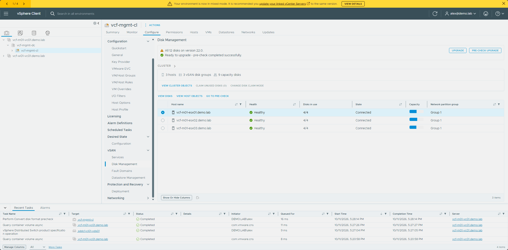

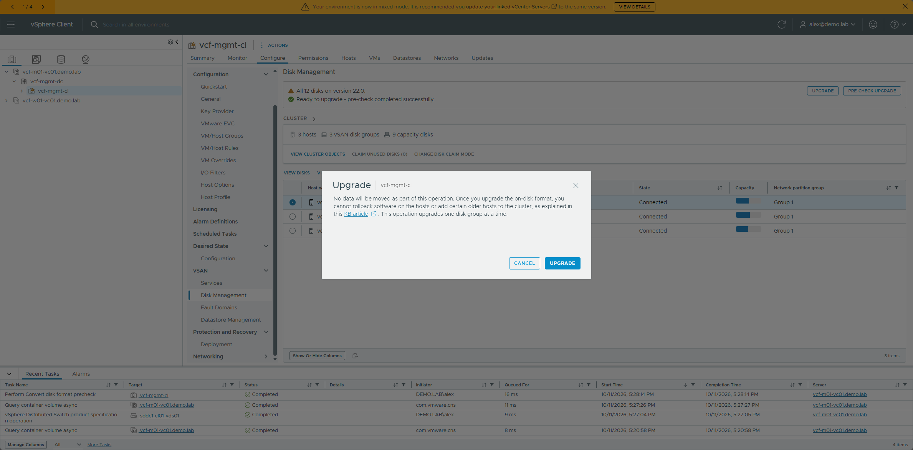

<aside class="info-block">
The upgrade dialog says no data will be moved as part of this operation, and that once the on-disk format is upgraded I can't roll back the software on the hosts or add certain older hosts to the cluster.  It upgrades one disk group at a time.
</aside>

I clicked **Upgrade**.

The page showed the disks formatting to version 24.0.

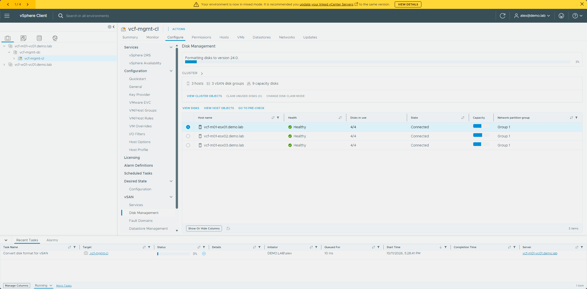

Afterward, Skyline Health showed no unhealthy findings, and **Disk format version** reported no disks with an older format on any of the three hosts.

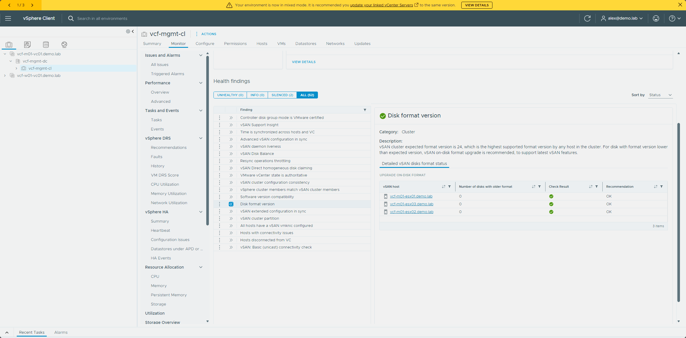

### vSAN file service

If you run vSAN File Service, it needs the on-disk format upgrade done first ([docs](https://techdocs.broadcom.com/us/en/vmware-cis/vcf/vcf-9-0-and-later/9-1/deployment/upgrading-cloud-foundation/upgrade-the-management-domain-to-vmware-cloud-foundation-5-2/upgrade-vsan-file-service.html)).  The upgrade is under the cluster's **Configure → vSAN → Services → File Service** page (select **Edit**, then **Check upgrade**).  If you don't use File Service, skip this one.

### Retire the leftovers

The upgrade powers things off but doesn't delete them.  My management cluster was short on space, so I deleted these sooner than I'd planned: the Fleet Management appliance at the end of [Part 2](/posts/vcf-9-1-upgrade-part-2-sddc-manager-management-services/), the old Automation node and the old Logs appliance at the end of [Part 3](/posts/vcf-9-1-upgrade-part-3-automation-logs/), and the SDDC Manager snapshot at the end of [Part 4](/posts/vcf-9-1-upgrade-part-4-nsx-vcenter/).  If you'd rather wait until the end, this is where they go.  The newly installed components should also be backed up ([workload domain upgrade](https://techdocs.broadcom.com/us/en/vmware-cis/vcf/vcf-9-0-and-later/9-1/lifecycle-management/upgrade-workload-domains-to-vcf-5-2.html)).

Last, I applied the configuration upgrade I left pending in Part 4 ([apply configuration upgrades](https://techdocs.broadcom.com/us/en/vmware-cis/vcf/vcf-9-0-and-later/9-1/deployment/upgrading-cloud-foundation/upgrade-the-management-domain-to-vmware-cloud-foundation-5-2/apply-configuration-updates.html)):

1. On the domain's **Upgrades** tab, expand **Available Configuration Upgrades** and click **Apply All**.
2. Follow the progress on the **Apply Configuration Upgrade** page.  The upgrades disappear from the table once they're applied.

I clicked **Apply All**, and **Services config in vCenter** applied successfully in about 30 seconds.

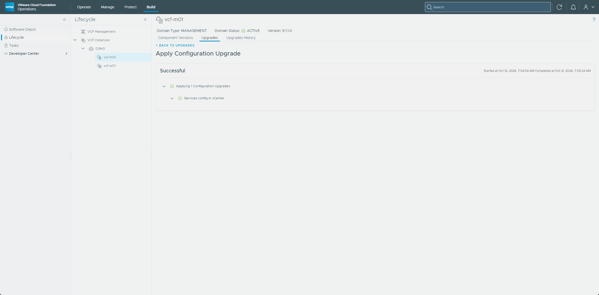

The **Available Configuration Upgrades** table then read "All configurations applied."

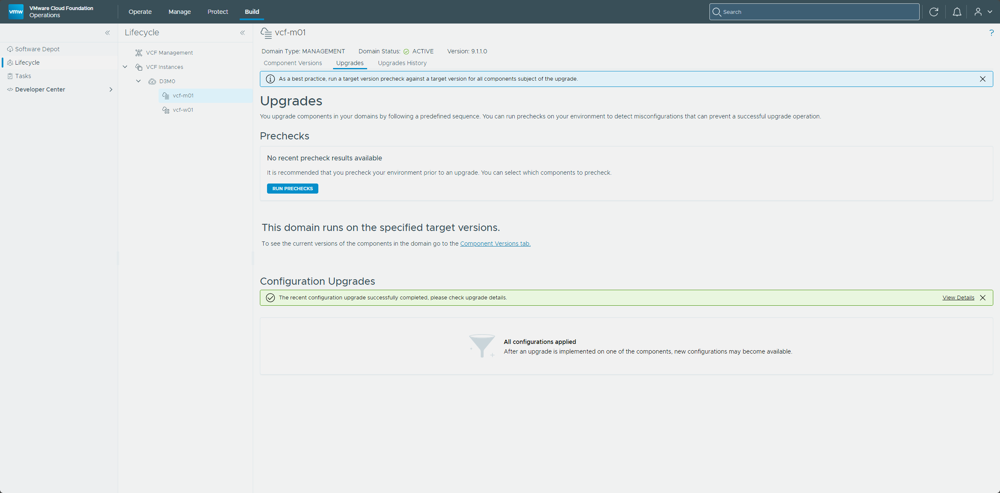

## The workload domain

Everything up to this point has been the **management domain** (`vcf-m01`).  Upgrading the workload domains isn't a mandatory part of the upgrade and can be done later as a Day-N procedure ([upgrade docs](https://techdocs.broadcom.com/us/en/vmware-cis/vcf/vcf-9-0-and-later/9-1/deployment/upgrading-cloud-foundation.html)), after the management domain is upgraded ([workload domain upgrade docs](https://techdocs.broadcom.com/us/en/vmware-cis/vcf/vcf-9-0-and-later/9-1/lifecycle-management/upgrade-workload-domains-to-vcf-5-2.html)).

The workload domain repeats the NSX, vCenter, and ESX stages I ran on the management domain, plus the Edge cluster upgrade, since the workload domain is the one in my lab with an Edge cluster.

### Plan the upgrade

The workload domain needs its own upgrade plan before the component tiles do anything, same as the management domain in Part 4.

1. Go to **Build → Lifecycle**, expand **VCF Instances**, and select `vcf-w01`.
2. On the **Upgrades** tab, click **Plan Domain Upgrade**.
3. Choose the target version, **9.1.1.0**, and review the component versions on the **Customize Target Version** page.
4. Choose the vCenter and NSX upgrade option, **Sequential**.
5. Review the **Plan Overview** and submit the plan.

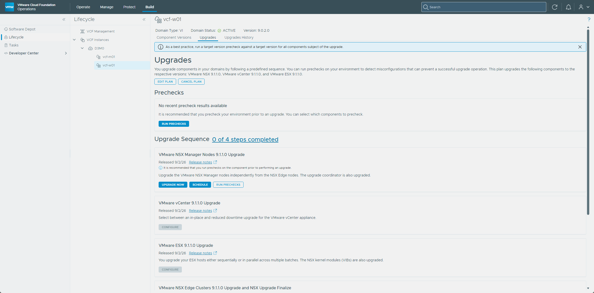

I ran the prechecks next, from the **Run Prechecks** button on the plan, against the workload domain's vCenter, NSX, and the `vcf-wld-cl` cluster.  The result came back with 0 errors, 5 warnings, and 1 silenced item.  Three of the warnings were the ESXi third party VIB warning for William Lam's mock hardware VIB, the same one I saw in Part 4.  The other two were the same two NSX warnings as in Part 4, on `vcf-w01-nsx01`: **Check for data inconsistencies in DB** and **IP reputation outbound rules disabled warning**.  I left all five as they were.

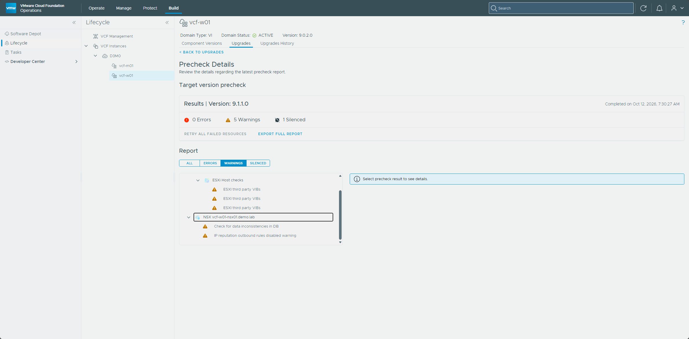

### Upgrading NSX Manager

The workload domain's NSX Manager node is `vcf-w01-nsx01`.

<aside class="info-block">
I skipped the tile's own precheck because I had already run the full precheck for all components when I planned the upgrade.
</aside>

1. On the **VMware NSX Manager Nodes 9.1.1.0 Upgrade** tile, click **Upgrade Now**.
2. Click **View Status** to follow the stages.

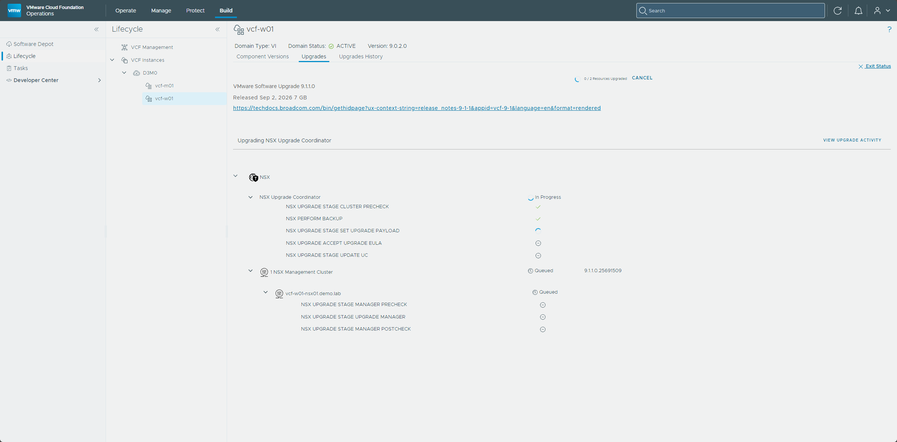

When it finished, the upgrade sequence showed 1 of 4 steps completed.

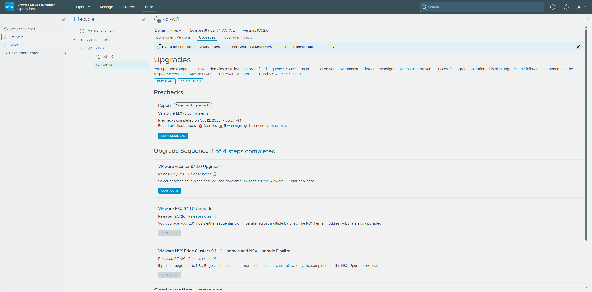

### Upgrading vCenter

I took a fresh backup of the workload vCenter before starting.

1. On the **VMware vCenter 9.1.1.0 Upgrade** tile, click **Configure**.
2. Choose **vCenter Regular Upgrade**, the same mechanism I used on the management domain.
3. Confirm the backup and review the settings.
4. Click **Finish**.
5. Click **Upgrade Now**.
6. Follow the stages from **View Status**.

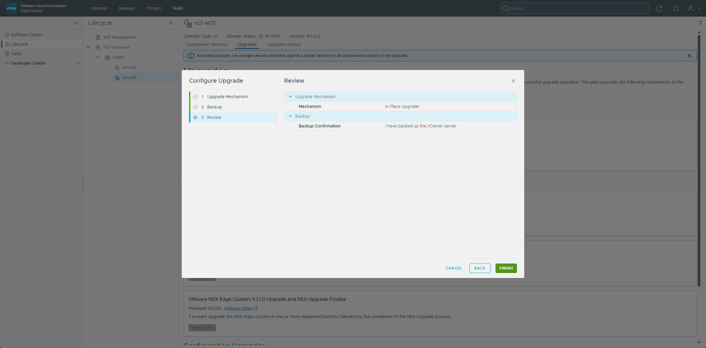

When it finished, the sequence showed 2 of 4 steps completed.

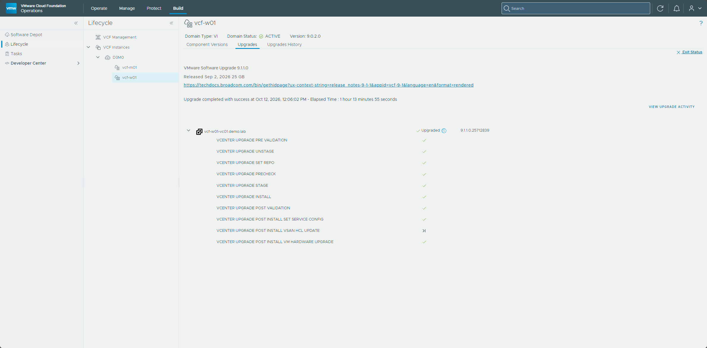

### Upgrading ESX

1. On the **VMware ESX 9.1.1.0 Upgrade** tile, click **Configure**.
2. Leave **All Clusters** selected, which picks `vcf-wld-cl` with all three hosts.
3. Click **Assign Image**, pick the image, click **Assign Image** again, and click **Next**.
4. Set the upgrade options and click **Next**.
5. There were no standalone hosts, so click **Next**, review the configuration, and click **Finish**.
6. Click **Upgrade Now** and follow it from **View Status**.

This time **Assign Image** listed `mgmt-software-spec-9110`, the image I fixed in [Part 5](/posts/vcf-9-1-upgrade-part-5-esxi-nsx-edge/), so there was nothing to redo.

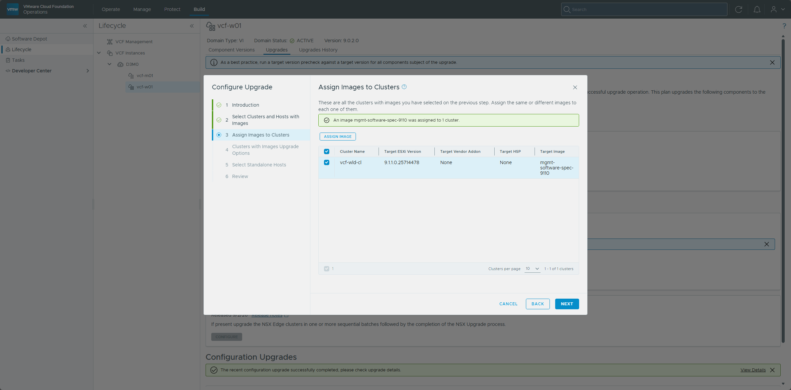

I used the same options as the management cluster, with Quick Boot enabled and the VM power state left on "Do not change power state."

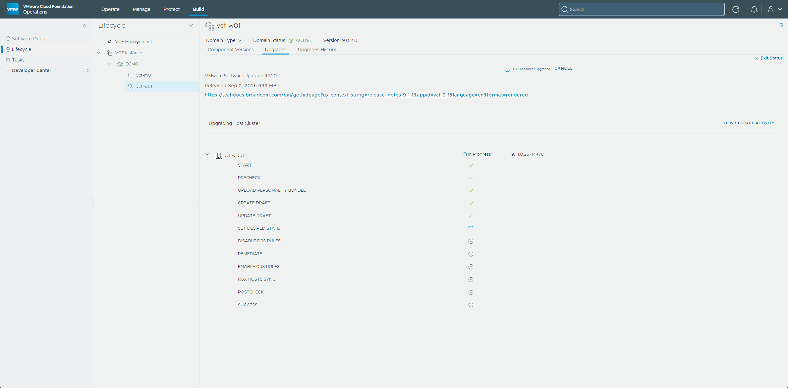

When it finished, **Component Versions** showed `vcf-wld-cl` on `9.1.1.0.25714478`, on target.  NSX still showed **Version Drift** there, which cleared after the Edge cluster upgrade and finalize below.

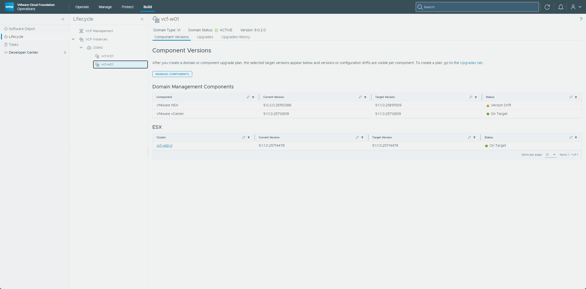

<aside class="info-block">
The ESX remediation failed twice on <code>vcf-w01-esx03</code> before it went through.  My workload hosts are nested ESX VMs whose disks live on an NFS datastore, and their virtual NVMe disks were rejecting the nested hosts' UNMAP requests (<code>DATASET MANAGEMENT Command failed</code> in each VM's <code>vmware.log</code>).  Over time that left the OSDATA volume inside each host unable to allocate large file blocks, so it logged "No space left on device" and "closed with dirty buffers" while still showing plenty of free space, and vLCM couldn't stage the image.  I moved each host to a VMFS datastore on local NVMe, rebooted it there, set automatic space reclamation to none on its OSDATA and install datastore (<code>esxcli storage vmfs reclaim config set -l &lt;volume&gt; --reclaim-priority none</code>), and moved it back.  The next remediation went through on all three hosts.  If you run nested hosts on NFS, keep an eye on this one.
</aside>

### Upgrading the NSX Edge cluster and finalizing NSX

This domain has its own NSX instance and a two-node Edge cluster, `vcf-w01-ec01`, so this time the tile had an Edge cluster to upgrade before the finalize.

1. On the **VMware NSX Edge Clusters 9.1.1.0 Upgrade and NSX Upgrade Finalize** tile, click **Configure**.
2. Leave **Enable NSX Edge cluster selection** off to upgrade all NSX Edge clusters, and click **Next**.
3. Leave **Enable sequential upgrade of NSX Edge clusters** cleared and click **Next**.
4. Review the configuration and click **Finish**.
5. Click **Upgrade Now** and follow it from **View Status**.

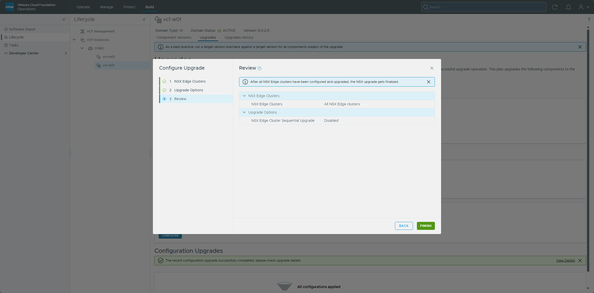

**View Status** showed an Edge precheck, the Edge upgrade, and an Edge postcheck for `vcf-w01-ec01`, followed by the same three finalize stages as the management domain.

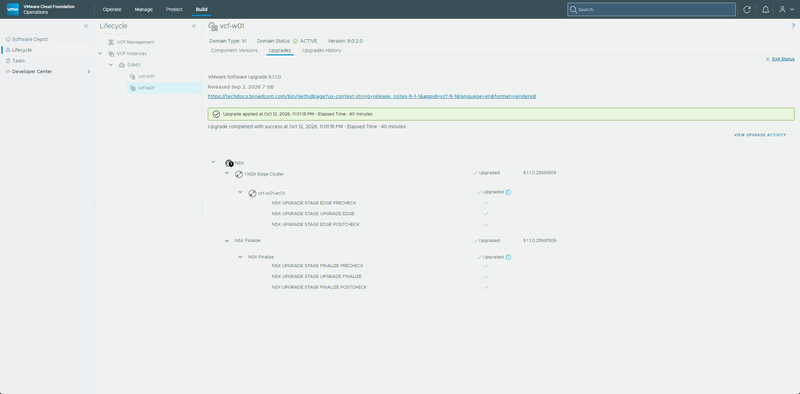

Back on the **Upgrades** tab, `vcf-w01` read 9.1.1.0, with the message "This domain runs on the specified target versions."  The **Configuration Upgrades** section on the same page already read "All configurations applied," so unlike the management domain, I had nothing to apply.

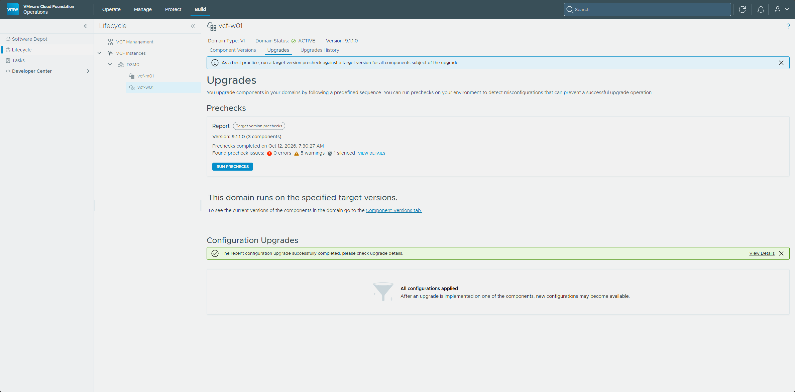

<aside class="info-block">
Same rules as Part 5: NSX functionality isn't available until the NSX Finalize step succeeds, and you should allow approximately 15 minutes for post-upgrade auto-reconciliation before you schedule another upgrade (<a href="https://techdocs.broadcom.com/us/en/vmware-cis/vcf/vcf-9-0-and-later/9-1/deployment/upgrading-cloud-foundation/upgrade-the-management-domain-to-vmware-cloud-foundation-5-2/update-the-nsx-edge-cluster-and-finalize-nsx-update.html">docs</a>).
</aside>

### Housekeeping on the workload cluster

I repeated the distributed switch and vSAN on-disk format steps from earlier in this part on `vcf-wld-cl`.  The review step for the vSphere Distributed Switch, `vcf-wld-cl-vds01`, showed the upgrade from 9.0.0 to 9.1.0.

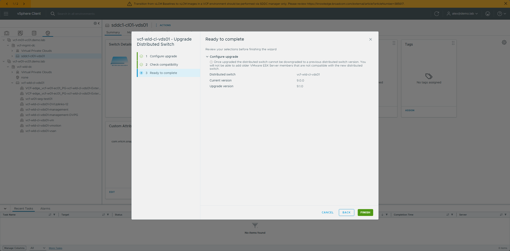

Afterward, the switch's Summary page showed version 9.1.0.

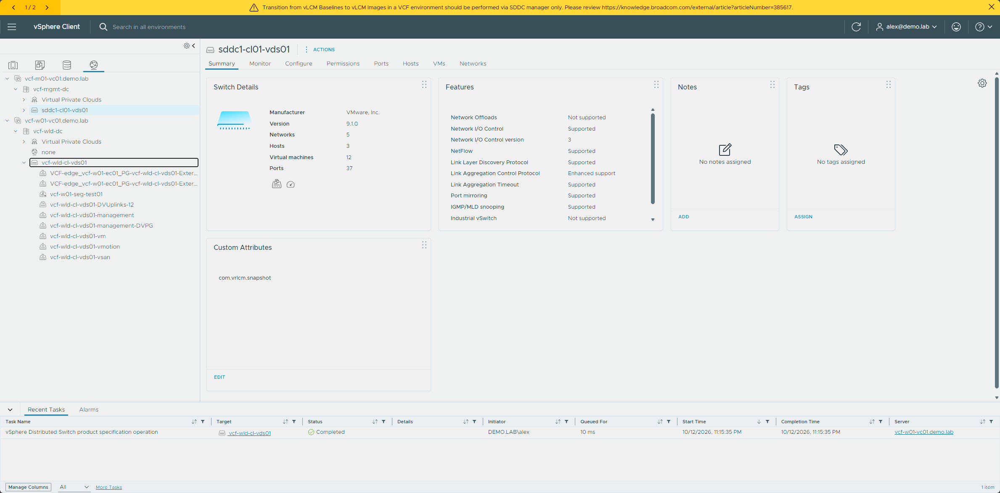

For the vSAN on-disk format, **Disk Management** showed all 6 disks on version 22.0.  I skipped **Pre-Check Upgrade** this time, since it isn't required, and clicked **Upgrade**, and when it finished, all 6 disks read version 24.0.

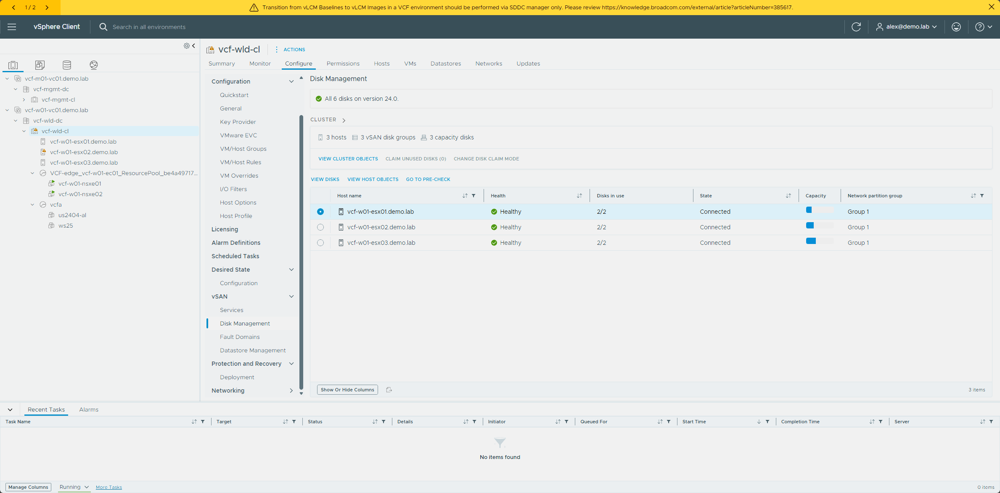

## Final validation

With both domains done, I did a last pass in **Build → Lifecycle**.  **Component Versions** for `vcf-m01` showed SDDC Manager, NSX, vCenter, and the ESX cluster all on target at 9.1.1.0 builds.

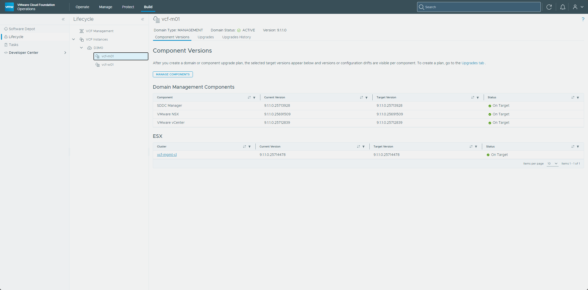

`vcf-w01` showed NSX, vCenter, and its ESX cluster on target as well.

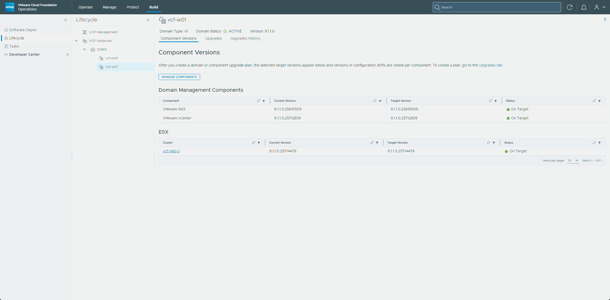

Under **VCF Management**, every component was on a 9.1.1.0 build, with VCF Automation, Fleet lifecycle, and SDDC lifecycle on 9.1.1.0100 ([patch releases](https://techdocs.broadcom.com/us/en/vmware-cis/vcf/vcf-9-0-and-later/9-1/release-notes/patch-releases-9-1-1-x.html)).  Log management was there too, along with the rest of VCF Management Services.

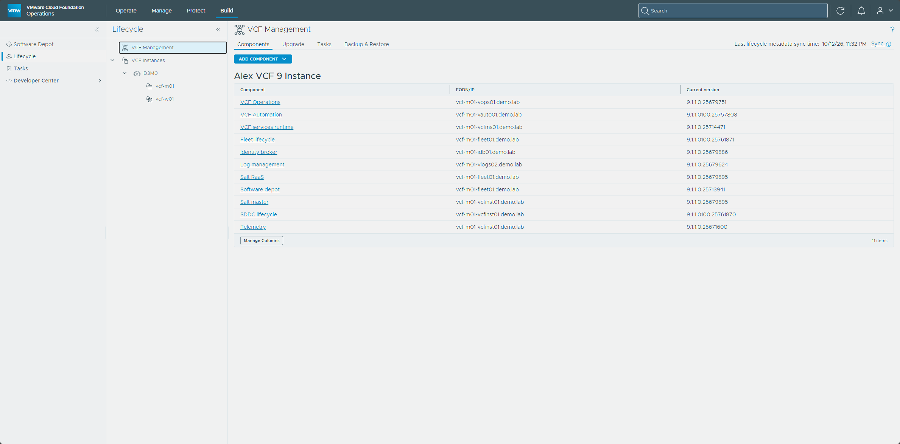

On **Operate → Administration → Configurations → Log Collection**, both NSX sources, `vcf-m01-nsx01` and `vcf-w01-nsx01`, showed **Received**.  They had shown **Failed** back in Part 3.

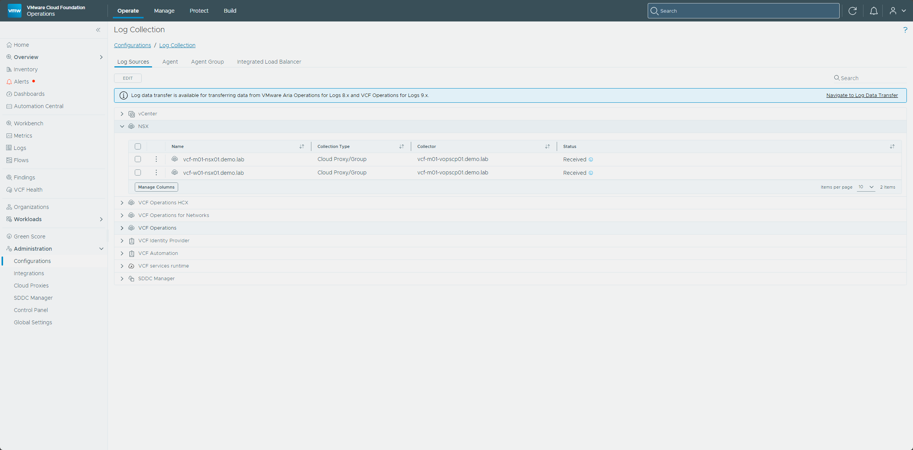

## Wrapping up the series

That's a full VMware Cloud Foundation 9.0.2 to 9.1 upgrade, start to finish.

A few parting thoughts.  Read the precheck results before you upgrade, because reviewing the errors and warnings first saves you from surprises later.  And plan your cert and password work around the freeze window, which runs from [Part 1](/posts/vcf-9-1-upgrade-part-1-vcf-operations/) until each component reaches 9.1, so [Part 3](/posts/vcf-9-1-upgrade-part-3-automation-logs/) for Automation and Logs, and [Part 4](/posts/vcf-9-1-upgrade-part-4-nsx-vcenter/) for an embedded Identity Broker.

Thanks for following the whole series.  If you ran your own 9.1 upgrade alongside it, I'd like to hear what went smoothly and what tripped you up, so drop a comment and let me know.

-virtualex-
